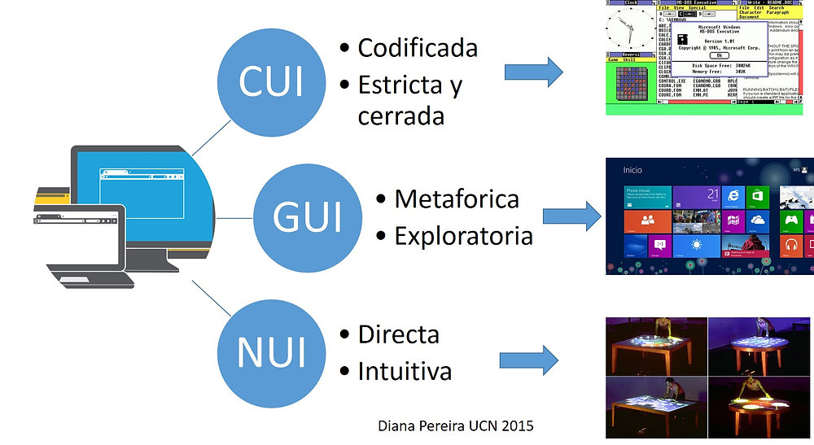
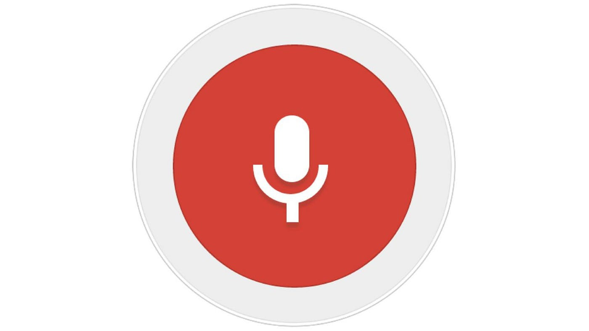
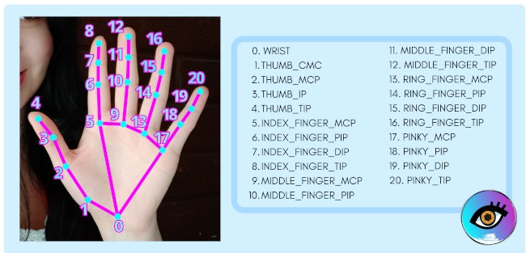
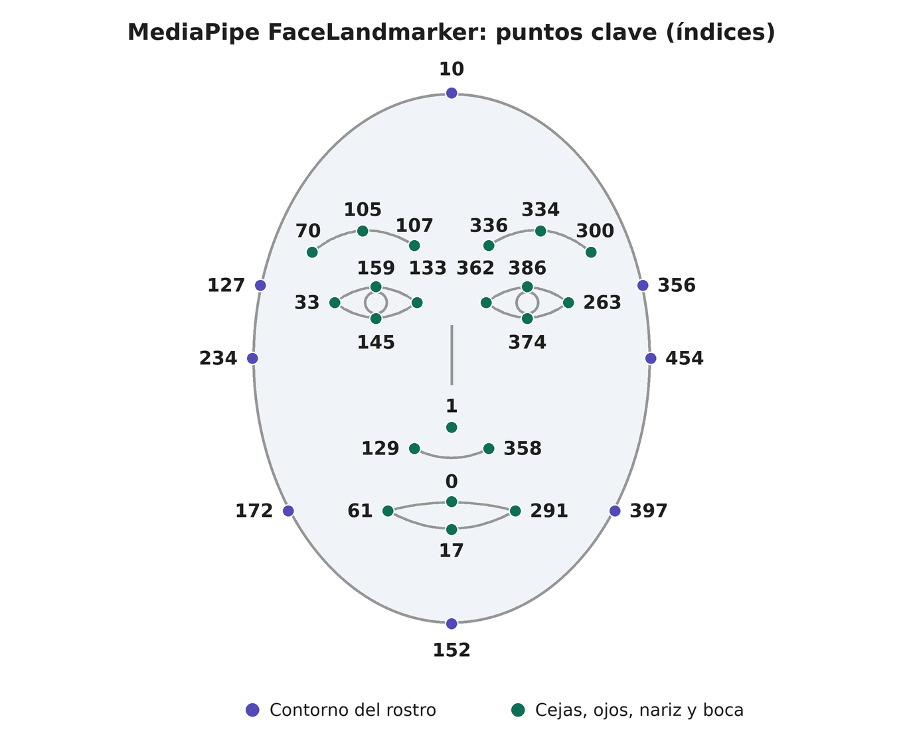
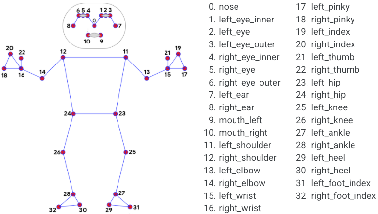

[⌂ Volver al inicio](index.md)

# Índice

- [1. Introducción a las interfaces naturales de usuario](#1-introducción-a-las-interfaces-naturales-de-usuario)
- [2. Tecnologías para desarrollar interfaces naturales](#2-tecnologías-para-desarrollar-interfaces-naturales)
- [3. Reconocimiento de voz con Web Speech API](#3-reconocimiento-de-voz-con-web-speech-api)
- [4. Detección de manos y rostro](#4-detección-de-manos-y-rostro)
- [5. Detección del rostro y de la pose corporal](#5-detección-del-rostro-y-de-la-pose-corporal)
- [6. Realidad aumentada en el navegador (WebAR)](#6-realidad-aumentada-en-el-navegador-webar)
- [7. Proyecto final: experimentación con interfaces naturales](#7-proyecto-final-experimentación-con-interfaces-naturales)

### 1. Introducción a las interfaces naturales de usuario



Las **Interfaces Naturales de Usuario (NUI - Natural User Interfaces)** representan un paradigma de interacción persona-ordenador donde los medios tradicionales (teclado y ratón) son sustituidos o complementados por habilidades humanas innatas: la voz, la gestualidad corporal, la expresión facial y la percepción espacial mediante Realidad Aumentada (RA).

En esta unidad se abordará el desarrollo de INUs web utilizando estándares modernos de JavaScript (Web APIs nativas como Web Speech API y WebRTC) junto con modelos de Machine Learning preentrenados en el cliente (MediaPipe / TensorFlow.js) y frameworks de Realidad Aumentada Web (MindAR / A-Frame).

A diferencia de las **GUI** (Interfaces Gráficas basadas en ventanas e íconos) o las **CUI** (Interfaces de Línea de Comandos), las **NUI** buscan reducir la brecha cognitiva de aprendizaje. El usuario interactúa a través de conductas cotidianas:
- **Voz:** Comandos orales, dictado, análisis semántico.
- **Gesto y Postura:** Control gestual con las manos, inclinación de cabeza, postura corporal completa.
- **Rostro:** Reconocimiento de expresiones faciales o dirección de la mirada (*eye tracking*).
- **Entorno Aumentado (RA):** Inserción de capas de información y objetos 3D sobre la emisión de video en tiempo real.

### 2. Tecnologías para desarrollar interfaces naturales
Para implementar NUI en el navegador moderno sin necesidad de plugins externos, empleamos:

1. **APIs Nativas del Navegador:**
   - `navigator.mediaDevices.getUserMedia()`: Acceso a cámaras y micrófonos.
   - `Web Speech API`: Reconocimiento de voz (`SpeechRecognition`) y síntesis de voz (`SpeechSynthesis`).
   - `WebXR Device API`: Interfaces de Realidad Virtual y Aumentada.
2. **Bibliotecas de Machine Learning Ejecutadas en Cliente (WebAssembly / WebGL):**
   - **MediaPipe (Google):** Detección ultra-rápida de landmarks corporales (manos, rostro, pose completa).
   - **TensorFlow.js:** Inferencia de modelos de visión por computador y clasificación personalizada.
3. **Frameworks de Realidad Aumentada y 3D:**
   - **A-Frame:** Framework declarativo basado en Custom Elements de HTML para WebVR/WebAR.
   - **MindAR.js:** Librería ligera de visión por ordenador para seguimiento de imágenes (*image tracking*) y rostros (*face tracking*).

### 3. Reconocimiento de voz con Web Speech API

{: width="300"}

La **Web Speech API** es una interfaz del navegador para incorporar voz a una aplicación web. Se compone de dos partes:

- **SpeechRecognition:** convierte el habla en texto. La aplicación puede analizar ese texto y utilizarlo para ejecutar acciones, como cambiar el contenido o el aspecto de la página.
- **SpeechSynthesis:** convierte texto en voz y permite que la aplicación responda oralmente al usuario.

#### 3.1. Componentes y flujo del reconocimiento

El reconocimiento de voz sigue un flujo parecido al de otros eventos del navegador:

1. Se crea un objeto `SpeechRecognition`.
2. Se configura el idioma y el tipo de resultados que se quieren recibir.
3. Tras una acción del usuario (por ejemplo, pulsar un botón), se llama a `start()` y el navegador comienza a escuchar.
4. El servicio de reconocimiento procesa el audio y emite eventos. Si reconoce palabras, las comunica mediante `result`; si ocurre un problema, lo hace mediante `error`.
5. La aplicación interpreta el texto y actualiza la interfaz. Al detenerse el reconocimiento, se produce `end`.

**Ejemplo.** Imaginemos una página con un botón «Hablar» y un párrafo donde se muestra lo que el usuario dice:

```js
const SpeechRecognition = window.SpeechRecognition || window.webkitSpeechRecognition;

// 1. Se crea el objeto
const reconocimiento = new SpeechRecognition();

// 2. Se configura el idioma y el tipo de resultados
reconocimiento.lang = "es-ES";
reconocimiento.interimResults = false; // solo resultados finales
reconocimiento.maxAlternatives = 1;

// 3. Una acción del usuario inicia la escucha
document.querySelector("#hablar").addEventListener("click", () => {
  reconocimiento.start();
});

// 4. El servicio emite eventos
reconocimiento.addEventListener("result", (e) => {
  // 5. La aplicación interpreta el texto y actualiza la interfaz
  const texto = e.results[0][0].transcript.toLowerCase();
  document.querySelector("#salida").textContent = `Has dicho: ${texto}`;
  if (texto.includes("azul")) document.body.style.background = "blue";
});

reconocimiento.addEventListener("error", (e) => {
  document.querySelector("#salida").textContent = `Error: ${e.error}`;
});

reconocimiento.addEventListener("end", () => {
  console.log("El reconocimiento ha terminado");
});
```

Secuencia: el usuario pulsa «Hablar» (se ejecuta `start()` y el navegador pide permiso de micrófono) y dice «pon la página en azul». El servicio procesa el audio y lanza `result` con la transcripción «pon la página en azul». La aplicación busca la palabra «azul» y cambia el fondo. Como `continuous` es `false` por defecto, el reconocimiento se detiene solo tras la frase y se dispara `end`. Si el usuario deniega el micrófono o no se oye nada, se lanza `error` (por ejemplo, `not-allowed` o `no-speech`) en lugar de `result`.

**¿Qué es `maxAlternatives`?** Indica cuántas transcripciones posibles devuelve el reconocedor para cada frase. El audio puede ser ambiguo y el motor puede proponer varias interpretaciones, ordenadas de más a menos probable (por ejemplo, «bola» y «bota»). Con `1` solo se recibe la mejor, que es el valor por defecto, por lo que esa línea es opcional.

**¿Por qué `results[0][0]` tiene dos índices?** Porque `e.results` es una lista de resultados y cada resultado es, a su vez, una lista de alternativas:

- Primer índice (`results[i]`): cada fragmento de habla reconocido. Con `continuous = false` suele haber uno solo; con `continuous = true`, uno por frase o pausa.
- Segundo índice (`results[i][j]`): cada alternativa de ese fragmento. La posición `0` es la más probable y llegan tantas como indique `maxAlternatives`.

Cada alternativa es un objeto con `transcript` (el texto) y `confidence` (valor entre 0 y 1). Con `maxAlternatives = 3`:

```js
e.results[0][0].transcript  // "pon la página en azul"  (confidence 0.92)
e.results[0][1].transcript  // "pon la pagina en azul"  (confidence 0.05)
e.results[0][2].transcript  // "pon la página en as ul" (confidence 0.01)
```

Así, `results[0][0]` significa «la mejor alternativa del primer resultado».

El objeto de reconocimiento no es el micrófono ni un traductor de intenciones: entrega una o más transcripciones posibles del audio. Es la aplicación la que debe decidir qué significa una frase y qué acciones permite ejecutar. Por ejemplo, «pon la página en azul» podría analizarse para identificar la intención «cambiar color» y el valor «azul». El ejemplo de esta unidad utiliza una lógica más sencilla: busca palabras concretas dentro de la transcripción.

El constructor y algunas propiedades habituales son:

| Elemento | Función |
| :--- | :--- |
| `new SpeechRecognition()` | Crea el controlador del reconocimiento. En algunos navegadores se encuentra como `webkitSpeechRecognition`. |
| `lang` | Establece el idioma que se espera reconocer, por ejemplo, `es-ES`. |
| `continuous` | Solicita resultados continuos en lugar de finalizar tras un único resultado. No garantiza que la escucha permanezca activa indefinidamente: el servicio puede finalizar y emitir `end`. |
| `interimResults` | Si vale `true`, permite recibir hipótesis provisionales mientras se habla. Si vale `false`, se reciben solo resultados finales. |
| `maxAlternatives` | Limita el número de transcripciones alternativas devueltas por cada resultado. Por defecto se devuelve una. |
| `start()` | Inicia la escucha. Normalmente debe llamarse como respuesta a una acción explícita del usuario. |
| `stop()` | Finaliza la captura e intenta devolver el resultado de lo que se haya reconocido hasta ese momento. |
| `abort()` | Detiene el reconocimiento sin intentar devolver un resultado. |

#### 3.2. Eventos y lectura de resultados

Los eventos permiten actualizar la interfaz según el estado del servicio:

- `start` indica que el servicio ha comenzado a escuchar; `end`, que ha dejado de hacerlo.
- `audiostart` y `audioend` señalan el inicio y el final de la captura de audio.
- `speechstart` y `speechend` indican cuándo se detecta habla, que no necesariamente coincide con toda la captura de audio.
- `result` se dispara cuando hay uno o más resultados de reconocimiento.
- `error` informa de errores como `not-allowed` (permiso denegado), `no-speech` (no se detectó habla), `audio-capture` (no se pudo capturar audio) o `network` (problema de red).
- `nomatch` puede indicar que el servicio no encontró una transcripción suficientemente reconocible.

El evento `result` contiene una lista `results`. Cada posición representa un resultado y puede contener varias alternativas. La alternativa más probable suele estar en la posición `0`; sus propiedades `transcript` y `confidence` permiten leer el texto reconocido y la confianza estimada por el servicio. La confianza es una estimación del reconocedor, no una garantía de que la frase sea correcta.

Si `interimResults` está activado, un resultado puede ser provisional (`isFinal === false`) y cambiar mientras la persona continúa hablando. Conviene mostrarlo como texto provisional, pero esperar a que sea final antes de ejecutar acciones con consecuencias. `resultIndex` indica el primer resultado de la lista que ha cambiado en el evento actual. Un patrón básico para recorrer los resultados es:

```javascript
recognition.addEventListener("result", (event) => {
  for (let i = event.resultIndex; i < event.results.length; i++) {
    const result = event.results[i];
    const transcript = result[0].transcript.trim();

    if (result.isFinal) {
      console.log("Resultado final:", transcript);
    } else {
      console.log("Resultado provisional:", transcript);
    }
  }
});
```

Para comandos de una interfaz, suele ser más seguro normalizar el texto (por ejemplo, pasar a minúsculas y quitar espacios sobrantes), compararlo con una lista permitida y ofrecer una alternativa visual o escrita. La frase reconocida puede contener errores, ruido o palabras adicionales; por eso, una acción importante no debería ejecutarse basándose únicamente en una transcripción ambigua.

#### 3.3. Síntesis de voz: respuestas habladas

La otra parte de la API, `SpeechSynthesis`, permite que la página lea texto en voz alta. Se crea un mensaje con `SpeechSynthesisUtterance` y se envía al sintetizador del dispositivo:

```javascript
const respuesta = new SpeechSynthesisUtterance("El color de la página es azul.");
respuesta.lang = "es-ES";
window.speechSynthesis.speak(respuesta);
```

La voz y el resultado pueden variar según el sistema y los idiomas disponibles. La síntesis es útil para confirmar una acción, leer instrucciones o facilitar el acceso a contenido; se puede combinar con el reconocimiento para crear un diálogo por voz. Si se utiliza en una aplicación real, se debe permitir detener o silenciar la lectura y evitar que la respuesta hablada interfiera con la captura del micrófono.

#### 3.4. Compatibilidad, permisos y privacidad

La compatibilidad de `SpeechRecognition` no es uniforme entre navegadores. Algunas implementaciones utilizan un servicio de reconocimiento remoto y otras pueden ofrecer reconocimiento en el propio dispositivo. Por tanto, no se debe asumir que el audio se procesa localmente ni que la API estará disponible sin conexión: hay que comprobar las capacidades del navegador y explicar al usuario cuándo se activa el micrófono.

Al iniciar el reconocimiento, el navegador puede solicitar permiso para usar el micrófono. La interfaz debe comunicar claramente si el acceso se ha denegado o no hay entrada de audio. Para una experiencia accesible y robusta, ofrece siempre un control alternativo que no dependa de la voz, como botones o un campo de texto. No uses reconocimiento de voz como único método de autenticación ni para confirmar operaciones sensibles.

Para probar el ejemplo, abre la página desde `localhost` o una conexión segura (`HTTPS`), concede acceso al micrófono y habla en el idioma configurado. Los resultados pueden variar por el ruido, el acento, el micrófono y el servicio disponible.

**Documentación oficial de referencia:**

- [Especificación de Web Speech API (WICG)](https://wicg.github.io/speech-api/).
- [Guía de Web Speech API en MDN](https://developer.mozilla.org/es/docs/Web/API/Web_Speech_API).
- Referencias de MDN para [`SpeechRecognition`](https://developer.mozilla.org/en-US/docs/Web/API/SpeechRecognition), [`SpeechRecognitionEvent`](https://developer.mozilla.org/en-US/docs/Web/API/SpeechRecognitionEvent), [`SpeechSynthesis`](https://developer.mozilla.org/en-US/docs/Web/API/SpeechSynthesis) y [`SpeechSynthesisUtterance`](https://developer.mozilla.org/en-US/docs/Web/API/SpeechSynthesisUtterance).

#### 3.5. Ejemplo: control de interfaz mediante voz

En el siguiente ejemplo, el usuario activa el reconocimiento con un botón. La aplicación muestra el texto detectado y cambia el color de fondo cuando reconoce los comandos «rojo», «verde», «azul» o «restablecer». Observa cómo se configuran las opciones, cómo se responde a los eventos y cómo se relaciona la transcripción con una acción de la interfaz. El código se separa en tres archivos: `index.html` (estructura), `styles.css` (estilos) y `app.js` (lógica).

Archivo `index.html`:

```html
<!DOCTYPE html>
<html lang="es">
<head>
  <meta charset="UTF-8">
  <title>Control por Voz - NUI</title>
  <link rel="stylesheet" href="styles.css">
</head>
<body>

  <div class="card">
    <h1>Panel de Control por Voz</h1>
    <p>Di ordenes como: <strong>"Rojo"</strong>, <strong>"Verde"</strong>, <strong>"Azul"</strong> o <strong>"Restablecer"</strong>.</p>
    <button id="btnStart">Activar Micrófono</button>
    <p class="status" id="statusText">Estado: Inactivo</p>
    <p>Último comando detectado: <span id="commandText">-</span></p>
  </div>

  <script src="app.js"></script>
</body>
</html>
```

Archivo `styles.css` (en la misma carpeta que `index.html`):

```css
body {
  font-family: Arial, sans-serif;
  transition: background-color 0.5s ease;
  display: flex;
  flex-direction: column;
  align-items: center;
  justify-content: center;
  height: 100vh;
  margin: 0;
}

.card {
  background: white;
  padding: 2rem;
  border-radius: 12px;
  box-shadow: 0 4px 15px rgba(0,0,0,0.1);
  text-align: center;
}

.status {
  font-weight: bold;
  color: #007bff;
  margin-top: 1rem;
}
```

Archivo `app.js` (debe estar en la misma carpeta que `index.html`):

```js
// Chrome y Edge exponen la API con el prefijo "webkit"; otros navegadores,
// sin prefijo. Se usa la que exista. Si ninguna existe, el valor es undefined.
const SpeechRecognition = window.SpeechRecognition || window.webkitSpeechRecognition;

// Si el navegador no soporta la API, se avisa y no se ejecuta el resto.
if (!SpeechRecognition) {
  alert("Tu navegador no soporta la Web Speech API. Prueba con Google Chrome u Edge.");
} else {
  // Se crea el objeto que se encargará de escuchar y transcribir.
  const recognition = new SpeechRecognition();

  // Idioma esperado del habla: español de España.
  recognition.lang = 'es-ES';
  // true: sigue escuchando tras cada frase, hasta que se llame a stop().
  // false (por defecto) pararía solo después de la primera frase.
  recognition.continuous = true;
  // false: solo se reciben resultados finales, no las transcripciones parciales.
  recognition.interimResults = false;

  // Se guardan referencias a los elementos del HTML con los que se va a trabajar.
  const btnStart = document.getElementById('btnStart');
  const statusText = document.getElementById('statusText');
  const commandText = document.getElementById('commandText');

  // Variable de control para saber si el micrófono está activo ahora mismo.
  let isListening = false;

  // El botón alterna entre iniciar y detener la escucha.
  // start() debe llamarse tras una acción del usuario: así el navegador
  // puede pedir el permiso del micrófono.
  btnStart.addEventListener('click', () => {
    if (!isListening) {
      recognition.start();
    } else {
      recognition.stop();
    }
  });

  // Se dispara cuando el navegador empieza a escuchar de verdad.
  // Aquí se actualiza la interfaz para reflejar el nuevo estado.
  recognition.onstart = () => {
    isListening = true;
    statusText.textContent = "Estado: Escuchando...";
    btnStart.textContent = "Detener Micrófono";
  };

  // Se dispara siempre que la escucha termina: por stop(), por un error
  // o porque el navegador la cierra. Se restaura la interfaz al estado inicial.
  recognition.onend = () => {
    isListening = false;
    statusText.textContent = "Estado: Inactivo";
    btnStart.textContent = "Activar Micrófono";
  };

  // Se dispara cada vez que el servicio reconoce una frase.
  recognition.onresult = (event) => {
    // Con continuous = true, event.results acumula todas las frases de la sesión.
    // La que acaba de llegar es la última de la lista.
    const lastIndex = event.results.length - 1;

    // [lastIndex] es el resultado y [0] su mejor alternativa (la más probable).
    // trim() quita espacios sobrantes y toLowerCase() pasa a minúsculas
    // para que "Rojo" y "rojo" se traten igual.
    const transcript = event.results[lastIndex][0].transcript.trim().toLowerCase();

    // Se muestra en pantalla lo que se ha entendido.
    commandText.textContent = transcript;

    // Se busca una palabra clave dentro de la frase y se aplica la acción.
    // includes() permite que funcione con frases como "pon el fondo en rojo".
    // Si no coincide ningún comando, no se cambia nada.
    if (transcript.includes('rojo')) {
      document.body.style.backgroundColor = '#f8d7da';
    } else if (transcript.includes('verde')) {
      document.body.style.backgroundColor = '#d4edda';
    } else if (transcript.includes('azul')) {
      document.body.style.backgroundColor = '#cce5ff';
    } else if (transcript.includes('restablecer') || transcript.includes('blanco')) {
      document.body.style.backgroundColor = '#ffffff';
    }
  };

  // Se dispara si algo falla (permiso denegado, sin micrófono, sin red...).
  // event.error contiene el código, por ejemplo "not-allowed" o "no-speech".
  // Después del error, el navegador lanza también "end".
  recognition.onerror = (event) => {
    console.error("Error en el reconocimiento de voz:", event.error);
    statusText.textContent = "Error: " + event.error;
  };
}
```

#### 3.6. Ejemplo: síntesis de voz para leer un texto

Este ejemplo utiliza `SpeechSynthesis` para que el navegador lea en voz alta el texto escrito por el usuario. Se puede seleccionar el idioma, iniciar la lectura y detenerla. La voz concreta depende de las voces que tenga disponibles el dispositivo.

Archivo `index.html`:

```html
<!DOCTYPE html>
<html lang="es">
<head>
  <meta charset="UTF-8">
  <meta name="viewport" content="width=device-width, initial-scale=1.0">
  <title>Lectura de texto con voz</title>
</head>
<body>
  <h1>Lectura de texto con voz</h1>
  <label for="texto">Texto que se leerá:</label>
  <textarea id="texto" rows="4" cols="50">Hola. Esta página puede leer texto en voz alta.</textarea>

  <p>
    <label for="idioma">Idioma:</label>
    <select id="idioma">
      <option value="es-ES">Español</option>
      <option value="en-US">Inglés</option>
    </select>
  </p>

  <button id="hablar" type="button">Leer texto</button>
  <button id="detener" type="button">Detener</button>
  <p id="estado" role="status" aria-live="polite">Preparado.</p>

  <script src="lectura.js"></script>
</body>
</html>
```

Archivo `lectura.js` (en la misma carpeta que `index.html`):

```js
// Referencias a los elementos del HTML que se van a leer o modificar.
const texto = document.getElementById("texto");
const idioma = document.getElementById("idioma");
const estado = document.getElementById("estado");
const hablar = document.getElementById("hablar");
const detener = document.getElementById("detener");

// Se comprueba que el navegador dispone de las dos piezas necesarias:
// speechSynthesis (el sintetizador que reproduce) y
// SpeechSynthesisUtterance (el "mensaje" que se le entrega para leer).
if (!("speechSynthesis" in window) || !("SpeechSynthesisUtterance" in window)) {
  // Si falta alguna, se informa y se desactivan los botones para que
  // el usuario no pulse algo que no va a funcionar.
  estado.textContent = "Este navegador no admite la síntesis de voz.";
  hablar.disabled = true;
  detener.disabled = true;
} else {
  // Botón "Leer texto".
  hablar.addEventListener("click", () => {
    // Se toma el contenido del textarea sin espacios al principio ni al final.
    const mensaje = texto.value.trim();

    // Si está vacío no hay nada que leer: se avisa y se sale de la función.
    if (!mensaje) {
      estado.textContent = "Escribe un texto antes de iniciar la lectura.";
      return;
    }

    // Cancela una lectura anterior para evitar que se acumulen mensajes.
    // Sin esto, pulsar varias veces el botón encolaría las lecturas una tras otra.
    window.speechSynthesis.cancel();

    // Se crea el mensaje que se va a pronunciar, con el texto escrito.
    const utterance = new SpeechSynthesisUtterance(mensaje);

    // Se indica el idioma elegido en el desplegable; el navegador usará
    // una voz instalada que coincida con ese idioma.
    utterance.lang = idioma.value;

    // Eventos del mensaje: permiten reflejar en la interfaz cada fase de la lectura.
    // Cuando empieza a sonar la voz:
    utterance.onstart = () => {
      estado.textContent = "Leyendo el texto...";
    };
    // Cuando termina de leer todo el texto:
    utterance.onend = () => {
      estado.textContent = "Lectura finalizada.";
    };
    // Si algo falla durante la lectura (por ejemplo, no hay voz disponible):
    utterance.onerror = (event) => {
      estado.textContent = "No se pudo completar la lectura: " + event.error;
    };

    // Se entrega el mensaje al sintetizador, que empieza a leerlo.
    window.speechSynthesis.speak(utterance);
  });

  // Botón "Detener": cancela la lectura en curso y vacía la cola de mensajes.
  // Se actualiza el estado a mano porque, al cancelar, onend puede no
  // dispararse de forma fiable en todos los navegadores.
  detener.addEventListener("click", () => {
    window.speechSynthesis.cancel();
    estado.textContent = "Lectura detenida.";
  });
}
```

Prueba a cambiar el texto y el idioma, inicia la lectura y deténla antes de que termine. Si no se escucha una voz, revisa el volumen del dispositivo y las voces disponibles en la configuración del sistema o del navegador.

#### 3.7. Casos de uso de la voz en interfaces

El reconocimiento y la síntesis de voz pueden utilizarse, por ejemplo, para:

- **Accesibilidad y uso manos libres:** navegar por un sitio o accionar controles cuando no se puede utilizar el teclado o el ratón.
- **Búsqueda y dictado:** introducir una consulta en un buscador o dictar texto en un formulario, siempre permitiendo revisar y corregir la transcripción.
- **Asistentes y experiencias educativas:** formular comandos, recibir confirmaciones habladas o practicar pronunciación e idiomas.
- **Interfaces en contextos compartidos:** consultar información en un kiosco o dispositivo público; en estos casos hay que considerar ruido, privacidad y disponibilidad de una alternativa táctil.

#### 3.8. Actividades

**Actividad 1: asistente de voz para una página web.** Amplía el ejemplo para convertirlo en un pequeño asistente de voz:

1. Añade los comandos «más grande» y «más pequeño» para cambiar el tamaño del texto principal.
2. Añade los comandos «modo oscuro» y «modo claro» para cambiar el aspecto de la página.
3. Muestra en pantalla el último comando reconocido y un estado comprensible para el usuario: inactivo, escuchando o error.
4. Añade una respuesta escrita cuando se reconozca un comando. Como ampliación, utiliza `SpeechSynthesis` para leerla. Si se reconoce una frase que no corresponde a ningún comando, muestra un mensaje sin cambiar la página.
5. Comprueba qué ocurre si el usuario deniega el permiso del micrófono, no se detecta habla o el navegador no admite el reconocimiento. La página debe informar de la situación y mantener los controles alternativos.

**Entrega:** el código actualizado y una breve explicación de los comandos implementados (mediante comentarios en el código) y de las pruebas realizadas. Prueba cada comando al menos una vez y verifica también el caso de una frase desconocida.

**Actividad 2: lista de la compra por voz.** Crea una aplicación web que permita gestionar una lista de la compra usando la voz. Tú decides la estructura, los archivos, el diseño y cómo interpretar las frases.

Requisitos mínimos:

- El usuario puede añadir un producto diciendo una frase como «añade leche», eliminar uno («quita leche») y vaciar la lista completa.
- La lista se muestra en pantalla y se conserva al recargar la página.
- La aplicación responde hablando para confirmar cada acción (por ejemplo, «He añadido leche»).
- Debe gestionar los casos límite: navegador no compatible, permiso de micrófono denegado, silencio, frase no entendida y producto que no está en la lista.
- Debe ofrecer una alternativa sin voz (por ejemplo, un campo de texto y botones) para poder usarse sin micrófono.

**Entrega:** los archivos del proyecto y una breve explicación (comentada en el código) de cómo interpretas las frases, qué decisiones de diseño has tomado y qué pruebas has realizado (incluidos los casos límite).

### 4. Detección de manos y rostro

#### Interacción natural: manos como entrada
Una **interfaz natural de usuario (NUI)** permite relacionarse con un sistema mediante acciones que ya forman parte de la interacción cotidiana, como señalar, mover una mano, hablar o cambiar la postura. «Natural» no quiere decir que todas las personas hagan el mismo gesto ni que la interacción se entienda sin aprenderla: el diseño debe explicar qué acciones reconoce y qué respuesta produce.

La mano puede cumplir varios papeles:

- **Señalar o apuntar:** indicar una zona u objeto de la pantalla.
- **Seleccionar:** confirmar un elemento, por ejemplo, con un gesto breve.
- **Manipular:** mover, girar o cambiar el tamaño de un objeto virtual.
- **Comunicar una señal:** usar una forma de la mano con un significado acordado, como mostrar la palma para detener una acción.

Conviene distinguir una **postura** (la forma de la mano en un instante, como la palma abierta) de un **gesto dinámico** (un movimiento a lo largo del tiempo, como saludar o deslizar la mano). Un sistema puede usar la mano como un puntero continuo, o reconocer un gesto concreto para activar una acción. En ambos casos, debe existir una relación clara entre lo que hace la persona y el resultado en pantalla.

```text
intención de la persona
        ↓
movimiento de la mano → interpretación → acción en la interfaz
        ↑                                      ↓
        └──────────── respuesta visual ────────┘
```

La respuesta visual ayuda a entender si el sistema está siguiendo la mano, si ha reconocido el gesto y qué elemento va a cambiar. El gesto debe ser cómodo, fácil de recordar y tolerante a pequeñas variaciones; mantener el brazo levantado mucho tiempo puede cansar. También hay diferencias culturales y personales en el significado o la comodidad de ciertos gestos. Es importante ofrecer controles alternativos, especialmente para acciones importantes. La [guía de WCAG sobre gestos de puntero](https://www.w3.org/WAI/WCAG22/Understanding/pointer-gestures.html) explica por qué las acciones basadas en gestos complejos necesitan una alternativa sencilla. Las [pautas de interacción táctil de Microsoft](https://learn.microsoft.com/en-us/windows/apps/develop/input/touch-interactions) ofrecen ejemplos del valor de dar respuesta visual inmediata; el principio también resulta útil al diseñar una interfaz gestual.

La ilustración de abajo muestra un gesto definido por su trayectoria. En una interfaz controlada por cámara, el sistema interpreta el movimiento de la mano; la idea de distinguir la trayectoria de la acción resultante sigue siendo útil:


La cámara capta imágenes y **MediaPipe Tasks Vision** las analiza en el navegador con un modelo ya entrenado. La biblioteca devuelve puntos de referencia (*landmarks*) que podemos usar para crear interacciones.

#### 4.1. Detección de manos (Hand Landmarker)



El modelo localiza hasta 21 puntos por mano. Cada punto tiene coordenadas `x`, `y` y `z`: `x` e `y` indican su posición en la imagen (entre `0` y `1`), y `z` representa la profundidad aproximada. Por ejemplo, el punto `0` es la muñeca, el `4` es la punta del pulgar y el `8` la punta del índice.

En este ejemplo, la página muestra la posición de la punta del índice en un campo, dibuja un botón en la posición que indiquemos y reacciona cuando el índice entra en él: el botón cambia de color y aparece el mensaje «Botón pulsado». Las coordenadas X e Y se expresan como porcentajes de la imagen: (0 %, 0 %) es la esquina superior izquierda y (100 %, 100 %) la esquina inferior derecha. Crea tres archivos en la misma carpeta, `index.html`, `styles.css` y `app.js`, y copia cada bloque en el archivo correspondiente. Abre `index.html` desde un servidor local (por ejemplo, Live Server en VS Code) o una página HTTPS. La cámara no suele estar disponible al abrir el archivo directamente con `file://`. Acepta el permiso de cámara y comprueba que el navegador tenga acceso a ella.

```html
<!DOCTYPE html>
<html lang="es">
<head>
  <meta charset="UTF-8">
  <meta name="viewport" content="width=device-width, initial-scale=1">
  <title>Detección de manos - MediaPipe</title>
  <link rel="stylesheet" href="styles.css">
</head>
<body>
  <h1>Detección de manos</h1>
  <button id="botonInicio">Iniciar cámara</button>
  <p id="estado" role="status">Pulsa el botón y permite el acceso a la cámara.</p>
  <p>Posición del índice: <output id="posicionIndice">Sin detectar</output></p>
  <p id="mensaje" role="status"></p>
  <div id="contenedorVideo">
    <video id="videoCamara" autoplay muted playsinline></video>
  </div>
  <script type="module" src="app.js"></script>
</body>
</html>
```

El archivo `styles.css` contiene los estilos y la posición de los elementos:

```css
body {
  margin: 0;
  padding: 1rem;
  background: #1a1a1a;
  color: white;
  font-family: sans-serif;
  text-align: center;
}

button {
  padding: 0.8rem 1rem;
  font-size: 1rem;
  cursor: pointer;
}

#estado { min-height: 1.5em; }

#mensaje { min-height: 1.5em; font-weight: bold; }

video {
  width: 100%;
  height: 100%;
  background: #333;
}

#contenedorVideo {
  position: relative;
  width: min(640px, 100%);
  aspect-ratio: 4 / 3;
  margin: 1rem auto;
  background: #333;
}

#botonDibujado {
  position: absolute;
  transform: translate(-50%, -50%);
  width: 20%;
  height: 12%;
  border: 2px solid white;
  border-radius: 6px;
  background: #087f5b;
  color: white;
}

#botonDibujado.pulsado { background: #c92a2a; }
```

El archivo `app.js` contiene la lógica de la detección:

```javascript
import { FilesetResolver, HandLandmarker } from "https://cdn.jsdelivr.net/npm/@mediapipe/tasks-vision@0.10.14/vision_bundle.mjs";

const videoCamara = document.getElementById("videoCamara");
const campoPosicion = document.getElementById("posicionIndice");
const botonInicio = document.getElementById("botonInicio");
const estado = document.getElementById("estado");
const mensaje = document.getElementById("mensaje");
const contenedorVideo = document.getElementById("contenedorVideo");
let detectorManos;
let ultimoTiempoVideo = -1;
let flujoCamara;
let botonX = 50;
let botonY = 50;
// Solicita la cámara, carga el modelo de manos e inicia la detección.
async function iniciarDeteccion() {
  botonInicio.disabled = true;
  estado.textContent = "Solicitando acceso a la cámara...";

  try {
    flujoCamara = await navigator.mediaDevices.getUserMedia({
      video: { width: 640, height: 480 }
    });
    videoCamara.srcObject = flujoCamara;
    await videoCamara.play();

    estado.textContent = "Cargando el detector...";
    const archivosVision = await FilesetResolver.forVisionTasks(
      "https://cdn.jsdelivr.net/npm/@mediapipe/tasks-vision@0.10.14/wasm"
    );
    detectorManos = await HandLandmarker.createFromOptions(archivosVision, {
      baseOptions: {
        modelAssetPath: "https://storage.googleapis.com/mediapipe-models/hand_landmarker/hand_landmarker/float16/1/hand_landmarker.task"
      },
      runningMode: "VIDEO",
      numHands: 1
    });

    estado.textContent = "Cámara activa: muestra la punta del índice.";
    dibujarBoton(50, 50);
    requestAnimationFrame(detectarManoEnVideo);
  } catch (errorInicio) {
    console.error(errorInicio);
    flujoCamara?.getTracks().forEach((pista) => pista.stop());
    flujoCamara = undefined;
    videoCamara.srcObject = null;
    detectorManos?.close();
    detectorManos = undefined;
    botonInicio.disabled = false;
    estado.textContent = "No se pudo iniciar. Comprueba el permiso de cámara, la conexión a Internet y que uses HTTPS o localhost.";
  }
}

// Crea un botón en el vídeo. La posición (X, Y) es su centro, en porcentajes.
function dibujarBoton(posicionX, posicionY) {
  let boton = document.getElementById("botonDibujado");

  if (!boton) {
    boton = document.createElement("button");
    boton.id = "botonDibujado";
    boton.textContent = "Botón";
    boton.type = "button";

    contenedorVideo.appendChild(boton);
  }

  boton.style.left = `${posicionX}%`;
  boton.style.top = `${posicionY}%`;
  botonX = posicionX;
  botonY = posicionY;
}

// Indica si un punto (en porcentajes del vídeo) está dentro del botón.
// El botón mide 20 % de ancho y 12 % de alto (ver CSS) y (botonX, botonY) es su centro,
// así que llega 10 % a cada lado en horizontal y 6 % en vertical.
function estaDentroDelBoton(posicionX, posicionY) {
  return Math.abs(posicionX - botonX) <= 10 &&
         Math.abs(posicionY - botonY) <= 6;
}

// Cambia el aspecto del botón y el mensaje según si el índice está dentro.
function actualizarBoton(dentro) {
  const boton = document.getElementById("botonDibujado");

  if (dentro) {
    boton.classList.add("pulsado");
    mensaje.textContent = "Botón pulsado";
  } else {
    boton.classList.remove("pulsado");
    mensaje.textContent = "";
  }
}

/**
 * Analiza el fotograma actual, muestra la posición de la punta del índice
 * y cambia el botón según el índice esté dentro o fuera.
 * Se vuelve a ejecutar en el siguiente fotograma mientras la cámara está activa.
 */
function detectarManoEnVideo() {
  // Solo analiza una imagen cuando el vídeo ha avanzado y el detector está listo.
  if (videoCamara.currentTime !== ultimoTiempoVideo && detectorManos) {
    ultimoTiempoVideo = videoCamara.currentTime;
    const resultados = detectorManos.detectForVideo(videoCamara, performance.now());

    // Si hay una mano, el punto 8 corresponde a la punta del dedo índice.
    if (resultados.landmarks && resultados.landmarks.length > 0) {
      const puntaIndice = resultados.landmarks[0][8];
      // MediaPipe entrega coordenadas entre 0 y 1; las convertimos a porcentajes.
      const posicionX = puntaIndice.x * 100;
      const posicionY = puntaIndice.y * 100;
      campoPosicion.textContent = `X: ${posicionX.toFixed(1)} %, Y: ${posicionY.toFixed(1)} %`;
      actualizarBoton(estaDentroDelBoton(posicionX, posicionY));
    } else {
      campoPosicion.textContent = "No se detecta ninguna mano";
      actualizarBoton(false);
    }
  }

  // Solicita analizar el siguiente fotograma de la cámara.
  requestAnimationFrame(detectarManoEnVideo);
}

botonInicio.addEventListener("click", iniciarDeteccion);
```

**Explicación paso a paso del JavaScript:**

1. **Importar MediaPipe.** La primera línea descarga la biblioteca que contiene el detector. `FilesetResolver` prepara los archivos necesarios para ejecutarlo en el navegador y `HandLandmarker` es el detector de manos.
2. **Conectar JavaScript con el HTML.** Las llamadas a `getElementById` guardan referencias al vídeo, al campo de posición, al botón de inicio, al texto de estado y al contenedor del vídeo. `mensaje` es el texto donde aparece «Botón pulsado». `detectorManos`, `ultimoTiempoVideo` y `flujoCamara` guardan, respectivamente, el detector, el instante de la última imagen procesada y la conexión con la cámara.
3. **Esperar a que el usuario inicie.** La última línea indica que `iniciarDeteccion` se ejecuta al pulsar «Iniciar cámara». La función desactiva el botón temporalmente y actualiza el mensaje.
4. **Solicitar la cámara.** `getUserMedia` pide permiso para recibir vídeo. Cuando se concede, se conecta la cámara al elemento `<video>` y `videoCamara.play()` inicia la reproducción.
5. **Preparar el detector.** `forVisionTasks` carga los archivos de MediaPipe. Después, `createFromOptions` carga el modelo de manos, indica que se analizará vídeo (`VIDEO`) y limita la detección a una mano (`numHands: 1`).
6. **Dibujar un botón.** `dibujarBoton(50, 50)` crea un botón en el centro del contenedor del vídeo. La función recibe la posición horizontal y vertical como porcentajes; por ejemplo, `dibujarBoton(20, 30)` lo coloca a un 20 % desde la izquierda y un 30 % desde arriba. Si se vuelve a llamar, mueve el botón existente en vez de crear otro.
7. **Cambiar el botón.** `actualizarBoton` recibe `true` o `false`. Si el índice está dentro, añade la clase CSS `pulsado` (cambia el fondo) y escribe «Botón pulsado»; si está fuera, quita la clase y borra el mensaje.
8. **Comprobar si el índice está dentro.** El botón mide un 20 % de ancho y un 12 % de alto del vídeo (en el CSS), y `botonX` y `botonY` guardan su centro. `estaDentroDelBoton` mira si el índice está a menos de 10 % del centro en horizontal y a menos de 6 % en vertical (la mitad del ancho y del alto). Si ambas cosas se cumplen, el índice está dentro.
9. **Cómo funciona `detectarManoEnVideo`.** La función se ejecuta una vez por fotograma mediante `requestAnimationFrame`. Comprueba si el vídeo ha avanzado y analiza la imagen con `detectForVideo`. Si encuentra una mano, obtiene el punto `8` (punta del índice), convierte sus coordenadas `x` e `y` a porcentajes, las escribe en el campo de posición y avisa al botón con `actualizarBoton`. Si no hay mano, muestra un mensaje y considera que el índice está fuera. Al final solicita el siguiente fotograma.
10. **Mostrar errores.** Si no se puede acceder a la cámara o cargar el modelo, `catch` escribe el error en la consola, libera los recursos y muestra un mensaje para revisar el permiso, la conexión y el servidor HTTPS o `localhost`.

### 5. Detección del rostro y de la pose corporal
Antes de estudiar los detectores, conviene entender qué información puede aportar el rostro y el movimiento del cuerpo a una NUI. Son señales no verbales: acompañan a la acción de la persona, pero no tienen un significado universal ni permiten deducir con certeza lo que piensa o siente.

**Rostro y expresión.** La posición de la cabeza puede servir para orientar una interacción, por ejemplo, desplazar un cursor o mantener un elemento alineado con la cara. Los cambios visibles en ojos y boca pueden usarse como señales de una acción (por ejemplo, detectar que la boca se abre), pero una expresión no equivale automáticamente a una emoción. El contexto, las diferencias entre personas, la iluminación y la oclusión influyen. Por ello, es preferible usar estas señales para interacciones concretas y evitar tratar una estimación como una conclusión sobre el estado de ánimo.

**Postura y movimiento corporal.** La postura describe cómo están colocadas las partes del cuerpo en un momento; el movimiento describe cómo cambian esas posiciones con el tiempo. Una pose puede representar una posición (brazo levantado), mientras que una secuencia puede representar una acción (levantar el brazo, saludar o desplazarse). Una interfaz puede responder a un gesto puntual o seguir continuamente el movimiento para controlar una posición en pantalla.

```text
postura en un instante:      brazo levantado
secuencia de posturas:       brazo abajo → sube → arriba
posible interpretación:      posición mantenida / acción de levantar
```

Para que estas interacciones sean comprensibles, la persona necesita saber qué movimiento se espera y recibir una respuesta visible cuando se reconoce. Las acciones deben funcionar dentro de un espacio cómodo, sin exigir movimientos repetidos o agotadores. Hay que prever que el cuerpo pueda quedar parcialmente fuera de cámara, que distintas personas se muevan de forma diferente y que un movimiento accidental no active una acción importante. Los controles convencionales deben seguir disponibles como alternativa.

#### 5.1. Detección del rostro (Face Landmarker)



**Face Landmarker** es una tarea de **MediaPipe Tasks Vision**: una biblioteca que permite ejecutar en el navegador modelos de visión artificial ya entrenados. Este modelo localiza puntos de referencia (*landmarks*) en el rostro, por ejemplo, alrededor de los ojos, la nariz, la boca y el contorno. No identifica a la persona; estima dónde están esas partes en cada imagen.

La aplicación obtiene imágenes de la cámara y las entrega al modelo. El resultado contiene una lista de rostros detectados y sus puntos. Si se activa la opción correspondiente, también incluye valores que describen movimientos faciales (por ejemplo, abrir la boca) y que pueden servir para animar una interfaz. Estos valores no determinan con certeza cómo se siente una persona.

El siguiente `app.js` es un ejemplo completo para detectar si hay un rostro. Reutiliza del ejemplo anterior los elementos HTML con los identificadores `botonInicio`, `estado` y `videoCamara`; el vídeo debe tener los atributos `autoplay`, `muted` y `playsinline`. Cárgalo como módulo con `<script type="module" src="app.js"></script>` y ejecuta la página desde `localhost` o HTTPS. La biblioteca y el modelo se descargan desde Internet.

```javascript
import {
  FaceLandmarker,
  FilesetResolver
} from "https://cdn.jsdelivr.net/npm/@mediapipe/tasks-vision@0.10.14/vision_bundle.mjs";

const videoCamara = document.getElementById("videoCamara");
const botonInicio = document.getElementById("botonInicio");
const estado = document.getElementById("estado");

let detectorRostro;
let flujoCamara;
let ultimoTiempoVideo = -1;

async function iniciarDeteccion() {
  botonInicio.disabled = true;
  estado.textContent = "Solicitando acceso a la cámara...";

  try {
    flujoCamara = await navigator.mediaDevices.getUserMedia({
      video: { width: 640, height: 480 }
    });
    videoCamara.srcObject = flujoCamara;
    await videoCamara.play();

    estado.textContent = "Cargando el detector de rostro...";
    const archivosVision = await FilesetResolver.forVisionTasks(
      "https://cdn.jsdelivr.net/npm/@mediapipe/tasks-vision@0.10.14/wasm"
    );
    detectorRostro = await FaceLandmarker.createFromOptions(archivosVision, {
      baseOptions: {
        modelAssetPath: "https://storage.googleapis.com/mediapipe-models/face_landmarker/face_landmarker/float16/1/face_landmarker.task"
      },
      runningMode: "VIDEO",
      numFaces: 1
    });

    estado.textContent = "Cámara activa: buscando un rostro.";
    requestAnimationFrame(detectarRostroEnVideo);
  } catch (errorInicio) {
    console.error(errorInicio);
    flujoCamara?.getTracks().forEach((pista) => pista.stop());
    flujoCamara = undefined;
    videoCamara.srcObject = null;
    detectorRostro?.close();
    detectorRostro = undefined;
    botonInicio.disabled = false;
    estado.textContent = "No se pudo iniciar. Comprueba el permiso de cámara, la conexión a Internet y que uses HTTPS o localhost.";
  }
}

function detectarRostroEnVideo() {
  if (videoCamara.currentTime !== ultimoTiempoVideo && detectorRostro) {
    ultimoTiempoVideo = videoCamara.currentTime;
    const resultado = detectorRostro.detectForVideo(
      videoCamara,
      performance.now()
    );
    const hayRostro = resultado.faceLandmarks.length > 0;
    estado.textContent = hayRostro
      ? "Rostro detectado"
      : "No se detecta un rostro";
  }

  requestAnimationFrame(detectarRostroEnVideo);
}

botonInicio.addEventListener("click", iniciarDeteccion);
```

`detectorRostro` es la variable donde se guarda el modelo después de cargarlo; `resultado` se crea en cada fotograma con el análisis del vídeo. `faceLandmarks` es la lista de rostros encontrados: si contiene al menos uno, se muestra «Rostro detectado». `requestAnimationFrame` vuelve a llamar a la función para analizar el siguiente fotograma. Si falla el permiso o la carga, el bloque `catch` informa del problema y libera la cámara.

#### 5.2. Detección de pose corporal y control por movimiento



Para analizar el cuerpo se usa **Pose Landmarker**, otra tarea de MediaPipe Tasks Vision. En vez de centrarse en la mano o el rostro, estima puntos como hombros, codos, muñecas, caderas, rodillas y tobillos. La salida es una lista de puntos (*landmarks*); cada uno tiene coordenadas normalizadas respecto a la imagen. `x` representa la posición horizontal y `y` la vertical, desde `0` (arriba) hasta `1` (abajo).

Comparar las coordenadas permite construir reglas sencillas de interacción. Por ejemplo, como `y` aumenta hacia abajo, la muñeca tiene una coordenada menor que la nariz si está más arriba en la imagen. El ejemplo analiza un fotograma y muestra un mensaje si detecta una pose con la muñeca por encima de la nariz:

```javascript
const resultado = detectorPose.detectForVideo(videoCamara, performance.now());
const poses = resultado.landmarks;

if (poses.length > 0) {
  const puntos = poses[0];
  const muñeca = puntos[15];
  const nariz = puntos[0];
  estado.textContent = muñeca.y < nariz.y
    ? "Brazo levantado"
    : "Brazo abajo";
} else {
  estado.textContent = "No se detecta ninguna pose";
}
```

En la lista de Pose Landmarker, el punto `0` es la nariz y el `15` corresponde a la muñeca izquierda. El código consulta primero si hay alguna pose para evitar leer puntos inexistentes. Para convertir esta regla en un control, el texto podría sustituirse por otra acción de la página, como cambiar de diapositiva. La detección puede variar si la persona sale del encuadre o hay poca luz; si el vídeo se refleja, también puede cambiar la izquierda y la derecha percibidas.

### 6. Realidad aumentada en el navegador (WebAR)

La **realidad aumentada (RA)** combina la imagen del entorno real con contenido digital. **WebAR** permite hacerlo desde el navegador, normalmente sin instalar una aplicación: la página solicita acceso a la cámara, analiza los fotogramas y dibuja objetos virtuales alineados con lo que ve.

Una forma accesible de probar WebAR es el **seguimiento de imágenes** (*image tracking*). Se prepara una imagen objetivo y una herramienta la convierte en un archivo de datos de seguimiento. Cuando la cámara reconoce esa imagen, la biblioteca calcula su posición y orientación; la escena 3D puede entonces colocar contenido sobre ella. A diferencia de un código QR, el objetivo no tiene que ser un patrón cuadriculado, aunque las imágenes con detalles y contraste suelen funcionar mejor.

El ejemplo usa:

- **A-Frame**, para describir y representar la escena 3D mediante elementos HTML.
- **MindAR**, para localizar una imagen objetivo en el vídeo de la cámara y mantener el contenido alineado con ella.
- **WebGL**, que el navegador utiliza para dibujar la escena.

La cámara requiere permiso del usuario y, por seguridad, normalmente solo está disponible en un **contexto seguro**: `https://` o `http://localhost`. No abras el archivo HTML directamente como `file://`. El rendimiento depende del dispositivo, la iluminación y la calidad de la imagen; el seguimiento puede perderse si el objetivo sale del encuadre o queda tapado.

#### 6.1. Ejemplo: cubo sobre una imagen

Crea tres archivos en la misma carpeta, `index.html` (estructura de la escena), `styles.css` (estilos) y `app.js` (lógica), y copia cada bloque en el archivo correspondiente. Sirve la carpeta desde un servidor local (por ejemplo, con la extensión Live Server de VS Code) y abre la página en un teléfono o en un ordenador con cámara. El ejemplo utiliza una imagen de demostración incluida en MindAR: muestra esa imagen en otra pantalla o imprímela y apunta la cámara hacia ella.

Archivo `index.html`:

```html
<!DOCTYPE html>
<html lang="es">
<head>
  <meta charset="UTF-8">
  <meta name="viewport" content="width=device-width, initial-scale=1.0">
  <title>Demostración de WebAR</title>

  <!-- A-Frame crea y representa la escena 3D. -->
  <script src="https://aframe.io/releases/1.5.0/aframe.min.js"></script>
  <!-- MindAR añade a A-Frame el seguimiento de imágenes. -->
  <script src="https://cdn.jsdelivr.net/npm/mind-ar@1.2.5/dist/mindar-image-aframe.prod.js"></script>

  <link rel="stylesheet" href="styles.css">
</head>
<body>
  <p id="estado" role="status">Preparando la escena…</p>

  <div class="controles">
    <button id="iniciar" type="button" disabled>Iniciar cámara</button>
    <button id="cambiar-color" type="button" disabled>Cambiar color</button>
  </div>

  <!--
    autoStart:false evita solicitar la cámara al cargar la página.
    La cámara se inicia después de que la persona pulse el botón.
  -->
  <a-scene
    id="escena"
    mindar-image="
      imageTargetSrc: https://cdn.jsdelivr.net/gh/hiukim/mind-ar-js@1.2.5/examples/image-tracking/assets/card-example/card.mind;
      autoStart: false"
    color-space="sRGB"
    renderer="colorManagement: true"
    vr-mode-ui="enabled: false"
    device-orientation-permission-ui="enabled: false">

    <!-- MindAR alinea esta entidad con el objetivo número 0 del archivo .mind. -->
    <a-entity id="objetivo" mindar-image-target="targetIndex: 0">
      <!-- El cubo pertenece al objetivo: aparece al reconocer la imagen y la sigue. -->
      <a-box
        id="cubo"
        position="0 0.2 0"
        rotation="0 0 0"
        scale="0.35 0.35 0.35"
        material="color: #20a4f3">
      </a-box>

      <!-- El texto también se dibuja en el plano del objetivo. -->
      <a-text
        value="¡WebAR funciona!"
        position="-0.8 0.65 0"
        color="#ffffff"
        align="center"
        width="2">
      </a-text>
    </a-entity>

    <!-- MindAR necesita una cámara de A-Frame para representar la escena. -->
    <a-camera position="0 0 0" look-controls="enabled: false"></a-camera>
  </a-scene>

  <script src="app.js"></script>
</body>
</html>
```

Archivo `styles.css`:

```css
body {
  margin: 0;
  font-family: sans-serif;
}

.controles {
  position: fixed;
  z-index: 10;
  right: 1rem;
  bottom: 1rem;
  left: 1rem;
  display: flex;
  justify-content: center;
  gap: 0.5rem;
}

button {
  padding: 0.75rem 1rem;
  border: 0;
  border-radius: 0.5rem;
  background: #1457a6;
  color: white;
  font-size: 1rem;
}

button:disabled {
  opacity: 0.55;
}

#estado {
  position: fixed;
  z-index: 10;
  top: 1rem;
  left: 1rem;
  margin: 0;
  padding: 0.5rem 0.75rem;
  border-radius: 0.5rem;
  background: #fff;
}
```

Archivo `app.js`:

```javascript
const escena = document.querySelector("#escena");
const objetivo = document.querySelector("#objetivo");
const cubo = document.querySelector("#cubo");
const estado = document.querySelector("#estado");
const botonIniciar = document.querySelector("#iniciar");
const botonColor = document.querySelector("#cambiar-color");

const colores = ["#20a4f3", "#f4a261", "#70c1b3", "#e76f51"];
let indiceColor = 0;

// Espera a que A-Frame y MindAR creen sus componentes y sistemas.
const prepararEscena = () => {
  botonIniciar.disabled = false;
  estado.textContent = "Pulsa «Iniciar cámara» y permite el acceso.";
};

if (escena.hasLoaded) {
  prepararEscena();
} else {
  escena.addEventListener("loaded", prepararEscena, { once: true });
}

// La cámara solo se solicita como respuesta a una acción del usuario.
botonIniciar.addEventListener("click", async () => {
  const sistemaAR = escena.systems["mindar-image-system"];
  botonIniciar.disabled = true;
  estado.textContent = "Iniciando cámara…";

  try {
    await sistemaAR.start();
  } catch (error) {
    console.error("No se pudo iniciar WebAR:", error);
    estado.textContent =
      "No se pudo iniciar la cámara. Comprueba el permiso y usa HTTPS o localhost.";
    botonIniciar.disabled = false;
  }
});

// MindAR avisa cuando termina de inicializar o si no puede iniciar la cámara.
escena.addEventListener("arReady", () => {
  estado.textContent = "Cámara activa. Busca la imagen objetivo.";
  botonColor.disabled = false;
});

escena.addEventListener("arError", (event) => {
  console.error("MindAR no pudo iniciar WebAR:", event.detail);
  estado.textContent =
    "No se pudo iniciar la cámara. Comprueba el permiso y usa HTTPS o localhost.";
  botonIniciar.disabled = false;
});

// Estos eventos informan de si MindAR encuentra o pierde la imagen.
objetivo.addEventListener("targetFound", () => {
  estado.textContent = "Imagen detectada: el cubo está sobre ella.";
});

objetivo.addEventListener("targetLost", () => {
  estado.textContent = "Imagen no visible. Vuelve a encuadrar el objetivo.";
});

// Cambia el material del cubo sin alterar el seguimiento de la imagen.
botonColor.addEventListener("click", () => {
  indiceColor = (indiceColor + 1) % colores.length;
  cubo.setAttribute("material", "color", colores[indiceColor]);
});
```

#### 6.2. Cómo funciona el ejemplo

1. Al cargar la página, `loaded` confirma que A-Frame ha inicializado la escena. El botón de inicio se habilita, pero la cámara aún no se ha solicitado.
2. Al pulsar **Iniciar cámara**, el sistema `mindar-image-system` solicita el permiso y comienza el análisis del vídeo. El navegador puede rechazarlo si se deniega el permiso o la página no se sirve desde un contexto seguro.
3. `imageTargetSrc` apunta a un archivo `.mind`, que contiene los datos de seguimiento. `targetIndex: 0` enlaza la entidad con el primer objetivo de ese archivo.
4. El cubo y el texto son hijos de la entidad objetivo, por lo que MindAR los muestra alineados con la imagen detectada. `targetFound` y `targetLost` permiten actualizar el mensaje según se encuentre o se pierda el objetivo.
5. El segundo botón cambia el color del cubo mediante `setAttribute`. Es un control HTML normal, independiente del seguimiento de cámara.

Para probarlo, utiliza la imagen de ejemplo correspondiente al archivo `.mind`: [imagen objetivo de MindAR](https://cdn.jsdelivr.net/gh/hiukim/mind-ar-js@1.2.5/examples/image-tracking/assets/card-example/card.png). Si la cámara no inicia, comprueba los permisos del navegador y que la página se sirve con HTTPS o desde `localhost`; si la cámara inicia pero no aparece el cubo, verifica que se está mostrando esa imagen con suficiente luz y dentro del encuadre.

### 7. Proyecto final: experimentación con interfaces naturales

El proyecto se realizará **en parejas** y permitirá aplicar los contenidos de los apartados **4, 5 y 6**: interacción mediante manos, detección de pose o rostro y realidad aumentada en el navegador (WebAR). El propósito es comprender y explicar los ejemplos del tema y realizar modificaciones pequeñas, funcionales y asequibles a partir del código proporcionado. No se espera desarrollar las aplicaciones desde cero ni hacer una investigación extensa, pero sí entender qué hace el código y poder explicar los cambios realizados.

#### 7.1. Parte 1: explicación, investigación y pruebas

En grupo, revisad los apartados 4, 5 y 6 y:

1. Explicad brevemente qué problema resuelve cada tecnología y qué bibliotecas o herramientas se utilizan.
2. Ejecutad y probad los ejemplos de código proporcionados en el tema. Comprobad qué ocurre en el funcionamiento normal y, cuando sea posible, qué sucede si se pierde la detección o no se concede el permiso de cámara.
3. Explicad las partes principales de cada ejemplo: cómo se inicia, qué datos detecta, cómo se actualiza la interfaz y qué limitaciones tiene.

#### 7.2. Parte 2: modificaciones funcionales

Realizad **una modificación sencilla y funcional para cada tipo de interacción**, partiendo del ejemplo correspondiente del tema:

- **Manos:** modificad el ejemplo del apartado 4 para que una acción o posición detectada de la mano produzca un resultado visible en la página. Por ejemplo, mover un elemento de la interfaz según la posición de la punta del índice.
- **Pose o rostro:** modificad uno de los ejemplos del apartado 5 para que una pose o un punto facial detectado active un cambio visible. Por ejemplo, mostrar un mensaje al levantar el brazo o al detectar un rostro.
- **Realidad aumentada:** modificad el ejemplo WebAR del apartado 6 para cambiar algún aspecto del contenido 3D o su interacción. Por ejemplo, cambiar el color, el tamaño o el texto del objeto superpuesto.

Cada grupo elegirá qué modificación realizar en cada ejemplo. Las propuestas deben ser originales, sencillas de implementar a partir del código proporcionado y no requerir una investigación adicional extensa. Antes de empezar, comprobad que podéis explicar la idea y cómo adaptarla con los conocimientos trabajados en clase. En el documento, indicad qué modificasteis, qué parte del código interviene y cómo comprobasteis que funciona. Si una limitación del dispositivo, del navegador o de la cámara impide una prueba, describidla y aportad la evidencia disponible.

#### 7.3. Organización y sesiones

El proyecto se realizará durante las sesiones de los días **28/10 y 29/10**. La asistencia a estas sesiones es obligatoria para quienes realicen el proyecto. El trabajo y la entrega deben mostrar la participación de **ambos miembros** de la pareja: los dos integrantes deben conocer y poder explicar los ejemplos y las modificaciones.

Quien no asista a clase, tanto por motivos justificados como injustificados, podrá superar este tema mediante un **examen tipo test**, en lugar de realizar el proyecto en clase.

#### 7.4. Entrega

Cada pareja entregará:

1. **Un documento en PDF**, elaborado siguiendo la plantilla de trabajos disponible. Debe incluir la explicación de los apartados 4, 5 y 6, una descripción de las pruebas, las modificaciones realizadas y cómo funciona cada una.
2. **El código fuente** de los tres ejercicios modificados, organizado e identificado para que se pueda ejecutar y revisar.
3. **Un vídeo demostrativo por cada programa** (tres vídeos en total). Cada vídeo debe durar **entre 2 y 3 minutos, sin superar los 3 minutos**. Debe mostrar el programa funcionando y explicar brevemente su funcionamiento y la modificación realizada. En los vídeos debe poder identificarse la participación de ambos miembros de la pareja.

Antes de entregar, verificad que los archivos abren correctamente, que los vídeos se reproducen y que los ejemplos se han probado en las condiciones necesarias, especialmente el acceso a la cámara y el uso de HTTPS o `localhost` cuando corresponda.

---
