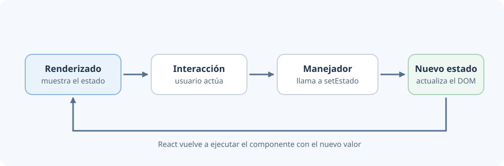
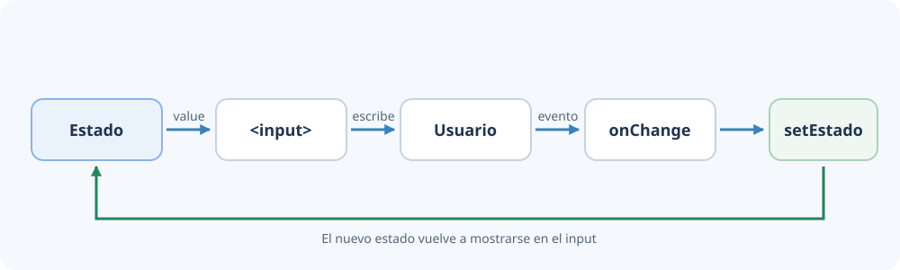



[⌂ Volver al inicio](index.md)

> **Resultado de aprendizaje RA4.** Diseña interfaces gráficas identificando y aplicando criterios de usabilidad y accesibilidad.
>
> **Objetivos de la unidad**
>
> - Diseñar interfaces visuales coherentes y accesibles aplicando principios UX/UI.
> - Gestionar el estado y los efectos de los componentes con hooks (`useState`, `useEffect`, `useRef`) y crear hooks personalizados.
> - Crear formularios controlados y no controlados con validación accesible.
> - Gestionar el estado compartido de la aplicación mediante Context API, de acuerdo con la complejidad de la interfaz.
> - Implementar enrutamiento con React Router, organizando la navegación entre vistas.
> - Aplicar patrones de diseño adaptativo y *responsive* para distintos dispositivos.
> - Integrar bibliotecas de componentes visuales (Material UI) para mejorar la experiencia de usuario.
> - Garantizar la accesibilidad (a11y) de la aplicación mediante atributos ARIA y validación con herramientas automáticas.
> - Diseñar vistas navegables de una aplicación React, asegurando coherencia visual, adaptación a distintos dispositivos y accesibilidad.
>
> **Requisitos previos:** esta unidad parte de los contenidos de la [UD4](ud4.md): componentes, props, estilos, eventos y comunicación entre componentes.

# Índice

1. [Diseño de interfaces: principios UX/UI](#1-diseño-de-interfaces-principios-uxui)
2. [Hooks: useState y useEffect](#2-hooks-usestate-y-useeffect)
    - [Práctica 1](#28-práctica-1-estado-y-eventos)
    - [Práctica 2](#29-práctica-2-pokédex-con-react)
3. [Formularios](#3-formularios)
    - [Práctica 3](#36-práctica-3-formulario-de-registro-validado)
    - [Práctica 4](#37-práctica-4-taskflow-gestor-de-tareas)
4. [Gestión del estado global con Context API](#4-gestión-del-estado-global-con-context-api)
    - [Práctica 5](#47-práctica-5-estado-global-con-context)
5. [Enrutamiento con React Router](#5-enrutamiento-con-react-router)
    - [Práctica 6](#511-práctica-6-aplicación-navegable)
6. [Diseño adaptativo y responsive](#6-diseño-adaptativo-y-responsive)
7. [Material UI](#7-material-ui)
    - [Práctica 7](#79-práctica-7-interfaz-con-material-ui)
8. [Usabilidad y accesibilidad](#8-usabilidad-y-accesibilidad)
    - [Práctica 8](#89-práctica-8-auditoría-de-accesibilidad)
9. [Integración con servicios backend mediante API REST](#9-integración-con-servicios-backend-mediante-api-rest)
    - [Práctica guiada](#98-práctica-guiada-gestor-de-tareas-conectado-a-una-api)
10. [Proyecto final: aplicación React completa](#10-proyecto-final-aplicación-react-completa)

---

# 1. Diseño de interfaces: principios UX/UI

## 1.1 UX y UI

- **UI (*User Interface*, interfaz de usuario):** lo que el usuario ve y toca: colores, tipografías, iconos, botones, espaciado, disposición de los elementos. Responde a la pregunta *¿cómo se ve?*
- **UX (*User Experience*, experiencia de usuario):** cómo se siente el usuario al utilizar el producto: si consigue su objetivo, cuánto esfuerzo le cuesta, si comete errores, si le resulta agradable. Responde a la pregunta *¿cómo funciona para la persona?*

Una interfaz puede ser bonita (buena UI) y aun así frustrante (mala UX): por ejemplo, un formulario precioso que borra todos los datos cuando hay un error. En esta unidad trabajaremos ambos aspectos, junto con la **usabilidad** (facilidad de uso) y la **accesibilidad** (que pueda usarla cualquier persona, incluidas las personas con discapacidad).

## 1.2 Proceso de diseño de una interfaz

Antes de programar conviene seguir un proceso, aunque sea ligero:

1. **Investigar:** ¿quién usará la aplicación?, ¿qué necesita hacer?, ¿desde qué dispositivo? Se pueden definir **personas** (perfiles ficticios de usuarios tipo) y **escenarios de uso**.
2. **Organizar la información (arquitectura de la información):** qué pantallas habrá, qué contiene cada una y cómo se navega entre ellas. Se representa con un **mapa del sitio** o un diagrama de navegación (nos servirá para definir las rutas).
3. **Bocetar (*wireframes*):** esquemas en blanco y negro de cada pantalla, sin colores ni imágenes, centrados en la disposición y la jerarquía.
4. **Diseñar (*mockups*) y prototipar:** diseño visual completo y, si es posible, un prototipo navegable. Herramientas como **Figma**, **Penpot** (libre) o **Excalidraw** facilitan este paso.
5. **Implementar** con componentes reutilizables.
6. **Evaluar:** pruebas con usuarios, revisión heurística y auditorías de accesibilidad. Los resultados vuelven al paso 1: el diseño es **iterativo**.

```text
 Investigar ──► Organizar ──► Bocetar ──► Diseñar/Prototipar ──► Implementar ──► Evaluar
     ▲                                                                          │
     └──────────────────────────────── iterar ──────────────────────────────────┘
```

## 1.3 Las 10 heurísticas de usabilidad de Nielsen

Jakob Nielsen propuso en 1994 diez principios generales que siguen siendo la referencia para evaluar la usabilidad de una interfaz:

| # | Heurística | Significado | Ejemplo en React |
| --- | --- | --- | --- |
| 1 | **Visibilidad del estado del sistema** | El usuario siempre sabe qué está pasando. | Indicadores de carga, mensajes «Guardado», botón «Enviando…». |
| 2 | **Relación con el mundo real** | Lenguaje e iconos familiares para el usuario. | «Carrito», no «Colección de ítems seleccionados». |
| 3 | **Control y libertad** | Salidas de emergencia: deshacer, cancelar, volver. | Botón «Deshacer» tras eliminar; «Cancelar» en los diálogos. |
| 4 | **Consistencia y estándares** | Lo mismo se ve y funciona igual en toda la aplicación. | Componentes reutilizables, un único tema, convenciones de la plataforma. |
| 5 | **Prevención de errores** | Mejor evitar el error que avisar de él. | Desactivar botones no válidos, confirmación antes de borrar, `type="email"`. |
| 6 | **Reconocer mejor que recordar** | Opciones visibles en lugar de memorizarlas. | Menús visibles, autocompletado, búsquedas recientes. |
| 7 | **Flexibilidad y eficiencia** | Atajos para usuarios expertos. | Atajos de teclado, filtros guardados. |
| 8 | **Diseño estético y minimalista** | Solo la información relevante. | Jerarquía visual clara, espacio en blanco. |
| 9 | **Ayudar a reconocer y recuperarse de errores** | Mensajes claros que indican la solución. | «La contraseña debe tener 8 caracteres» en lugar de «Error 422». |
| 10 | **Ayuda y documentación** | Ayuda contextual cuando sea necesaria. | *Tooltips*, textos de ayuda bajo los campos, página de preguntas frecuentes. |

## 1.4 Principios de diseño visual

- **Jerarquía visual:** lo más importante debe destacar más (tamaño, peso, color, posición). El usuario debe saber en dos segundos qué es la pantalla y qué puede hacer en ella. Cada pantalla debería tener una sola **acción principal** destacada.
- **Principios de la Gestalt:**
  - *Proximidad:* los elementos cercanos se perciben como un grupo (una etiqueta debe estar más cerca de su campo que del campo anterior).
  - *Semejanza:* los elementos con el mismo aspecto se perciben con la misma función (todos los enlaces del mismo color).
  - *Región común:* los elementos dentro de un mismo contenedor (una tarjeta) se perciben relacionados.
  - *Continuidad y cierre:* el ojo sigue líneas y completa formas.
- **Alineación y rejilla:** alinear los elementos a una rejilla da orden. Usa un **sistema de espaciado** consistente, por ejemplo múltiplos de 8 px (8, 16, 24, 32...).
- **Tipografía:** como máximo dos familias tipográficas, una escala de tamaños coherente (por ejemplo 14, 16, 20, 24, 32 px), cuerpo de texto de al menos 16 px y longitud de línea entre 45 y 75 caracteres.
- **Color:** una paleta limitada (primario, secundario, neutros y colores de estado: éxito, aviso, error, información). El color **nunca debe ser la única forma** de transmitir información y debe tener **contraste suficiente** (apartado 8).
- **Consistencia mediante un sistema de diseño:** un conjunto documentado de tokens (colores, tipografías, espaciados) y componentes reutilizables. Material Design (Google), Fluent (Microsoft) o Human Interface Guidelines (Apple) son sistemas de diseño públicos. En React, el **tema** de Material UI (apartado 7) es la implementación de un sistema de diseño.
- **Retroalimentación (*feedback*):** cada acción debe tener una respuesta visible: estados `:hover`, `:focus` y `:active`, animaciones breves, mensajes de confirmación.
- **Patrones conocidos:** no reinventes la rueda. Los usuarios ya conocen el icono de la hamburguesa, la lupa de búsqueda, el carrito, las pestañas o las migas de pan.

## 1.5 Estados de la interfaz

Un error frecuente es diseñar solo el «caso feliz». Cada vista que muestra datos tiene, al menos, estos estados, y todos deben estar diseñados:

| Estado | Qué mostrar |
| --- | --- |
| **Cargando** | Indicador de progreso o esqueleto (*skeleton*) con la forma del contenido. |
| **Vacío** | Mensaje explicativo y una acción («Aún no tienes tareas. Crea la primera»). |
| **Error** | Qué ha pasado, en lenguaje humano, y cómo solucionarlo («Reintentar»). |
| **Parcial** | Pocos datos o datos incompletos (sin imagen, sin descripción). |
| **Ideal** | El contenido completo. |

En React estos estados se implementan con renderizado condicional, como vimos en la UD4.

---

# 2. Hooks: useState y useEffect

## 2.1 ¿Qué son los hooks?

Los hooks son funciones que permiten a los componentes funcionales usar el estado y otras características de React. Se introdujeron en React 16.8 y su nombre siempre empieza por `use`. Los principales son:

- **`useState`:** añade estado local a un componente.
- **`useEffect`:** ejecuta efectos secundarios (peticiones a una API, temporizadores, suscripciones, sincronización con el DOM o `localStorage`).
- **`useRef`:** guarda una referencia a un elemento del DOM o un valor mutable que no provoca renderizados.
- **`useContext`:** accede a datos compartidos sin pasar props por todos los niveles (apartado 4).
- **`useReducer`:** alternativa a `useState` para estados complejos con muchas transiciones.
- **`useMemo` y `useCallback`:** memorizan valores y funciones para optimizar el rendimiento.
- **Hooks personalizados:** funciones propias que combinan otros hooks para reutilizar lógica (`useFetch`, `useLocalStorage`...).

### 2.1.1 Reglas de los hooks

1. **Llámalos solo en el nivel superior** del componente: nunca dentro de condiciones, bucles ni funciones anidadas. React identifica cada hook por el orden en que se llama, que debe ser el mismo en cada renderizado.
2. **Llámalos solo desde componentes de React o desde hooks personalizados**, nunca desde funciones normales de JavaScript.

```jsx
function Perfil({ usuario }) {
  if (!usuario) return null;
  const [abierto, setAbierto] = useState(false); // MAL: hook después de un return condicional
  // ...
}
```

El plugin `eslint-plugin-react-hooks` de la plantilla de Vite detecta estas infracciones.

## 2.2 `useState`: el estado del componente

### 2.2.1 ¿Por qué no basta con una variable?

```jsx
function Contador() {
  let contador = 0;
  return (
    <button onClick={() => { contador++; console.log(contador); }}>
      Pulsado {contador} veces
    </button>
  );
}
```

La consola muestra 1, 2, 3..., pero la pantalla sigue en «0». Por dos motivos:

1. Cambiar una variable local no avisa a React de que tiene que volver a renderizar.
2. Aunque se volviera a renderizar, la función del componente se ejecuta de nuevo desde el principio y `contador` volvería a valer `0`.

El estado soluciona ambos problemas: React guarda el valor entre renderizados y vuelve a renderizar el componente cuando cambia.

### 2.2.2 Sintaxis

```jsx
import { useState } from "react";

function Contador() {
  const [contador, setContador] = useState(0);
  //     ▲ valor    ▲ función para    ▲ valor inicial
  //       actual     actualizarlo

  return (
    <div>
      <p>Has pulsado {contador} veces</p>
      <button onClick={() => setContador(contador + 1)}>Sumar</button>
      <button onClick={() => setContador(contador - 1)}>Restar</button>
      <button onClick={() => setContador(0)}>Reiniciar</button>
    </div>
  );
}
```

`useState` devuelve un array con dos elementos que desestructuramos: el valor actual y la función de actualización (por convenio, `setNombre`). Cada llamada a `setContador` programa un nuevo renderizado con el nuevo valor.

El ciclo es siempre el mismo:



Cada componente tiene su propio estado: si renderizas dos `<Contador />`, cada uno cuenta por separado.

### 2.2.3 El estado es una «foto» y la función actualizadora

El valor del estado no cambia inmediatamente al llamar a `setContador`: se mantiene igual durante todo el renderizado actual.

```jsx
function handleClick() {
  setContador(contador + 1);
  setContador(contador + 1);
  setContador(contador + 1);
  console.log(contador); // Sigue mostrando el valor anterior
}
// Resultado: solo suma 1, porque las tres llamadas usan el mismo valor de `contador`
```

Si el nuevo estado depende del anterior, usa la función actualizadora, que recibe el valor más reciente:

```jsx
function handleClick() {
  setContador((c) => c + 1);
  setContador((c) => c + 1);
  setContador((c) => c + 1);
}
// Resultado: suma 3
```

Recomendación: cuando calcules el nuevo estado a partir del anterior, usa la forma `setX(prev => ...)`.

### 2.2.4 Estado con objetos y arrays: inmutabilidad

React detecta los cambios comparando la referencia del estado anterior con la del nuevo. Si modificas (mutas) un objeto o un array existente, la referencia es la misma y React no vuelve a renderizar. Siempre hay que crear un objeto o array nuevo, normalmente con el operador spread.

**Objetos:**

```jsx
const [usuario, setUsuario] = useState({ nombre: "Ana", edad: 30 });

// MAL: muta el objeto, React no se entera
usuario.edad = 31;
setUsuario(usuario);

// BIEN: crea un objeto nuevo copiando el anterior
setUsuario({ ...usuario, edad: 31 });
// o con función actualizadora
setUsuario((prev) => ({ ...prev, edad: prev.edad + 1 }));
```

**Arrays.** Operaciones habituales sin mutar:

| Operación | Muta (evitar) | Crea un array nuevo |
| --- | --- | --- |
| Añadir | `push`, `unshift` | `[...arr, nuevo]`, `[nuevo, ...arr]` |
| Eliminar | `splice`, `pop`, `shift` | `arr.filter(x => x.id !== id)` |
| Modificar | `arr[i] = x` | `arr.map(x => x.id === id ? { ...x, hecho: true } : x)` |
| Ordenar | `sort`, `reverse` | `arr.toSorted(...)`, `[...arr].sort(...)` |

```jsx
import { useState } from "react";

function ListaCompra() {
  const [productos, setProductos] = useState([
    { id: 1, nombre: "Leche", comprado: false },
  ]);
  const [texto, setTexto] = useState("");

  const añadir = () => {
    if (texto.trim() === "") return;
    setProductos((prev) => [...prev, { id: crypto.randomUUID(), nombre: texto.trim(), comprado: false }]);
    setTexto("");
  };

  const alternar = (id) => {
    setProductos((prev) =>
      prev.map((p) => (p.id === id ? { ...p, comprado: !p.comprado } : p))
    );
  };

  const eliminar = (id) => {
    setProductos((prev) => prev.filter((p) => p.id !== id));
  };

  return (
    <section>
      <input value={texto} onChange={(e) => setTexto(e.target.value)} aria-label="Producto" />
      <button onClick={añadir}>Añadir</button>
      <ul>
        {productos.map((p) => (
          <li key={p.id}>
            <label>
              <input type="checkbox" checked={p.comprado} onChange={() => alternar(p.id)} />
              <span style={{ textDecoration: p.comprado ? "line-through" : "none" }}>{p.nombre}</span>
            </label>
            <button onClick={() => eliminar(p.id)}>Eliminar</button>
          </li>
        ))}
      </ul>
    </section>
  );
}
```

### 2.2.5 Buenas prácticas con el estado

- **No guardes en el estado lo que puedes calcular.** En el ejemplo anterior, el número de productos comprados se calcula al renderizar: `const comprados = productos.filter(p => p.comprado).length;`. Guardarlo en otro estado obligaría a sincronizar ambos y es una fuente de errores.
- **Varios estados simples o un objeto.** Usa estados separados para valores independientes (`const [abierto, setAbierto]`, `const [filtro, setFiltro]`) y un objeto cuando los valores cambian juntos (los campos de un formulario).
- **Inicialización perezosa.** Si el valor inicial es costoso de calcular (leer `localStorage`, por ejemplo), pasa una función: `useState(() => leerDeLocalStorage())`. Así solo se ejecuta en el primer renderizado.
- **Dónde colocar el estado:** en el componente más bajo del árbol que lo necesite; si lo necesitan varios, en su ancestro común (apartado 2.2.6).

### 2.2.6 Elevar el estado (*lifting state up*)

En la UD4 (apartado 7.5) viste que un hijo avisa a su padre llamando a una función que recibe por props. Ahora que el padre puede guardar datos en el estado, ese aviso sirve para algo más: compartir un dato entre componentes hermanos.

Por ejemplo, un buscador y la lista que filtra. Los hermanos no se hablan directamente, así que el dato se sube («se eleva») a su padre común. El padre lo guarda en su estado y se lo da a los dos: al buscador junto con la función para cambiarlo, y a la lista para que filtre.

```jsx
import { useState } from "react";

function Buscador({ texto, onCambiarTexto }) {
  return (
    <input
      type="search"
      value={texto}
      onChange={(e) => onCambiarTexto(e.target.value)}
      placeholder="Buscar fruta"
      aria-label="Buscar fruta"
    />
  );
}

function ListaFiltrada({ elementos, texto }) {
  const filtrados = elementos.filter((e) => e.toLowerCase().includes(texto.toLowerCase()));
  return (
    <ul>
      {filtrados.map((e) => <li key={e}>{e}</li>)}
    </ul>
  );
}

export default function App() {
  const [texto, setTexto] = useState(""); // El dato vive en el padre común
  const frutas = ["Manzana", "Pera", "Plátano", "Melocotón", "Mango"];

  return (
    <>
      <Buscador texto={texto} onCambiarTexto={setTexto} />
      <ListaFiltrada elementos={frutas} texto={texto} />
    </>
  );
}
```

Al escribir, `Buscador` avisa a `App` con el callback, `App` guarda el nuevo texto en su estado y se lo pasa a `ListaFiltrada`, que se vuelve a dibujar filtrada. Cuando hay que pasar datos a través de muchos niveles (*prop drilling*), se usa el Context API (apartado 4).

## 2.3 `useEffect`: efectos secundarios

### 2.3.1 ¿Qué es un efecto?

Un componente debe ser una función pura: dados unos props y un estado, devuelve siempre el mismo JSX, sin modificar nada externo. Sin embargo, las aplicaciones necesitan efectos secundarios: comunicarse con algo que está fuera de React.

- Pedir datos a una API.
- Crear temporizadores (`setInterval`, `setTimeout`).
- Suscribirse a eventos del navegador (`resize`, `keydown` en `window`).
- Leer o escribir en `localStorage`.
- Cambiar el título del documento o un atributo de `<html>`.

`useEffect` ejecuta código después de que React haya actualizado el DOM.

### 2.3.2 Sintaxis y array de dependencias

```jsx
useEffect(() => {
  // Código del efecto
  return () => {
    // (Opcional) Función de limpieza
  };
}, [dependencias]);
```

El array de dependencias controla cuándo se vuelve a ejecutar:

| Segundo argumento | Cuándo se ejecuta el efecto |
| --- | --- |
| Sin array | Después de cada renderizado (rara vez es lo que se quiere). |
| `[]` (vacío) | **Solo una vez**, cuando el componente se monta (aparece en pantalla). |
| `[a, b]` | Al montarse y cada vez que cambie `a` o `b`. |

```jsx
import { useState, useEffect } from "react";

function TituloContador() {
  const [contador, setContador] = useState(0);

  useEffect(() => {
    document.title = `Has pulsado ${contador} veces`;
  }, [contador]); // Se ejecuta cada vez que cambia `contador`

  return <button onClick={() => setContador((c) => c + 1)}>Pulsado {contador}</button>;
}
```

Regla: todo valor del componente (props, estado, funciones) que se use dentro del efecto debe estar en el array de dependencias. ESLint te avisará si falta alguno.

### 2.3.3 Ciclo de vida y función de limpieza

Un componente se monta (aparece), se actualiza (se vuelve a renderizar) y se desmonta (desaparece). Con `useEffect` se controla cada fase:

- El cuerpo del efecto se ejecuta tras el montaje y tras los cambios de sus dependencias.
- La función de limpieza que devuelve el efecto se ejecuta antes de volver a ejecutar el efecto y al desmontar el componente. Sirve para deshacer lo que hizo el efecto: parar temporizadores, quitar *listeners*, cancelar peticiones.

```jsx
function Reloj() {
  const [hora, setHora] = useState(new Date());

  useEffect(() => {
    const id = setInterval(() => setHora(new Date()), 1000);
    console.log("Reloj montado: temporizador iniciado");

    return () => {
      clearInterval(id);
      console.log("Reloj desmontado: temporizador detenido");
    };
  }, []);

  return <p>Son las {hora.toLocaleTimeString("es-ES")}</p>;
}

function App() {
  const [visible, setVisible] = useState(true);
  return (
    <>
      <button onClick={() => setVisible((v) => !v)}>{visible ? "Ocultar" : "Mostrar"} reloj</button>
      {visible && <Reloj />}
    </>
  );
}
```

Sin `clearInterval`, al ocultar el reloj el temporizador seguiría funcionando en segundo plano (una fuga de memoria).

Ejemplo con un evento de `window`:

```jsx
function AnchoVentana() {
  const [ancho, setAncho] = useState(window.innerWidth);

  useEffect(() => {
    const handleResize = () => setAncho(window.innerWidth);
    window.addEventListener("resize", handleResize);
    return () => window.removeEventListener("resize", handleResize);
  }, []);

  return <p>Ancho de la ventana: {ancho}px</p>;
}
```

> **`StrictMode` ejecuta los efectos dos veces en desarrollo.** Si ves en la consola «montado → desmontado → montado» al cargar la página, es normal: React monta, desmonta y vuelve a montar cada componente para comprobar que la función de limpieza funciona correctamente. En producción solo se ejecuta una vez. Si un efecto falla por ejecutarse dos veces, es que le falta la limpieza.

### 2.3.4 Persistir el estado en `localStorage`

Combinando la inicialización perezosa de `useState` y un efecto, el estado sobrevive a la recarga de la página:

```jsx
function useTema() {
  const [tema, setTema] = useState(() => localStorage.getItem("tema") ?? "claro");

  useEffect(() => {
    localStorage.setItem("tema", tema);
    document.documentElement.dataset.tema = tema; // Aplica las variables CSS de la UD4 (apartado 6.7)
  }, [tema]);

  return [tema, setTema];
}

function BotonTema() {
  const [tema, setTema] = useTema();
  return (
    <button onClick={() => setTema((t) => (t === "claro" ? "oscuro" : "claro"))}>
      Cambiar a tema {tema === "claro" ? "oscuro" : "claro"}
    </button>
  );
}
```

`useTema` es un hook personalizado: una función cuyo nombre empieza por `use` y que utiliza otros hooks. Permite reutilizar la lógica en cualquier componente.

### 2.3.5 Obtener datos de una API

En la UD2 usamos `fetch` con promesas y `async/await`. En React, las peticiones al cargar un componente se hacen en un efecto. Necesitamos tres estados: datos, cargando y error.

```jsx
import { useState, useEffect } from "react";

function Cafe({ id }) {
  const [cafe, setCafe] = useState(null);
  const [cargando, setCargando] = useState(true);
  const [error, setError] = useState(null);

  useEffect(() => {
    let ignorar = false; // Evita usar respuestas obsoletas

    async function cargar() {
      setCargando(true);
      setError(null);
      try {
        const respuesta = await fetch(`https://api.sampleapis.com/coffee/hot/${id}`);
        if (!respuesta.ok) throw new Error(`Error HTTP ${respuesta.status}`);
        const datos = await respuesta.json();
        if (!ignorar) setCafe(datos);
      } catch (err) {
        if (!ignorar) setError(err.message);
      } finally {
        if (!ignorar) setCargando(false);
      }
    }

    cargar();

    return () => {
      ignorar = true; // Si cambia `id` o se desmonta, se descarta la respuesta pendiente
    };
  }, [id]);

  if (cargando) return <p>Cargando café…</p>;
  if (error) return <p role="alert">No se ha podido cargar el café: {error}</p>;
  if (!cafe) return null;

  return (
    <article>
      <h2>{cafe.title}</h2>
      <p>{cafe.description}</p>
      
    </article>
  );
}
```

Puntos importantes:

- La función del efecto no puede ser `async` (debe devolver nada o una función de limpieza, no una promesa). Por eso se declara una función `async` dentro y se llama.
- **`ignorar`** evita una *condición de carrera*: si el usuario cambia rápidamente de `id`, una respuesta lenta anterior podría llegar después de la nueva y sobrescribirla.
- El efecto depende de `id`: al cambiarlo, se vuelve a pedir.
- Siempre se gestionan los tres casos: cargando, error y datos.

> Alternativa a `ignorar`: un `AbortController` que cancela la petición en la función de limpieza (`fetch(url, { signal: controller.signal })` y `return () => controller.abort();`). Lo usaremos en el apartado 9.

### 2.3.6 Cuándo NO usar `useEffect`

Un error común es usar efectos para cosas que no son efectos:

- **Calcular datos a partir de props o estado:** hazlo directamente durante el renderizado.

  ```jsx
  // MAL: innecesario
  const [total, setTotal] = useState(0);
  useEffect(() => { setTotal(items.reduce((s, i) => s + i.precio, 0)); }, [items]);

  // BIEN: se calcula al renderizar
  const total = items.reduce((s, i) => s + i.precio, 0);
  ```

- **Responder a un evento del usuario** (enviar un formulario, añadir al carrito): hazlo en el manejador del evento, no en un efecto.

Usa `useEffect` solo para sincronizar el componente con sistemas externos.

## 2.4 `useRef`: referencias al DOM

`useRef` crea un objeto `{ current: valor }` que persiste entre renderizados y cuya modificación no provoca un renderizado. Su uso más habitual es acceder directamente a un elemento del DOM, por ejemplo para darle el foco:

```jsx
import { useRef } from "react";

function Buscador() {
  const inputRef = useRef(null);

  return (
    <>
      <input ref={inputRef} type="search" aria-label="Buscar" />
      <button onClick={() => inputRef.current.focus()}>Ir al buscador</button>
    </>
  );
}
```

React asigna el nodo del DOM a `inputRef.current` después de montarlo. Lo volveremos a usar en los formularios no controlados.

## 2.5 Ejemplo completo: tarjeta de usuario aleatorio

Combina estado, efecto, eventos y renderizado condicional usando la API pública [randomuser.me](https://randomuser.me):

```jsx
import { useState, useEffect } from "react";

export default function UsuarioAleatorio() {
  const [usuario, setUsuario] = useState(null);
  const [estado, setEstado] = useState("cargando"); // "cargando" | "ok" | "error"
  const [recargas, setRecargas] = useState(0);

  useEffect(() => {
    const controller = new AbortController();

    fetch("https://randomuser.me/api/?nat=es", { signal: controller.signal })
      .then((r) => {
        if (!r.ok) throw new Error(r.status);
        return r.json();
      })
      .then((datos) => {
        setUsuario(datos.results[0]);
        setEstado("ok");
      })
      .catch((err) => {
        if (err.name !== "AbortError") setEstado("error");
      });

    return () => controller.abort();
  }, [recargas]); // Cada vez que se pulsa «Otro» cambia `recargas` y se repite la petición

  const otro = () => {
    setEstado("cargando");
    setRecargas((n) => n + 1);
  };

  return (
    <section>
      {estado === "cargando" && <p>Cargando…</p>}
      {estado === "error" && <p role="alert">Error al cargar el usuario.</p>}
      {estado === "ok" && usuario && (
        <article>
          
          <h2>{usuario.name.first} {usuario.name.last}</h2>
          <p>{usuario.email}</p>
          <p>{usuario.location.city}</p>
        </article>
      )}
      <button onClick={otro} disabled={estado === "cargando"}>Otro usuario</button>
    </section>
  );
}
```

## 2.6 Hooks personalizados

Cuando varios componentes repiten la misma lógica con hooks, se extrae a un hook personalizado. Ejemplo genérico para persistir cualquier estado en `localStorage`:

```jsx
// src/hooks/useLocalStorage.js
import { useState, useEffect } from "react";

export function useLocalStorage(clave, valorInicial) {
  const [valor, setValor] = useState(() => {
    try {
      const guardado = localStorage.getItem(clave);
      return guardado !== null ? JSON.parse(guardado) : valorInicial;
    } catch {
      return valorInicial; // JSON corrupto o almacenamiento no disponible
    }
  });

  useEffect(() => {
    try {
      localStorage.setItem(clave, JSON.stringify(valor));
    } catch {
      // Almacenamiento lleno o bloqueado: se ignora
    }
  }, [clave, valor]);

  return [valor, setValor];
}
```

Se usa exactamente igual que `useState`:

```jsx
const [tareas, setTareas] = useLocalStorage("tareas", []);
```

Cada componente que usa un hook personalizado tiene su propio estado: el hook comparte la lógica, no los datos.

## 2.7 Resumen

| Necesito... | Herramienta |
| --- | --- |
| Datos que cambian y deben verse en pantalla | `useState` |
| Valores que se calculan a partir de otros | Una variable normal en el cuerpo del componente |
| Sincronizarme con algo externo (API, temporizador, `window`, `localStorage`) | `useEffect` (con limpieza si procede) |
| Acceder a un nodo del DOM o guardar un valor sin renderizar | `useRef` |
| Reaccionar a una acción del usuario | Manejador de eventos |
| Reutilizar lógica con hooks | Hook personalizado |

## 2.8 PRÁCTICA 1: Estado y eventos

Crea el proyecto `ud5-practica-1-estado`.

**1. Contador avanzado**

Crea un componente `Contador` con los botones `+1`, `-1`, `+5` y «Reiniciar».

- **a.** Usa la función actualizadora en todos los cambios.
- **b.** Recibe por props `min` y `max` (por defecto 0 y 20) y desactiva los botones que superarían los límites.
- **c.** Muestra el número en rojo si es mayor que 15 (con una clase CSS, no con `style`).
- **d.** Renderiza tres contadores independientes en `App` y comprueba que cada uno tiene su estado.

**2. Selector de tema**

- **a.** Reutiliza las variables CSS de la práctica de estilos de la UD4 y crea un hook `useTema` que guarde el tema en `localStorage` y lo aplique a `<html>` con un efecto.
- **b.** Añade un botón en el `Header` para alternar el tema. Al recargar, debe mantenerse.

**3. Carrito de la compra**

Crea una tienda con un catálogo fijo de al menos 6 productos (`id`, `nombre`, `precio`, `imagen`).

- **a.** Componentes: `Catalogo`, `ProductoCard`, `Carrito` y `LineaCarrito`. El estado del carrito estará en `App` (elevado) y se comunicará con callbacks (`onAñadir`, `onCambiarCantidad`, `onEliminar`).
- **b.** Al añadir un producto que ya está en el carrito, se incrementa su cantidad en lugar de duplicarlo.
- **c.** Cada línea permite aumentar o disminuir la cantidad; si llega a 0, se elimina.
- **d.** El total y el número de artículos se calculan durante el renderizado (no se guardan en estado).
- **e.** Si el carrito está vacío, muestra un mensaje.
- **f.** Persiste el carrito con el hook `useLocalStorage`.
- **g.** Ningún array ni objeto del estado debe mutarse. Revisa tu código buscando `push`, `splice` o asignaciones directas.

**4. Temporizador**

- **a.** Crea un componente `Temporizador` con «Iniciar», «Pausar» y «Reiniciar» que muestre minutos y segundos.
- **b.** Usa `useEffect` con su función de limpieza. Comprueba que al ocultar el componente no quedan temporizadores activos (añade un `console.log` en la limpieza).

**Entrega:** sube el proyecto a tu repositorio `React` y explica en comentarios del código las decisiones sobre dónde se ha colocado cada estado.

## 2.9 PRÁCTICA 2: Pokédex con React

En la UD2 construiste una Pokédex con el DOM. Ahora la reconstruirás con componentes, estado y efectos, y comprobarás cuánto código de manipulación del DOM desaparece.

### API

| Recurso | URL |
| --- | --- |
| Listado paginado | `https://pokeapi.co/api/v2/pokemon?limit=20&offset=0` |
| Detalle | `https://pokeapi.co/api/v2/pokemon/{nombre o número}` |
| Imagen oficial | `https://raw.githubusercontent.com/PokeAPI/sprites/master/sprites/pokemon/other/official-artwork/{numero}.png` |

### Tareas

**1. Estructura**

- **a.** Crea el proyecto `ud5-practica-2-pokedex` con los componentes `App`, `Buscador`, `ListaPokemon`, `PokemonCard`, `FichaPokemon`, `Paginacion` y `Mensaje`.
- **b.** Crea `src/services/pokeapi.js` con una función `obtenerDatos(url)` que haga `fetch`, compruebe `respuesta.ok` y devuelva el JSON (igual que en la UD2).

**2. Listado**

- **a.** `ListaPokemon` carga 20 Pokémon en un `useEffect`, gestionando los estados de carga y error.
- **b.** Cada `PokemonCard` muestra el número, el nombre y la imagen oficial (extrae el número de la URL de cada resultado).
- **c.** `Paginacion` tiene los botones «Anterior» y «Siguiente», que cambian un estado `pagina`. El efecto depende de ese estado. Desactiva «Anterior» en la primera página.
- **d.** Evita las condiciones de carrera con una variable `ignorar` o un `AbortController`.

**3. Ficha de detalle**

- **a.** Al pulsar una tarjeta, se guarda en el estado de `App` el Pokémon seleccionado y se muestra `FichaPokemon` (sin cambiar de página; el enrutamiento llegará en el apartado 5).
- **b.** `FichaPokemon` pide el detalle en un efecto que depende del nombre seleccionado y muestra: nombre, número, imagen, tipos, altura (en metros), peso (en kilos), habilidades y estadísticas base con una barra por estadística.
- **c.** Incluye un botón «Volver al listado».

**4. Búsqueda**

- **a.** `Buscador` es un formulario con un campo controlado. Al enviarlo (`preventDefault`), se busca el Pokémon por nombre o número en minúsculas y sin espacios.
- **b.** Si existe, se abre su ficha; si la API responde `404`, se muestra «No se ha encontrado ese Pokémon».

**5. Favoritos**

- **a.** Cada tarjeta tiene un botón de favorito (★/☆). Al pulsarlo no debe abrirse la ficha (`stopPropagation`).
- **b.** Los favoritos se guardan con `useLocalStorage` y se puede filtrar el listado para ver solo los favoritos.

**6. Estilos**

- **a.** Usa módulos CSS y las variables del tema. Colorea la tarjeta según el tipo principal del Pokémon.
- **b.** El listado se mostrará en una rejilla adaptable (1 columna en móvil, 2–4 en pantallas mayores).

**Entrega:** proyecto en tu repositorio `React` y, en el `README.md`, una comparación breve entre la versión de la UD2 y la de React: qué ha resultado más sencillo y qué más complejo.

---

# 3. Formularios

Los formularios son la principal vía de entrada de datos del usuario. En React hay dos formas de gestionarlos: controlados y no controlados.

## 3.1 Formularios controlados

En un formulario controlado, el valor de cada campo está ligado al estado de React. El campo muestra siempre lo que dice el estado (`value`) y cada cambio actualiza el estado (`onChange`). React es la única fuente de verdad.



### 3.1.1 Un campo

```jsx
import { useState } from "react";

function Nombre() {
  const [nombre, setNombre] = useState("");

  return (
    <>
      <label htmlFor="nombre">Nombre</label>
      <input id="nombre" value={nombre} onChange={(e) => setNombre(e.target.value)} />
      <p>Hola, {nombre || "desconocido"}</p>
    </>
  );
}
```

> Si pones `value` sin `onChange`, el campo queda bloqueado: React siempre lo devuelve al valor del estado. La consola mostrará un aviso. Si lo que quieres es un valor inicial modificable sin controlarlo, usa `defaultValue`.

### 3.1.2 Varios campos con un único estado

Cuando hay varios campos, se agrupan en un objeto y se usa un único manejador que identifica el campo por su atributo `name` gracias a las propiedades calculadas (`[name]: value`):

```jsx
import { useState } from "react";

function MultiFieldForm() {
  const [formData, setFormData] = useState({
    firstName: "",
    lastName: "",
    email: "",
  });

  const handleChange = (event) => {
    const { name, value } = event.target;
    setFormData((prev) => ({
      ...prev,
      [name]: value,
    }));
  };

  const handleSubmit = (event) => {
    event.preventDefault();
    console.log("Datos del formulario:", formData);
  };

  return (
    <form onSubmit={handleSubmit}>
      <label>
        Nombre:
        <input type="text" name="firstName" value={formData.firstName} onChange={handleChange} />
      </label>
      <label>
        Apellido:
        <input type="text" name="lastName" value={formData.lastName} onChange={handleChange} />
      </label>
      <label>
        Correo electrónico:
        <input type="email" name="email" value={formData.email} onChange={handleChange} />
      </label>
      <button type="submit">Enviar</button>
    </form>
  );
}

export default MultiFieldForm;
```

- **Estado inicial:** un objeto con una propiedad por campo. El atributo `name` de cada campo debe coincidir con su propiedad.
- **`handleChange`:** desestructura `name` y `value` de `event.target` y actualiza solo esa propiedad, copiando el resto con spread.
- **`handleSubmit`:** evita la recarga de la página y procesa los datos.

### 3.1.3 Otros tipos de campo

```jsx
import { useState } from "react";

const inicial = {
  ciclo: "DAM",
  turno: "mañana",
  comentarios: "",
  acepta: false,
  intereses: [],
};

function FormularioCompleto() {
  const [datos, setDatos] = useState(inicial);

  const handleChange = (e) => {
    const { name, value, type, checked } = e.target;
    setDatos((prev) => ({ ...prev, [name]: type === "checkbox" ? checked : value }));
  };

  const handleInteres = (e) => {
    const { value, checked } = e.target;
    setDatos((prev) => ({
      ...prev,
      intereses: checked
        ? [...prev.intereses, value]
        : prev.intereses.filter((i) => i !== value),
    }));
  };

  return (
    <form onSubmit={(e) => { e.preventDefault(); console.log(datos); }}>
      {/* select: se controla con value en el <select>, no con selected en <option> */}
      <label htmlFor="ciclo">Ciclo</label>
      <select id="ciclo" name="ciclo" value={datos.ciclo} onChange={handleChange}>
        <option value="DAM">Desarrollo de Aplicaciones Multiplataforma</option>
        <option value="DAW">Desarrollo de Aplicaciones Web</option>
        <option value="ASIR">Administración de Sistemas</option>
      </select>

      {/* radio: checked compara el valor del estado con el de cada opción */}
      <fieldset>
        <legend>Turno</legend>
        {["mañana", "tarde"].map((t) => (
          <label key={t}>
            <input type="radio" name="turno" value={t} checked={datos.turno === t} onChange={handleChange} />
            {t}
          </label>
        ))}
      </fieldset>

      {/* checkboxes múltiples: un array en el estado */}
      <fieldset>
        <legend>Intereses</legend>
        {["Frontend", "Backend", "Móvil", "Videojuegos"].map((i) => (
          <label key={i}>
            <input type="checkbox" value={i} checked={datos.intereses.includes(i)} onChange={handleInteres} />
            {i}
          </label>
        ))}
      </fieldset>

      {/* textarea: en React usa value, no contenido entre etiquetas */}
      <label htmlFor="comentarios">Comentarios</label>
      <textarea id="comentarios" name="comentarios" value={datos.comentarios} onChange={handleChange} />

      {/* checkbox único: se usa checked, no value */}
      <label>
        <input type="checkbox" name="acepta" checked={datos.acepta} onChange={handleChange} />
        Acepto las condiciones
      </label>

      <button type="submit" disabled={!datos.acepta}>Enviar</button>
      <button type="button" onClick={() => setDatos(inicial)}>Limpiar</button>
    </form>
  );
}
```

| Campo | Propiedad controlada | Valor en el evento |
| --- | --- | --- |
| `input` de texto, `email`, `number`... | `value` | `e.target.value` (siempre string) |
| `textarea` | `value` | `e.target.value` |
| `select` | `value` en el `<select>` | `e.target.value` |
| `checkbox` | `checked` | `e.target.checked` |
| `radio` | `checked={estado === valor}` | `e.target.value` |

> **Los campos `number` devuelven texto.** `e.target.value` siempre es un string, también en `type="number"`. Convierte con `Number(valor)` antes de operar, y comprueba que el resultado es válido.

### 3.1.4 Ventajas y desventajas

- **Ventajas:** el estado y el formulario están siempre sincronizados; se pueden validar, transformar o formatear los datos mientras se escriben; los datos están disponibles en todo momento para mostrar vistas previas o activar botones.
- **Desventajas:** código más extenso en formularios grandes; en formularios muy grandes, actualizar el estado en cada pulsación puede afectar al rendimiento si no se gestiona bien.

## 3.2 Formularios no controlados

En los formularios no controlados, el DOM guarda los valores y React los lee solo cuando los necesita, normalmente al enviar. Se usan referencias (`useRef`) o el objeto `FormData`.

¿Cuándo usarlos?

- Formularios sencillos sin validación en tiempo real.
- Cuando se prefiere menos código y menos estado.
- Integración con bibliotecas externas que gestionan el DOM directamente.
- Campos de tipo `file` (que siempre son no controlados).

### 3.2.1 Con `useRef`

React proporciona el hook `useRef` para crear referencias a elementos del DOM (apartado 2.4). Esas referencias permiten acceder a los valores de los campos sin necesidad de gestionar estado.

**Ejemplo básico:**

```jsx
import { useRef } from "react";

function UncontrolledForm() {
  const usernameRef = useRef(null);
  const passwordRef = useRef(null);

  const handleSubmit = (event) => {
    event.preventDefault();
    const username = usernameRef.current.value;
    const password = passwordRef.current.value;
    console.log("Nombre de usuario:", username);
    console.log("Contraseña:", password);
  };

  return (
    <form onSubmit={handleSubmit}>
      <label>
        Nombre de usuario:
        <input type="text" ref={usernameRef} />
      </label>
      <label>
        Contraseña:
        <input type="password" ref={passwordRef} />
      </label>
      <button type="submit">Enviar</button>
    </form>
  );
}

export default UncontrolledForm;
```

**Ejemplo más completo:** un formulario de registro que procesa varios campos al enviarse.

```jsx
import { useRef } from "react";

function CompleteUncontrolledForm() {
  const firstNameRef = useRef(null);
  const lastNameRef = useRef(null);
  const emailRef = useRef(null);
  const passwordRef = useRef(null);

  const handleSubmit = (event) => {
    event.preventDefault();
    const formData = {
      firstName: firstNameRef.current.value,
      lastName: lastNameRef.current.value,
      email: emailRef.current.value,
      password: passwordRef.current.value,
    };
    console.log("Datos del formulario:", formData);
    // Envío de los datos al servidor
  };

  return (
    <form onSubmit={handleSubmit}>
      <label>Nombre: <input type="text" ref={firstNameRef} defaultValue="" /></label>
      <label>Apellido: <input type="text" ref={lastNameRef} /></label>
      <label>Correo electrónico: <input type="email" ref={emailRef} /></label>
      <label>Contraseña: <input type="password" ref={passwordRef} /></label>
      <button type="submit">Enviar</button>
    </form>
  );
}
```

Explicación del código:

- **Referencias:** `useRef` crea una referencia por campo, que se asigna al `input` mediante el atributo `ref`. Después del montaje, `ref.current` contiene el nodo del DOM.
- **`handleSubmit`:** se ejecuta al enviar el formulario. Evita el comportamiento predeterminado, lee los valores de los campos a través de `ref.current.value` y procesa los datos (por ejemplo, enviándolos al servidor).
- Para dar un valor inicial a un campo no controlado se usa `defaultValue` (o `defaultChecked` en casillas), no `value`.

**Ventajas de los formularios no controlados:**

- **Menos código:** no es necesario gestionar el estado del formulario.
- **Simplicidad:** más sencillos para formularios simples que no requieren validación en tiempo real.
- **Rendimiento:** no se actualiza el estado (ni se vuelve a renderizar) en cada pulsación.

**Desventajas:**

- **Validación y errores:** es más difícil implementar validaciones complejas y mostrar errores en tiempo real.
- **Sincronización:** menor control sobre la relación entre los valores del formulario y el estado del componente (por ejemplo, para activar un botón según lo escrito).
- **Depuración:** más difícil, porque los valores no aparecen en el estado del componente (ni en React DevTools).

### 3.2.2 Con `FormData`

Una alternativa más limpia, sin una referencia por campo, es leer todos los campos del formulario con la API nativa `FormData` (los campos necesitan atributo `name`):

```jsx
function FormularioContacto() {
  const handleSubmit = (event) => {
    event.preventDefault();
    const datos = Object.fromEntries(new FormData(event.currentTarget));
    console.log(datos); // { nombre: "...", email: "...", mensaje: "..." }
    event.currentTarget.reset();
  };

  return (
    <form onSubmit={handleSubmit}>
      <label>Nombre <input name="nombre" required /></label>
      <label>Email <input name="email" type="email" required /></label>
      <label>Mensaje <textarea name="mensaje" /></label>
      <button>Enviar</button>
    </form>
  );
}
```

> React 19 añade la posibilidad de pasar una función a `<form action={fn}>`, que recibe directamente un `FormData`, junto con hooks como `useActionState`. Es útil sobre todo con frameworks que ejecutan acciones en el servidor; en este módulo usaremos `onSubmit`.

### 3.2.3 Comparación

| | Controlado | No controlado |
| --- | --- | --- |
| Fuente de verdad | Estado de React | DOM |
| Lectura del valor | En todo momento | Al enviar (`ref` o `FormData`) |
| Validación en tiempo real | Sencilla | Difícil |
| Cantidad de código | Mayor | Menor |
| Renderizados | Uno por pulsación | Ninguno al escribir |
| Depuración | Valores visibles en React DevTools | Valores fuera del estado |

**Recomendación:** usa formularios controlados por defecto, especialmente si necesitas validación, campos dependientes o mostrar los datos mientras se escriben.

## 3.3 Validación

La validación comprueba que los datos son correctos antes de procesarlos. Hay varios niveles complementarios:

1. **Validación nativa de HTML:** `required`, `type="email"`, `minLength`, `maxLength`, `min`, `max`, `pattern`. Funciona sin JavaScript, pero sus mensajes son poco personalizables y su aspecto depende del navegador.
2. **Validación con JavaScript en el cliente:** permite reglas a medida y mensajes claros. Mejora la experiencia de usuario.
3. **Validación en el servidor:** imprescindible siempre. La validación del cliente se puede saltar fácilmente (desactivando JavaScript o enviando peticiones directamente a la API), así que nunca garantiza la integridad ni la seguridad de los datos.

> Si validas con JavaScript y no quieres que aparezcan las burbujas nativas del navegador, añade `noValidate` al `<form>`; pero mantén atributos como `required` o `type="email"`, que ayudan a la accesibilidad y a los teclados móviles.

### 3.3.1 Validación al enviar

Todos los campos se comprueban cuando el usuario intenta enviar el formulario. Los errores se guardan en un objeto en el estado, con una propiedad por campo:

```jsx
import { useState } from "react";

const Form = () => {
  const [formData, setFormData] = useState({ name: "", email: "" });
  const [errors, setErrors] = useState({});
  const [successMessage, setSuccessMessage] = useState("");

  const validate = () => {
    const newErrors = {};
    if (!formData.name.trim()) newErrors.name = "El nombre es obligatorio";
    if (!formData.email) {
      newErrors.email = "El correo electrónico es obligatorio";
    } else if (!/\S+@\S+\.\S+/.test(formData.email)) {
      newErrors.email = "El correo electrónico no es válido";
    }
    return newErrors;
  };

  const handleChange = (e) => {
    const { name, value } = e.target;
    setFormData((prev) => ({ ...prev, [name]: value }));
  };

  const handleSubmit = (e) => {
    e.preventDefault();
    const validationErrors = validate();
    if (Object.keys(validationErrors).length === 0) {
      setSuccessMessage("Formulario enviado con éxito");
      setErrors({});
      setFormData({ name: "", email: "" });
    } else {
      setSuccessMessage("");
      setErrors(validationErrors);
    }
  };

  return (
    <div>
      <form onSubmit={handleSubmit} noValidate>
        <div>
          <label htmlFor="name">Nombre:</label>
          <input type="text" id="name" name="name" value={formData.name} onChange={handleChange} />
          {errors.name && <p className="error">{errors.name}</p>}
        </div>
        <div>
          <label htmlFor="email">Correo electrónico:</label>
          <input type="email" id="email" name="email" value={formData.email} onChange={handleChange} />
          {errors.email && <p className="error">{errors.email}</p>}
        </div>
        <button type="submit">Enviar</button>
      </form>
      {successMessage && <p className="success">{successMessage}</p>}
    </div>
  );
};

export default Form;
```

La expresión `/\S+@\S+\.\S+/` comprueba de forma sencilla que hay texto, una arroba, texto, un punto y más texto. Validar un correo con total exactitud es muy complejo; la verificación real consiste en enviar un mensaje de confirmación.

### 3.3.2 Validación en tiempo real

Comprueba cada campo mientras se escribe y ofrece retroalimentación inmediata. Necesita formularios controlados. La clave es separar la lógica en una función que valida un campo y reutilizarla para validar todo el formulario al enviar:

```jsx
import { useState } from "react";

const validateField = (name, value) => {
  let error = "";
  if (name === "name" && !value.trim()) {
    error = "El nombre es obligatorio";
  }
  if (name === "email") {
    if (!value) {
      error = "El correo electrónico es obligatorio";
    } else if (!/\S+@\S+\.\S+/.test(value)) {
      error = "El correo electrónico no es válido";
    }
  }
  return error;
};

const Form = () => {
  const [formData, setFormData] = useState({ name: "", email: "" });
  const [errors, setErrors] = useState({});
  const [successMessage, setSuccessMessage] = useState("");

  const handleChange = (e) => {
    const { name, value } = e.target;
    setFormData((prev) => ({ ...prev, [name]: value }));
    setErrors((prev) => ({ ...prev, [name]: validateField(name, value) }));
  };

  const validateForm = () => {
    const validationErrors = {};
    Object.keys(formData).forEach((key) => {
      const error = validateField(key, formData[key]);
      if (error) validationErrors[key] = error;
    });
    return validationErrors;
  };

  const handleSubmit = (e) => {
    e.preventDefault();
    const validationErrors = validateForm();
    if (Object.keys(validationErrors).length === 0) {
      setSuccessMessage("Formulario enviado con éxito");
      setErrors({});
      setFormData({ name: "", email: "" });
    } else {
      setSuccessMessage("");
      setErrors(validationErrors);
    }
  };

  return (
    <div>
      <form onSubmit={handleSubmit} noValidate>
        <div>
          <label htmlFor="name">Nombre:</label>
          <input type="text" id="name" name="name" value={formData.name} onChange={handleChange} />
          {errors.name && <p className="error">{errors.name}</p>}
        </div>
        <div>
          <label htmlFor="email">Correo electrónico:</label>
          <input type="email" id="email" name="email" value={formData.email} onChange={handleChange} />
          {errors.email && <p className="error">{errors.email}</p>}
        </div>
        <button type="submit">Enviar</button>
      </form>
      {successMessage && <p className="success">{successMessage}</p>}
    </div>
  );
};

export default Form;
```

**Cómo funciona.** El formulario utiliza un único estado `formData` para almacenar los valores de los campos (`name` y `email`). A medida que el usuario escribe, el manejador `handleChange` actualiza `formData` y valida el campo en tiempo real mediante `validateField`, que devuelve un mensaje de error si la validación falla (o una cadena vacía si es correcto). Esos errores se guardan en el estado `errors`. Al enviar, `handleSubmit` evita la recarga de la página, valida todos los campos con `validateForm` (que reutiliza `validateField` para cada clave de `formData`) y actualiza los errores y el mensaje de éxito. Si no hay errores, se muestra el mensaje de éxito y se reinicia el formulario; si los hay, se muestran junto a los campos correspondientes.

Fíjate en que `validateField` está fuera del componente: no usa estado ni props, así que no hace falta recrearla en cada renderizado y es fácil de probar. Observa también que los dos `set` de `handleChange` usan la función actualizadora (`prev => ...`), para no trabajar con una versión antigua del estado.

**Ventajas de la validación en tiempo real:**

- **Mejora la experiencia de usuario:** retroalimentación inmediata que facilita la corrección.
- **Reducción de errores al enviar:** los usuarios corrigen los fallos a medida que completan los campos.
- **Claridad:** mensajes de error claros y específicos junto al campo afectado.

**Desventajas:**

- **Complejidad adicional:** requiere más lógica y más estado.
- **Rendimiento:** en formularios muy grandes y complejos, validar en cada pulsación puede afectar al rendimiento si no se gestiona bien.
- **Puede resultar molesta** si muestra errores antes de que el usuario haya terminado de escribir (se soluciona en el apartado siguiente).

| | Validación al enviar | Validación en tiempo real |
| --- | --- | --- |
| Momento | Al pulsar «Enviar». | Al escribir (`onChange`) o al salir del campo (`onBlur`). |
| Funciona con | Formularios controlados y no controlados. | Preferiblemente formularios controlados. |
| Complejidad | Baja. | Media. |
| Experiencia | El usuario descubre los errores al final. | El usuario corrige sobre la marcha. |

### 3.3.3 Mostrar errores solo tras salir del campo (`touched`)

Mostrar «El correo no es válido» cuando el usuario solo ha escrito la primera letra es frustrante. La solución habitual es guardar qué campos se han visitado (`touched`) y mostrar el error solo en ellos, validando al perder el foco (`onBlur`) y al enviar:

```jsx
const [touched, setTouched] = useState({});

const handleBlur = (e) => {
  const { name, value } = e.target;
  setTouched((prev) => ({ ...prev, [name]: true }));
  setErrors((prev) => ({ ...prev, [name]: validateField(name, value) }));
};

const handleSubmit = (e) => {
  e.preventDefault();
  const validationErrors = validateForm();
  // Al enviar, se marcan todos los campos como visitados
  setTouched(Object.fromEntries(Object.keys(formData).map((k) => [k, true])));
  setErrors(validationErrors);
  // ...
};

// En el JSX
<input name="email" value={formData.email} onChange={handleChange} onBlur={handleBlur} />
{touched.email && errors.email && <p className="error">{errors.email}</p>}
```

### 3.3.4 Mensajes de error accesibles

Para que las personas que usan lectores de pantalla sepan que un campo tiene un error y cuál es, se enlaza el mensaje con el campo (se profundiza en el apartado 8):

```jsx
<label htmlFor="email">Correo electrónico</label>
<input
  id="email"
  name="email"
  type="email"
  value={formData.email}
  onChange={handleChange}
  onBlur={handleBlur}
  aria-invalid={Boolean(errors.email)}
  aria-describedby={errors.email ? "email-error" : undefined}
/>
{errors.email && (
  <p id="email-error" className="error" role="alert">
    {errors.email}
  </p>
)}
```

- `aria-invalid` indica que el valor no es válido.
- `aria-describedby` hace que el lector lea el mensaje de error al enfocar el campo.
- No te limites al color rojo para indicar el error: añade texto (y, si quieres, un icono).
- Al enviar con errores, lleva el foco al primer campo inválido.

## 3.4 Ejemplo completo: componente de campo reutilizable

Para no repetir la etiqueta, el campo y el mensaje en cada entrada, se crea un componente `Campo`:

```jsx
// Campo.jsx
import styles from "./Campo.module.css";

export default function Campo({ label, name, error, type = "text", ...resto }) {
  const idError = `${name}-error`;
  return (
    <div className={styles.campo}>
      <label htmlFor={name}>{label}</label>
      <input
        id={name}
        name={name}
        type={type}
        className={error ? styles.inputError : undefined}
        aria-invalid={Boolean(error)}
        aria-describedby={error ? idError : undefined}
        {...resto}
      />
      {error && <p id={idError} className={styles.error}>{error}</p>}
    </div>
  );
}
```

`...resto` recoge el resto de props (`value`, `onChange`, `onBlur`, `required`, `autoComplete`...) y las pasa al `input`. Uso:

```jsx
<Campo
  label="Correo electrónico"
  name="email"
  type="email"
  autoComplete="email"
  value={formData.email}
  onChange={handleChange}
  onBlur={handleBlur}
  error={touched.email && errors.email}
/>
```

## 3.5 Gestión del envío

Un envío real a un servidor es asíncrono: hay que indicar que se está enviando, evitar envíos duplicados y gestionar los errores.

```jsx
const [enviando, setEnviando] = useState(false);
const [errorEnvio, setErrorEnvio] = useState("");

const handleSubmit = async (e) => {
  e.preventDefault();
  const validationErrors = validateForm();
  setErrors(validationErrors);
  if (Object.keys(validationErrors).length > 0) return;

  setEnviando(true);
  setErrorEnvio("");
  try {
    const respuesta = await fetch("https://jsonplaceholder.typicode.com/users", {
      method: "POST",
      headers: { "Content-Type": "application/json" },
      body: JSON.stringify(formData),
    });
    if (!respuesta.ok) throw new Error(`Error HTTP ${respuesta.status}`);
    const creado = await respuesta.json();
    setSuccessMessage(`Usuario creado con id ${creado.id}`);
    setFormData(inicial);
    setTouched({});
  } catch (err) {
    setErrorEnvio("No se ha podido enviar el formulario. Inténtalo de nuevo.");
    console.error(err);
  } finally {
    setEnviando(false);
  }
};

// En el JSX
<button type="submit" disabled={enviando}>
  {enviando ? "Enviando…" : "Enviar"}
</button>
{errorEnvio && <p role="alert">{errorEnvio}</p>}
```

[JSONPlaceholder](https://jsonplaceholder.typicode.com) es una API falsa de pruebas: acepta la petición y responde como si hubiera creado el recurso, pero no lo guarda. En el apartado 9 conectaremos con una API propia.

> **Bibliotecas de formularios.** En proyectos grandes se usan bibliotecas como **React Hook Form** (formularios principalmente no controlados con muy buen rendimiento) junto con bibliotecas para definir las reglas de validación. Conviene dominar antes la técnica manual que se explica en este apartado.

## 3.6 PRÁCTICA 3: Formulario de registro validado

Crea el proyecto `ud5-practica-3-formularios` con un formulario de inscripción a una actividad extraescolar del instituto.

**1. Campos**

| Campo | Tipo | Reglas |
| --- | --- | --- |
| Nombre y apellidos | texto | Obligatorio, mínimo 3 caracteres. |
| Correo electrónico | email | Obligatorio y con formato válido. |
| Teléfono | tel | Opcional; si se escribe, 9 dígitos que empiecen por 6, 7, 8 o 9. |
| Fecha de nacimiento | date | Obligatoria; el alumno debe tener entre 12 y 25 años. |
| Curso | select | Obligatorio (opción inicial «Selecciona un curso» con valor vacío). |
| Actividad | radio | Obligatoria: robótica, teatro, deporte o videojuegos. |
| Días disponibles | checkboxes | Al menos uno. |
| Contraseña | password | Mínimo 8 caracteres, al menos una mayúscula, una minúscula y un número. |
| Repetir contraseña | password | Debe coincidir con la anterior. |
| Observaciones | textarea | Opcional, máximo 200 caracteres; muestra un contador «n/200». |
| Acepto la política de privacidad | checkbox | Obligatorio. |

**2. Requisitos**

- **a.** Formulario controlado con un único objeto de estado y un único manejador `handleChange` para todos los campos (excepto los días, que pueden tener el suyo).
- **b.** Las reglas de validación estarán en una función `validarCampo(nombre, valor, datos)` fuera del componente (el tercer parámetro permite comparar las contraseñas).
- **c.** Valida en tiempo real, pero muestra los errores solo de los campos visitados (`touched`) y de todos al enviar.
- **d.** Usa un componente reutilizable `Campo` para los campos de texto.
- **e.** Los errores deben ser accesibles: `aria-invalid`, `aria-describedby` y texto (no solo color). Al enviar con errores, el foco debe ir al primer campo inválido (`useRef` o `document.getElementById`).
- **f.** Añade un indicador de fortaleza de la contraseña (débil, media, fuerte) calculado durante el renderizado.
- **g.** El botón «Enviar» muestra «Enviando…» y se desactiva durante el envío. Envía los datos (sin las contraseñas) con `POST` a `https://jsonplaceholder.typicode.com/users` y muestra el id devuelto.
- **h.** Tras el envío correcto, muestra un resumen de los datos inscritos y un botón «Nueva inscripción» que reinicia el formulario.
- **i.** Guarda un borrador del formulario (sin contraseñas) en `localStorage` mientras se escribe, para no perder los datos al recargar.
- **j.** Estilos con módulos CSS y las variables del tema. El formulario debe verse bien en un móvil.

**3. Pruebas**

Incluye en el `README.md` una tabla con al menos 10 casos de prueba (datos introducidos, resultado esperado y resultado obtenido), incluidos casos límite: campos con solo espacios, edad exacta de 12 y 25 años, contraseñas que no coinciden, teléfono con letras y envío sin conexión (puedes simularlo en la pestaña *Network* con la opción *Offline*).

---

## 3.7 PRÁCTICA 4: TaskFlow, gestor de tareas

El proyecto se realizará de forma individual y permitirá aplicar lo aprendido en la UD4 y en los apartados 2 y 3. Consiste en desarrollar «TaskFlow», una aplicación de gestión de tareas personales tipo tablero.

### Descripción funcional

La aplicación permitirá:

1. **Crear tareas** mediante un formulario con: título (obligatorio, entre 3 y 60 caracteres), descripción (opcional, máximo 300), prioridad (baja, media, alta), fecha límite (opcional, no anterior a hoy) y categoría (seleccionable de una lista).
2. **Mostrar las tareas** agrupadas en tres columnas: «Pendiente», «En curso» y «Hecha». Cada tarea se muestra en una tarjeta con su prioridad (con un color y un texto), su categoría y su fecha límite. Si la fecha ha vencido y la tarea no está hecha, la tarjeta se marca como vencida.
3. **Cambiar el estado** de una tarea con botones «← / →» para moverla entre columnas.
4. **Editar** una tarea, reutilizando el mismo formulario precargado con sus datos.
5. **Eliminar** una tarea pidiendo confirmación.
6. **Filtrar y buscar:** por texto (título o descripción), por prioridad y por categoría. Los filtros se combinan.
7. **Ordenar** cada columna por fecha límite o por prioridad.
8. **Estadísticas:** total de tareas, porcentaje completado (con una barra de progreso) y número de tareas vencidas. Todo calculado, no almacenado.
9. **Persistencia:** las tareas y el tema elegido se guardan en `localStorage`.
10. **Tema claro y oscuro** con variables CSS.
11. **Frase motivadora:** al cargar la aplicación, se muestra una cita obtenida de una API pública (por ejemplo, `https://dummyjson.com/quotes/random`), gestionando la carga y los errores. Si falla, se muestra una frase por defecto.

### Requisitos técnicos

- Proyecto creado con Vite, organizado en `components/`, `hooks/`, `services/`, `utils/` y `styles/`.
- **Mínimo 10 componentes** funcionales con responsabilidades claras y comunicación mediante props y callbacks. Al menos un componente contenedor que use `children` (por ejemplo, `Modal` o `Columna`).
- **Estado** con `useState`, sin mutaciones, colocado en el lugar adecuado (elevado cuando lo compartan varios componentes). Los datos derivados (filtrados, estadísticas) se calculan durante el renderizado.
- **Efectos** con `useEffect` correctamente declarados (dependencias completas y limpieza cuando proceda). Al menos dos hooks personalizados (por ejemplo, `useLocalStorage` y `useTema`).
- **Formulario controlado** con validación en tiempo real, errores accesibles y control de envío.
- **Listas** con claves estables (`crypto.randomUUID()` al crear cada tarea).
- **Estilos:** variables CSS para el tema y al menos dos métodos distintos de los vistos (por ejemplo, módulos CSS y SCSS con BEM). La interfaz debe ser usable en móvil (columnas apiladas) y escritorio.
- **Sin errores ni avisos** en la consola ni en `npm run lint`.

### Organización y sesiones

El proyecto se desarrollará en las sesiones de clase que indique el profesor. Se recomienda seguir este orden: (1) boceto de la interfaz y árbol de componentes; (2) componentes estáticos con datos de ejemplo; (3) estado y eventos; (4) formulario y validación; (5) filtros, ordenación y estadísticas; (6) persistencia, tema y API; (7) estilos y pruebas.

El profesor podrá solicitar una defensa del proyecto en la que el alumno deberá explicar cualquier parte del código y realizar una pequeña modificación en directo.

### Entrega

1. **Código fuente** en el repositorio `React`, carpeta `ud5-practica-4-taskflow`, con commits frecuentes y descriptivos que muestren la evolución del trabajo.
2. **`README.md`** con: instrucciones para ejecutarlo, el boceto y el árbol de componentes, una tabla con el estado de cada componente y dónde se ubica cada estado, los métodos de estilo usados y una lista de pruebas realizadas.
3. **Un vídeo demostrativo** de entre 3 y 5 minutos que muestre todas las funcionalidades y explique brevemente la estructura del código. Se entregará mediante un enlace (Drive, YouTube oculto o similar).

Antes de entregar, clona el repositorio en otra carpeta, ejecuta `npm install` y `npm run dev`, y comprueba que funciona.

---

# 4. Gestión del estado global con Context API

## 4.1 El problema: *prop drilling*

En el apartado 2.2.6 vimos que, cuando varios componentes comparten datos, el estado se **eleva** al ancestro común y se pasa hacia abajo por props. Cuando el árbol es profundo, muchos componentes intermedios reciben props que no usan, solo para pasarlas a sus hijos. Es el ***prop drilling*** (perforación de props):

```text
App  (usuario, tema)
 └─ Layout          ← recibe usuario y tema solo para pasarlos
     └─ Header      ← recibe usuario y tema solo para pasarlos
         └─ Menu    ← recibe usuario solo para pasarlo
             └─ Avatar   ← ¡por fin usa usuario!
```

Problemas: código repetitivo, componentes intermedios acoplados a datos que no les importan y refactorizaciones costosas.

## 4.2 ¿Qué es Context API?

**Context** es un mecanismo de React para que un componente proporcione datos a **todo su subárbol**, sin pasarlos explícitamente por props en cada nivel. Funciona como un «canal» al que cualquier descendiente puede conectarse.

```text
<TemaContext value={...}>      ← el Provider «emite» el valor
   App
    └─ Layout
        └─ Header
            └─ Menu
                └─ Avatar      ← useContext(TemaContext) lo «recibe»
```

Se usa en tres pasos:

1. **Crear** el contexto con `createContext`.
2. **Proveer** un valor envolviendo una parte del árbol con el *Provider*.
3. **Consumir** el valor en cualquier descendiente con el hook `useContext`.

## 4.3 Ejemplo básico: tema claro/oscuro

**1. Crear el contexto** (`src/context/TemaContext.js`):

```jsx
import { createContext } from "react";

// El argumento es el valor por defecto, que se usa si un componente
// consume el contexto sin tener un Provider por encima
export const TemaContext = createContext("claro");
```

**2. Proveer el valor** en un componente superior:

```jsx
import { useState } from "react";
import { TemaContext } from "./context/TemaContext";
import Pagina from "./Pagina";

export default function App() {
  const [tema, setTema] = useState("claro");

  return (
    <TemaContext.Provider value={tema}>
      <button onClick={() => setTema((t) => (t === "claro" ? "oscuro" : "claro"))}>
        Cambiar tema
      </button>
      <Pagina />
    </TemaContext.Provider>
  );
}
```

**3. Consumir el valor** en cualquier componente descendiente, por profundo que esté:

```jsx
import { useContext } from "react";
import { TemaContext } from "./context/TemaContext";

export default function Boton({ children }) {
  const tema = useContext(TemaContext);
  return <button className={`boton boton--${tema}`}>{children}</button>;
}
```

Cuando cambia el `value` del Provider, **todos los componentes que consumen ese contexto se vuelven a renderizar** con el nuevo valor.

> **Sintaxis de React 19.** Desde React 19 se puede usar el propio contexto como proveedor: `<TemaContext value={tema}>...</TemaContext>`. `TemaContext.Provider` sigue funcionando y es la forma que encontrarás en la mayoría de la documentación y del código existente.

## 4.4 Patrón recomendado: Provider propio y hook personalizado

En una aplicación real, el contexto suele contener **el estado y las funciones para modificarlo**. Lo más limpio es encapsularlo todo en un archivo con:

- Un componente **Provider** propio que contiene el estado.
- Un **hook personalizado** (`useTema`) que consume el contexto y comprueba que se usa dentro del Provider.

`src/context/TemaContext.jsx`:

```jsx
import { createContext, useContext, useEffect, useState } from "react";

const TemaContext = createContext(null);

export function TemaProvider({ children }) {
  const [tema, setTema] = useState(() => localStorage.getItem("tema") ?? "claro");

  useEffect(() => {
    localStorage.setItem("tema", tema);
    document.documentElement.dataset.tema = tema;
  }, [tema]);

  const alternarTema = () => setTema((t) => (t === "claro" ? "oscuro" : "claro"));

  return (
    <TemaContext.Provider value={{ tema, alternarTema }}>
      {children}
    </TemaContext.Provider>
  );
}

export function useTema() {
  const contexto = useContext(TemaContext);
  if (contexto === null) {
    throw new Error("useTema debe usarse dentro de <TemaProvider>");
  }
  return contexto;
}
```

`src/main.jsx`:

```jsx
import { StrictMode } from "react";
import { createRoot } from "react-dom/client";
import { TemaProvider } from "./context/TemaContext";
import App from "./App";

createRoot(document.getElementById("root")).render(
  <StrictMode>
    <TemaProvider>
      <App />
    </TemaProvider>
  </StrictMode>
);
```

Consumo en cualquier componente:

```jsx
import { useTema } from "../context/TemaContext";

export default function BotonTema() {
  const { tema, alternarTema } = useTema();
  return (
    <button onClick={alternarTema} aria-pressed={tema === "oscuro"}>
      Modo oscuro
    </button>
  );
}
```

Ventajas: los componentes no saben cómo está implementado el contexto; solo usan `useTema()`. Si se olvida el Provider, el error es claro.

> **Vite y Fast Refresh.** El plugin de React de Vite muestra un aviso si un archivo exporta componentes y otras cosas a la vez (aquí, `TemaProvider` y `useTema`). La recarga en caliente sigue funcionando, aunque recargue la página completa. Si quieres evitarlo, separa el contexto, el Provider y el hook en archivos distintos.

## 4.5 Ejemplo completo: autenticación y carrito

Una aplicación puede tener varios contextos, cada uno con una responsabilidad. Veamos un **contexto de autenticación** (lo usaremos en las rutas privadas) y un **contexto de carrito** gestionado con `useReducer`.

### 4.5.1 Contexto de autenticación

`src/context/AuthContext.jsx`:

```jsx
import { createContext, useContext, useState } from "react";

const AuthContext = createContext(null);

export function AuthProvider({ children }) {
  const [usuario, setUsuario] = useState(() => {
    const guardado = sessionStorage.getItem("usuario");
    return guardado ? JSON.parse(guardado) : null;
  });

  // Login simulado: en una aplicación real se llamaría a la API (apartado 9)
  const login = async (email, password) => {
    await new Promise((r) => setTimeout(r, 500)); // Simula la latencia de red
    if (email === "alumno@iesvirgendelcarmen.com" && password === "React2025") {
      const datos = { nombre: "Alumno", email, rol: "usuario" };
      setUsuario(datos);
      sessionStorage.setItem("usuario", JSON.stringify(datos));
      return true;
    }
    return false;
  };

  const logout = () => {
    setUsuario(null);
    sessionStorage.removeItem("usuario");
  };

  return (
    <AuthContext.Provider value={{ usuario, estaAutenticado: usuario !== null, login, logout }}>
      {children}
    </AuthContext.Provider>
  );
}

export function useAuth() {
  const ctx = useContext(AuthContext);
  if (!ctx) throw new Error("useAuth debe usarse dentro de <AuthProvider>");
  return ctx;
}
```

> **Seguridad.** Este login es solo una simulación para practicar la interfaz. La autenticación real **siempre** se comprueba en el servidor, que devuelve un token o una cookie de sesión. Nunca se guardan contraseñas en el código del cliente ni en `localStorage`, y ocultar una ruta en el cliente no protege los datos: la API debe comprobar los permisos en cada petición.

### 4.5.2 `useReducer` para estados complejos

Cuando el estado tiene muchas operaciones (añadir, eliminar, cambiar cantidad, vaciar...), `useReducer` centraliza toda la lógica en una función pura llamada **reducer**: recibe el estado actual y una **acción** (un objeto que describe qué ha pasado) y devuelve el nuevo estado.

```jsx
const [estado, dispatch] = useReducer(reducer, estadoInicial);
dispatch({ type: "añadir", producto });  // Se «despacha» una acción
```

`src/context/CarritoContext.jsx`:

```jsx
import { createContext, useContext, useEffect, useReducer } from "react";

const CarritoContext = createContext(null);

function carritoReducer(lineas, accion) {
  switch (accion.type) {
    case "añadir": {
      const existe = lineas.find((l) => l.id === accion.producto.id);
      if (existe) {
        return lineas.map((l) =>
          l.id === accion.producto.id ? { ...l, cantidad: l.cantidad + 1 } : l
        );
      }
      return [...lineas, { ...accion.producto, cantidad: 1 }];
    }
    case "cambiarCantidad":
      return lineas
        .map((l) => (l.id === accion.id ? { ...l, cantidad: accion.cantidad } : l))
        .filter((l) => l.cantidad > 0);
    case "eliminar":
      return lineas.filter((l) => l.id !== accion.id);
    case "vaciar":
      return [];
    default:
      throw new Error(`Acción desconocida: ${accion.type}`);
  }
}

export function CarritoProvider({ children }) {
  const [lineas, dispatch] = useReducer(carritoReducer, [], () => {
    try {
      return JSON.parse(localStorage.getItem("carrito")) ?? [];
    } catch {
      return [];
    }
  });

  useEffect(() => {
    localStorage.setItem("carrito", JSON.stringify(lineas));
  }, [lineas]);

  // Valores derivados: se calculan, no se almacenan
  const totalArticulos = lineas.reduce((s, l) => s + l.cantidad, 0);
  const totalPrecio = lineas.reduce((s, l) => s + l.cantidad * l.precio, 0);

  const valor = {
    lineas,
    totalArticulos,
    totalPrecio,
    añadir: (producto) => dispatch({ type: "añadir", producto }),
    cambiarCantidad: (id, cantidad) => dispatch({ type: "cambiarCantidad", id, cantidad }),
    eliminar: (id) => dispatch({ type: "eliminar", id }),
    vaciar: () => dispatch({ type: "vaciar" }),
  };

  return <CarritoContext.Provider value={valor}>{children}</CarritoContext.Provider>;
}

export function useCarrito() {
  const ctx = useContext(CarritoContext);
  if (!ctx) throw new Error("useCarrito debe usarse dentro de <CarritoProvider>");
  return ctx;
}
```

Uso en dos componentes muy alejados del árbol, sin pasar props:

```jsx
// En el Header
function IconoCarrito() {
  const { totalArticulos } = useCarrito();
  return <span aria-label={`Carrito: ${totalArticulos} artículos`}>🛒 {totalArticulos}</span>;
}

// En una tarjeta del catálogo
function ProductoCard({ producto }) {
  const { añadir } = useCarrito();
  return (
    <article>
      <h3>{producto.nombre}</h3>
      <p>{producto.precio.toFixed(2)} €</p>
      <button onClick={() => añadir(producto)}>Añadir al carrito</button>
    </article>
  );
}
```

Los Providers se anidan en `main.jsx`:

```jsx
<AuthProvider>
  <TemaProvider>
    <CarritoProvider>
      <App />
    </CarritoProvider>
  </TemaProvider>
</AuthProvider>
```

## 4.6 Cuándo usar Context (y cuándo no)

**Úsalo** para datos que necesitan **muchos componentes en distintos niveles** y que cambian **con poca frecuencia**:

- Usuario autenticado y permisos.
- Tema visual, idioma, preferencias.
- Carrito de la compra, notificaciones globales.

**No lo uses** cuando:

- Los datos solo los usan un componente y sus hijos directos: usa props. Pasar props dos o tres niveles es perfectamente normal y más explícito.
- Los datos cambian muy a menudo (la posición del ratón, el texto de un campo mientras se escribe): cada cambio vuelve a renderizar a todos los consumidores.
- Son datos del servidor que hay que cachear y sincronizar: existen bibliotecas específicas como **TanStack Query**.

Consejos:

- **Divide los contextos por responsabilidad** (tema, autenticación, carrito) en lugar de un único contexto gigante: un cambio en el carrito no debería renderizar los componentes que solo usan el tema.
- Coloca cada Provider **lo más abajo posible** en el árbol, envolviendo solo a quien lo necesita.
- Antes de usar Context, plantéate si la **composición con `children`** resuelve el problema: a veces basta con pasar el componente ya construido.

> **Alternativas para aplicaciones grandes.** Cuando el estado global es complejo se usan bibliotecas como **Redux Toolkit** o **Zustand**. Context + `useReducer` es suficiente para la mayoría de aplicaciones pequeñas y medianas y es la base conceptual de esas bibliotecas.

## 4.7 PRÁCTICA 5: Estado global con Context

Crea el proyecto `ud5-practica-5-context` partiendo del **carrito de la práctica 1**.

**1. Contexto de tema**

- **a.** Crea `TemaProvider` y el hook `useTema` siguiendo el patrón del apartado 4.4. Sustituye el hook de la práctica 1.
- **b.** El botón de cambio de tema estará en el `Header` y debe usar `aria-pressed`.

**2. Contexto de carrito con `useReducer`**

- **a.** Elimina todo el estado del carrito de `App` y las props que se pasaban para gestionarlo. Muévelo a `CarritoProvider` con un reducer que gestione las acciones `añadir`, `cambiarCantidad`, `eliminar` y `vaciar`.
- **b.** El `Header` mostrará un contador de artículos y el total del carrito obtenidos del contexto.
- **c.** Añade un componente `Notificacion` que muestre «Producto añadido» durante 3 segundos cada vez que se añade un producto. Créalo con un tercer contexto `NotificacionesProvider` que exponga una función `notificar(mensaje)`.

**3. Contexto de usuario**

- **a.** Crea `AuthProvider` con un login simulado. Muestra en el `Header` el nombre del usuario o un botón «Iniciar sesión».
- **b.** Solo los usuarios autenticados pueden pulsar «Finalizar compra». Si no lo están, se muestra un aviso.

**4. Documentación**

- **a.** En el `README.md`, dibuja el árbol de componentes antes y después de usar Context, marcando qué props han desaparecido.
- **b.** Explica por qué has decidido **no** usar Context para algún dato concreto de la aplicación.

---

# 5. Enrutamiento con React Router

## 5.1 ¿Qué es el enrutamiento en una SPA?

Una SPA solo tiene una página HTML, pero los usuarios esperan que la aplicación se comporte como un sitio con varias páginas:

- Que la **URL cambie** al navegar (`/productos`, `/productos/3`).
- Poder **compartir** o **guardar en favoritos** una URL concreta.
- Que los botones **atrás y adelante** del navegador funcionen.
- Que **recargar** la página muestre la misma vista.

El **enrutamiento en el cliente** consiste en que JavaScript lea la URL y decida qué componentes mostrar, cambiando la URL con la *History API* del navegador **sin recargar** la página. **React Router** es la biblioteca de enrutamiento más utilizada en React.

```text
URL del navegador          Componentes que se renderizan dentro de #root
─────────────────          ─────────────────────────────────────────────
/                     ──►  <Layout> + <Inicio />
/productos            ──►  <Layout> + <ListaProductos />
/productos/3          ──►  <Layout> + <DetalleProducto id="3" />
/cuenta               ──►  <Layout> + <RutaPrivada> + <Cuenta />
/cualquier-otra       ──►  <Layout> + <NoEncontrada />
```

## 5.2 Instalación

```bash
npm install react-router
```

> **Versiones.** En React Router v7 todo se importa desde el paquete `react-router`. En la versión 6 y anteriores se instalaba e importaba `react-router-dom`; ese paquete sigue existiendo como alias, por lo que verás ambas formas en la documentación. React Router v7 tiene tres modos de uso: *declarativo* (el que veremos), *data* y *framework* (heredero de Remix). El modo declarativo es el más sencillo y suficiente para una SPA.

## 5.3 Configuración básica

**1.** Envuelve la aplicación con `BrowserRouter` en `main.jsx`:

```jsx
import { StrictMode } from "react";
import { createRoot } from "react-dom/client";
import { BrowserRouter } from "react-router";
import App from "./App";

createRoot(document.getElementById("root")).render(
  <StrictMode>
    <BrowserRouter>
      <App />
    </BrowserRouter>
  </StrictMode>
);
```

**2.** Define las rutas con `Routes` y `Route` en `App.jsx`. Cada `Route` asocia un `path` con el componente que se muestra (`element`):

```jsx
import { Routes, Route } from "react-router";
import Inicio from "./pages/Inicio";
import AcercaDe from "./pages/AcercaDe";
import Contacto from "./pages/Contacto";
import NoEncontrada from "./pages/NoEncontrada";

export default function App() {
  return (
    <Routes>
      <Route path="/" element={<Inicio />} />
      <Route path="/acerca-de" element={<AcercaDe />} />
      <Route path="/contacto" element={<Contacto />} />
      <Route path="*" element={<NoEncontrada />} />
    </Routes>
  );
}
```

- `Routes` elige **la ruta que mejor coincide** con la URL actual y renderiza su elemento. El orden de las rutas no importa: React Router ordena por especificidad.
- `path="*"` coincide con cualquier URL que no tenga otra ruta: es la página **404**.

Por convenio, los componentes que representan pantallas completas se guardan en `src/pages/` (o `src/views/`) y los componentes reutilizables en `src/components/`.

## 5.4 Navegación: `Link` y `NavLink`

Para navegar **no se usa `<a href>`**, porque provocaría una petición al servidor y la recarga completa de la página (perdiendo el estado). Se usa el componente **`Link`**, que genera un `<a>` pero intercepta el clic y cambia la URL sin recargar:

```jsx
import { Link } from "react-router";

<Link to="/contacto">Contacto</Link>
```

**`NavLink`** es un `Link` que sabe si está **activo** (si su ruta coincide con la URL actual). Es ideal para menús de navegación: añade automáticamente la clase `active` y el atributo **`aria-current="page"`** (importante para la accesibilidad):

```jsx
import { NavLink } from "react-router";
import styles from "./Menu.module.css";

export default function Menu() {
  const clase = ({ isActive }) => (isActive ? `${styles.enlace} ${styles.activo}` : styles.enlace);

  return (
    <nav aria-label="Principal">
      <ul className={styles.lista}>
        <li><NavLink to="/" end className={clase}>Inicio</NavLink></li>
        <li><NavLink to="/productos" className={clase}>Productos</NavLink></li>
        <li><NavLink to="/contacto" className={clase}>Contacto</NavLink></li>
      </ul>
    </nav>
  );
}
```

- `className` puede recibir una **función** que recibe `{ isActive }` y devuelve las clases.
- La prop **`end`** en el enlace de inicio hace que solo esté activo en `/` exactamente; sin ella, `/` estaría activo en todas las rutas, porque todas empiezan por `/`.

## 5.5 Rutas con parámetros: `useParams`

Las rutas pueden tener **segmentos dinámicos**, que empiezan por dos puntos (`:`). Su valor se lee con el hook **`useParams`**:

```jsx
<Route path="/productos/:id" element={<DetalleProducto />} />
```

```jsx
import { useParams, Link } from "react-router";
import { productos } from "../data/productos";

export default function DetalleProducto() {
  const { id } = useParams(); // Siempre es un string: "3"
  const producto = productos.find((p) => p.id === Number(id));

  if (!producto) {
    return (
      <>
        <h1>Producto no encontrado</h1>
        <Link to="/productos">Volver al catálogo</Link>
      </>
    );
  }

  return (
    <article>
      <h1>{producto.nombre}</h1>
      <p>{producto.descripcion}</p>
      <Link to="/productos">← Volver al catálogo</Link>
    </article>
  );
}
```

En el listado, cada tarjeta enlaza con su detalle:

```jsx
{productos.map((p) => (
  <li key={p.id}>
    <Link to={`/productos/${p.id}`}>{p.nombre}</Link>
  </li>
))}
```

Si el detalle se obtiene de una API, se hace con `useEffect` dependiente de `id` (apartado 2.3.5), de modo que al navegar de un producto a otro se vuelve a pedir.

## 5.6 Navegación programática: `useNavigate`

A veces hay que navegar desde código, por ejemplo tras enviar un formulario o cerrar sesión. Para ello se usa **`useNavigate`**:

```jsx
import { useNavigate } from "react-router";

function FormularioNuevoProducto() {
  const navigate = useNavigate();

  const handleSubmit = async (e) => {
    e.preventDefault();
    const creado = await guardarProducto(/* ... */);
    navigate(`/productos/${creado.id}`);       // Ir a la nueva página
  };

  return (
    <form onSubmit={handleSubmit}>
      {/* ... */}
      <button type="button" onClick={() => navigate(-1)}>Cancelar</button> {/* Atrás */}
    </form>
  );
}
```

Opciones útiles: `navigate("/login", { replace: true })` sustituye la entrada actual del historial (el usuario no podrá volver atrás a ella), y `navigate("/ruta", { state: {...} })` pasa datos que se leen en el destino con `useLocation().state`.

La forma declarativa equivalente, para redirigir durante el renderizado, es el componente **`<Navigate to="/ruta" replace />`**.

## 5.7 Parámetros de búsqueda: `useSearchParams`

Los **parámetros de búsqueda** (*query string*), como `/productos?categoria=teclados&orden=precio`, son ideales para filtros, búsquedas, ordenación y paginación, porque así el estado queda en la URL y se puede compartir. `useSearchParams` funciona como `useState` pero lee y escribe la URL:

```jsx
import { useSearchParams } from "react-router";

export default function ListaProductos() {
  const [searchParams, setSearchParams] = useSearchParams();
  const categoria = searchParams.get("categoria") ?? "todas";
  const texto = searchParams.get("q") ?? "";

  const actualizar = (clave, valor) => {
    setSearchParams((prev) => {
      const nuevos = new URLSearchParams(prev);
      if (valor) nuevos.set(clave, valor);
      else nuevos.delete(clave);
      return nuevos;
    });
  };

  const visibles = productos
    .filter((p) => categoria === "todas" || p.categoria === categoria)
    .filter((p) => p.nombre.toLowerCase().includes(texto.toLowerCase()));

  return (
    <>
      <label htmlFor="q">Buscar</label>
      <input id="q" type="search" value={texto} onChange={(e) => actualizar("q", e.target.value)} />

      <label htmlFor="cat">Categoría</label>
      <select id="cat" value={categoria} onChange={(e) => actualizar("categoria", e.target.value === "todas" ? "" : e.target.value)}>
        <option value="todas">Todas</option>
        <option value="teclados">Teclados</option>
        <option value="ratones">Ratones</option>
      </select>

      <ul>{visibles.map((p) => <li key={p.id}>{p.nombre}</li>)}</ul>
    </>
  );
}
```

Recuerda que en la UD2 leíamos estos parámetros manualmente con `new URLSearchParams(window.location.search)`.

## 5.8 Rutas anidadas y layouts: `Outlet`

La mayoría de aplicaciones tienen una estructura común (cabecera, menú, pie) que se mantiene mientras cambia el contenido central. Con las **rutas anidadas**, una ruta padre renderiza un **layout** y, en el lugar donde coloca **`<Outlet />`**, se renderiza la ruta hija que coincida con la URL.

```jsx
// App.jsx
<Routes>
  <Route element={<Layout />}>                      {/* Ruta de layout: sin path */}
    <Route index element={<Inicio />} />            {/* «/» */}
    <Route path="productos">
      <Route index element={<ListaProductos />} />  {/* «/productos» */}
      <Route path=":id" element={<DetalleProducto />} /> {/* «/productos/3» */}
    </Route>
    <Route path="contacto" element={<Contacto />} />
    <Route path="*" element={<NoEncontrada />} />
  </Route>
</Routes>
```

```jsx
// components/Layout.jsx
import { Outlet } from "react-router";
import Header from "./Header";
import Footer from "./Footer";

export default function Layout() {
  return (
    <>
      <a href="#contenido" className="saltar-enlace">Saltar al contenido</a>
      <Header />
      <main id="contenido" tabIndex={-1}>
        <Outlet /> {/* Aquí se pinta la ruta hija activa */}
      </main>
      <Footer />
    </>
  );
}
```

Conceptos clave:

- Las rutas hijas usan **rutas relativas** (sin `/` inicial): `productos` dentro de una ruta padre en `/` equivale a `/productos`.
- Una **ruta índice** (`index`) es la que se muestra en la URL exacta del padre.
- Una **ruta de layout** no tiene `path`: solo aporta estructura visual.
- Se pueden anidar layouts dentro de layouts. Por ejemplo, un área `/cuenta` con un submenú lateral propio (`/cuenta/perfil`, `/cuenta/pedidos`) y su propio `<Outlet />`.

```jsx
<Route path="cuenta" element={<LayoutCuenta />}>
  <Route index element={<Navigate to="perfil" replace />} />
  <Route path="perfil" element={<Perfil />} />
  <Route path="pedidos" element={<Pedidos />} />
</Route>
```

## 5.9 Rutas privadas (protegidas)

Algunas vistas solo deben ser accesibles para usuarios autenticados. El patrón consiste en un componente que comprueba la autenticación (usando el contexto del apartado 4.5.1) y, si no hay sesión, **redirige al login** recordando a dónde quería ir el usuario:

```jsx
// components/RutaPrivada.jsx
import { Navigate, Outlet, useLocation } from "react-router";
import { useAuth } from "../context/AuthContext";

export default function RutaPrivada() {
  const { estaAutenticado } = useAuth();
  const location = useLocation();

  if (!estaAutenticado) {
    return <Navigate to="/login" replace state={{ desde: location }} />;
  }

  return <Outlet />; // Si hay sesión, se muestran las rutas hijas
}
```

Se usa como **ruta de layout** que envuelve a todas las rutas protegidas:

```jsx
<Routes>
  <Route element={<Layout />}>
    <Route index element={<Inicio />} />
    <Route path="login" element={<Login />} />

    <Route element={<RutaPrivada />}>
      <Route path="cuenta" element={<Cuenta />} />
      <Route path="pedidos" element={<Pedidos />} />
    </Route>

    <Route path="*" element={<NoEncontrada />} />
  </Route>
</Routes>
```

En la página de login, tras autenticarse se vuelve a la página solicitada originalmente:

```jsx
// pages/Login.jsx
import { useState } from "react";
import { useLocation, useNavigate } from "react-router";
import { useAuth } from "../context/AuthContext";

export default function Login() {
  const { login } = useAuth();
  const navigate = useNavigate();
  const location = useLocation();
  const destino = location.state?.desde?.pathname ?? "/";

  const [datos, setDatos] = useState({ email: "", password: "" });
  const [error, setError] = useState("");
  const [enviando, setEnviando] = useState(false);

  const handleChange = (e) => setDatos((d) => ({ ...d, [e.target.name]: e.target.value }));

  const handleSubmit = async (e) => {
    e.preventDefault();
    setEnviando(true);
    setError("");
    const ok = await login(datos.email, datos.password);
    setEnviando(false);
    if (ok) navigate(destino, { replace: true });
    else setError("Correo o contraseña incorrectos");
  };

  return (
    <section>
      <h1>Iniciar sesión</h1>
      <form onSubmit={handleSubmit}>
        <label htmlFor="email">Correo electrónico</label>
        <input id="email" name="email" type="email" autoComplete="email" required value={datos.email} onChange={handleChange} />

        <label htmlFor="password">Contraseña</label>
        <input id="password" name="password" type="password" autoComplete="current-password" required value={datos.password} onChange={handleChange} />

        {error && <p role="alert">{error}</p>}
        <button type="submit" disabled={enviando}>{enviando ? "Entrando…" : "Entrar"}</button>
      </form>
    </section>
  );
}
```

Del mismo modo se pueden crear rutas por **rol** (por ejemplo, `RutaAdmin` que compruebe `usuario.rol === "admin"` y, si no, muestre «Acceso denegado»).

> Recuerda: las rutas privadas mejoran la **experiencia de usuario**, pero **no son una medida de seguridad**. Cualquiera puede leer el código JavaScript de la aplicación. La protección real de los datos está en la API.

## 5.10 Otros aspectos del enrutamiento

### 5.10.1 Título del documento y foco al cambiar de ruta

En una SPA, al navegar **no cambia el título de la pestaña** ni los lectores de pantalla anuncian la nueva página, como ocurriría con una recarga. Para mejorar la accesibilidad:

```jsx
// En cada página: React 19 mueve automáticamente <title> al <head>
export default function Contacto() {
  return (
    <>
      <title>Contacto | Mi tienda</title>
      <h1>Contacto</h1>
      {/* ... */}
    </>
  );
}
```

Y en el layout, se puede mover el foco al contenido principal al cambiar de ruta:

```jsx
import { useEffect, useRef } from "react";
import { Outlet, useLocation } from "react-router";

export default function Layout() {
  const { pathname } = useLocation();
  const mainRef = useRef(null);

  useEffect(() => {
    mainRef.current?.focus(); // El <main> tiene tabIndex={-1}
    window.scrollTo(0, 0);
  }, [pathname]);

  return (
    <>
      <Header />
      <main id="contenido" ref={mainRef} tabIndex={-1}>
        <Outlet />
      </main>
      <Footer />
    </>
  );
}
```

> En versiones anteriores a React 19, el título se cambiaba con un efecto: `useEffect(() => { document.title = "Contacto | Mi tienda"; }, []);`.

### 5.10.2 Carga diferida de rutas (*lazy loading*)

En aplicaciones grandes, se puede dividir el código para que cada página se descargue solo cuando se visita, reduciendo la carga inicial:

```jsx
import { lazy, Suspense } from "react";

const Estadisticas = lazy(() => import("./pages/Estadisticas"));

<Route
  path="estadisticas"
  element={
    <Suspense fallback={<p>Cargando…</p>}>
      <Estadisticas />
    </Suspense>
  }
/>
```

### 5.10.3 Despliegue de una SPA con rutas

Si se recarga la página en `/productos/3`, el navegador pide ese archivo al servidor, que no existe (solo existe `index.html`). El servidor debe estar configurado para **devolver `index.html` en cualquier ruta**:

- **Vite** (`npm run dev` y `npm run preview`) ya lo hace.
- **Netlify:** archivo `public/_redirects` con `/*  /index.html  200`.
- **Vercel:** se configura con una regla de *rewrite* en `vercel.json`.
- **GitHub Pages:** no admite esta configuración. Las alternativas son usar `HashRouter` (las URL quedan como `/#/productos/3`) o copiar `index.html` como `404.html` al construir. Además, si la aplicación se publica en una subcarpeta (`usuario.github.io/repo/`), hay que configurar `base: "/repo/"` en `vite.config.js` y `<BrowserRouter basename={import.meta.env.BASE_URL}>`.

## 5.11 PRÁCTICA 6: Aplicación navegable

Convierte la **Pokédex de la práctica 2** en una aplicación navegable. Crea el proyecto `ud5-practica-6-router`.

**1. Mapa de navegación**

- **a.** Dibuja el mapa de rutas antes de programar e inclúyelo en el `README.md`.

**2. Rutas**

| Ruta | Vista |
| --- | --- |
| `/` | Inicio con una presentación y un enlace destacado a la Pokédex. |
| `/pokemon` | Listado paginado. La página actual se guarda en la URL: `/pokemon?pagina=2`. |
| `/pokemon/:nombre` | Ficha de detalle. |
| `/tipos/:tipo` | Listado de Pokémon de un tipo (`https://pokeapi.co/api/v2/type/{tipo}`). |
| `/favoritos` | Favoritos del usuario. **Ruta privada**. |
| `/login` | Inicio de sesión simulado. |
| `*` | Página 404 con enlace al inicio. |

**3. Requisitos**

- **a.** Un `Layout` con cabecera, menú con `NavLink` (con estilo para el enlace activo), `<main>` y pie, usando `Outlet`.
- **b.** El buscador navega a `/pokemon/:nombre` con `useNavigate`. Si el Pokémon no existe, la ficha muestra un estado de error con un enlace al listado.
- **c.** En la ficha, cada tipo es un `Link` a `/tipos/:tipo`.
- **d.** La paginación usa `useSearchParams`: al recargar o compartir la URL se mantiene la página. Los botones atrás/adelante del navegador deben funcionar.
- **e.** `/favoritos` está protegida con `RutaPrivada`; tras iniciar sesión se vuelve a la página solicitada.
- **f.** Cada página tiene un título de documento propio y el foco se mueve al contenido principal al cambiar de ruta.
- **g.** Los contextos de autenticación y favoritos se crean con el patrón Provider + hook.

---

# 6. Diseño adaptativo y responsive

## 6.1 Conceptos

- **Diseño *responsive* (adaptable):** una única interfaz que se **reorganiza de forma fluida** según el tamaño de la pantalla, usando rejillas flexibles, unidades relativas y *media queries*.
- **Diseño adaptativo:** se diseñan varias **versiones fijas** para tamaños concretos y se elige una según el dispositivo.

En la práctica se combinan ambos: un diseño fluido con algunos puntos de ruptura (*breakpoints*) donde la disposición cambia. Con más de la mitad del tráfico web desde móviles, el diseño adaptable no es opcional.

Para que funcione, `index.html` debe tener la etiqueta *viewport* (Vite ya la incluye):

```html
<meta name="viewport" content="width=device-width, initial-scale=1.0" />
```

## 6.2 *Mobile first*

La estrategia ***mobile first*** consiste en diseñar y escribir el CSS **primero para móvil** y añadir mejoras para pantallas mayores con `min-width`:

```css
/* Base: móvil (una columna) */
.catalogo {
  display: grid;
  grid-template-columns: 1fr;
  gap: 1rem;
  padding: 1rem;
}

/* Tableta */
@media (min-width: 600px) {
  .catalogo {
    grid-template-columns: repeat(2, 1fr);
  }
}

/* Escritorio */
@media (min-width: 900px) {
  .catalogo {
    grid-template-columns: repeat(4, 1fr);
    padding: 2rem;
  }
}
```

Ventajas: obliga a priorizar el contenido esencial, el CSS resultante es más sencillo y los móviles (los dispositivos con menos recursos) descargan menos reglas.

*Breakpoints* orientativos (los de Material UI): `xs` 0 px, `sm` 600 px, `md` 900 px, `lg` 1200 px, `xl` 1536 px. Lo ideal es colocar los puntos de ruptura **donde el contenido lo necesita**, no según dispositivos concretos.

## 6.3 Técnicas

### 6.3.1 Rejillas fluidas sin *media queries*

CSS Grid permite rejillas que se adaptan solas:

```css
.catalogo {
  display: grid;
  grid-template-columns: repeat(auto-fill, minmax(220px, 1fr));
  gap: 1rem;
}
```

Crea tantas columnas de al menos 220 px como quepan, repartiendo el espacio sobrante.

### 6.3.2 Flexbox para componentes

```css
.cabecera {
  display: flex;
  flex-wrap: wrap;            /* Los elementos bajan de línea si no caben */
  justify-content: space-between;
  align-items: center;
  gap: 1rem;
}
```

Regla general: **Grid** para la disposición en dos dimensiones (página, rejillas de tarjetas) y **Flexbox** para alinear elementos en una dimensión (barras, botones, contenido de una tarjeta).

### 6.3.3 Unidades relativas y tipografía fluida

- `rem` para tamaños de texto y espaciados (relativos al tamaño de fuente raíz, que el usuario puede cambiar en su navegador). Evita fijar el texto en `px`.
- `%`, `fr`, `vw`, `vh` para anchos y altos. `dvh` (*dynamic viewport height*) tiene en cuenta las barras del navegador móvil.
- `ch` para limitar la longitud de las líneas: `max-width: 65ch;`.
- `clamp(mínimo, preferido, máximo)` para valores fluidos:

```css
h1 {
  font-size: clamp(1.75rem, 1.2rem + 2.5vw, 3rem);
}

.contenedor {
  width: min(100% - 2rem, 1200px);   /* Ancho fluido con máximo y márgenes */
  margin-inline: auto;
}
```

### 6.3.4 Imágenes adaptables

```css
img {
  max-width: 100%;
  height: auto;
}

.miniatura {
  aspect-ratio: 1 / 1;
  object-fit: cover;   /* Recorta sin deformar */
}
```

Para servir imágenes de distinto tamaño según la pantalla se usan los atributos `srcSet` y `sizes` (en JSX en camelCase), y `loading="lazy"` para diferir las que están fuera de la pantalla.

### 6.3.5 *Container queries*

Las *media queries* dependen del tamaño de la **ventana**; las ***container queries*** dependen del tamaño del **contenedor** del componente. Son ideales en React porque un componente se adapta al espacio que le dan, se coloque donde se coloque:

```css
.tarjeta-contenedor {
  container-type: inline-size;
}

.tarjeta {
  display: grid;
  gap: 0.5rem;
}

@container (min-width: 400px) {
  .tarjeta {
    grid-template-columns: 120px 1fr;  /* Imagen al lado del texto si hay espacio */
  }
}
```

### 6.3.6 Interacción táctil

- Objetivos táctiles de **al menos 24 × 24 px** (criterio WCAG 2.2) y, preferiblemente, de 44 × 44 px.
- No dependas del `:hover`, que no existe en pantallas táctiles: la información importante no puede estar solo en un *tooltip* de *hover*. Se puede detectar con `@media (hover: hover)`.
- Respeta las preferencias del usuario: `prefers-reduced-motion` (reducir animaciones) y `prefers-color-scheme` (tema oscuro).

```css
@media (prefers-reduced-motion: reduce) {
  * {
    animation-duration: 0.01ms !important;
    transition-duration: 0.01ms !important;
  }
}
```

## 6.4 Responsive en React: cambiar componentes según el tamaño

Lo habitual es resolver el diseño adaptable **solo con CSS**. Pero a veces hay que renderizar **componentes distintos**: por ejemplo, un menú horizontal en escritorio y un menú desplegable en móvil. Para ello se crea un hook que escucha una *media query*:

```jsx
// hooks/useMediaQuery.js
import { useEffect, useState } from "react";

export function useMediaQuery(consulta) {
  const [coincide, setCoincide] = useState(() => window.matchMedia(consulta).matches);

  useEffect(() => {
    const mql = window.matchMedia(consulta);
    const handler = (e) => setCoincide(e.matches);
    mql.addEventListener("change", handler);
    setCoincide(mql.matches);
    return () => mql.removeEventListener("change", handler);
  }, [consulta]);

  return coincide;
}
```

```jsx
function Header() {
  const esMovil = useMediaQuery("(max-width: 599px)");
  return <header>{esMovil ? <MenuMovil /> : <MenuEscritorio />}</header>;
}
```

### 6.4.1 Ejemplo: menú desplegable accesible para móvil

```jsx
import { useState } from "react";
import { NavLink } from "react-router";
import styles from "./MenuMovil.module.css";

const enlaces = [
  { ruta: "/", texto: "Inicio" },
  { ruta: "/productos", texto: "Productos" },
  { ruta: "/contacto", texto: "Contacto" },
];

export default function MenuMovil() {
  const [abierto, setAbierto] = useState(false);

  return (
    <nav aria-label="Principal">
      <button
        className={styles.hamburguesa}
        aria-expanded={abierto}
        aria-controls="menu-principal"
        onClick={() => setAbierto((a) => !a)}
      >
        <span aria-hidden="true">☰</span> Menú
      </button>
      <ul id="menu-principal" className={styles.lista} hidden={!abierto}>
        {enlaces.map(({ ruta, texto }) => (
          <li key={ruta}>
            <NavLink to={ruta} end={ruta === "/"} onClick={() => setAbierto(false)}>
              {texto}
            </NavLink>
          </li>
        ))}
      </ul>
    </nav>
  );
}
```

`aria-expanded` informa a los lectores de pantalla de si el menú está abierto, y `aria-controls` indica qué elemento controla el botón. El atributo `hidden` oculta la lista también para las tecnologías de asistencia.

## 6.5 Probar el diseño adaptable

- **Modo dispositivo** de las herramientas de desarrollo (Ctrl+Mayús+M en Chrome/Edge): simula tamaños, densidad de píxeles y pantallas táctiles.
- Redimensiona la ventana despacio, desde 320 px hasta pantalla completa, buscando el punto en que algo «se rompe»: ahí necesitas un *breakpoint*.
- Comprueba con **zoom al 200 %** y con el tamaño de fuente del navegador aumentado: la interfaz debe seguir siendo usable (criterio WCAG 1.4.4) y no debe aparecer desplazamiento horizontal a 320 px de ancho (criterio 1.4.10, *Reflow*).
- Prueba siempre en al menos un **móvil real**.

---

# 7. Material UI

## 7.1 Bibliotecas de componentes

Una **biblioteca de componentes** ofrece un conjunto de componentes ya construidos, probados, accesibles y coherentes entre sí (botones, campos, diálogos, menús, tablas...). Ventajas:

- **Productividad:** no hay que construir ni mantener cada componente.
- **Coherencia visual:** todos siguen el mismo sistema de diseño.
- **Accesibilidad:** los componentes bien construidos gestionan el foco, el teclado y los atributos ARIA (aunque eso no exime de revisar la accesibilidad del conjunto).
- **Temas:** se personalizan de forma centralizada.

Inconvenientes: aumentan el tamaño de la aplicación, imponen una estética reconocible y requieren aprender su API.

Algunas bibliotecas para React: **Material UI (MUI)**, **Chakra UI**, **Ant Design**, **Mantine**, **React Bootstrap** y **shadcn/ui** (componentes que se copian al proyecto, basados en Radix y Tailwind).

**Material UI (MUI)** implementa **Material Design**, el sistema de diseño de Google, y es la biblioteca de componentes más utilizada en React.

## 7.2 Instalación

```bash
npm install @mui/material @emotion/react @emotion/styled
npm install @mui/icons-material
npm install @fontsource/roboto
```

- `@mui/material`: los componentes.
- `@emotion/react` y `@emotion/styled`: el motor de estilos CSS-in-JS que MUI usa internamente (similar a styled-components, UD4).
- `@mui/icons-material`: más de 2000 iconos de Material como componentes React.
- `@fontsource/roboto`: la tipografía Roboto, la de Material Design.

Importa la fuente en `main.jsx`:

```jsx
import "@fontsource/roboto/300.css";
import "@fontsource/roboto/400.css";
import "@fontsource/roboto/500.css";
import "@fontsource/roboto/700.css";
```

> **Versiones.** Los ejemplos están escritos para **MUI v7**. Si consultas tutoriales antiguos encontrarás diferencias, sobre todo en el componente `Grid` (ver apartado 7.6). Consulta siempre la documentación oficial en [mui.com](https://mui.com/material-ui/).

## 7.3 Primeros componentes

```jsx
import Button from "@mui/material/Button";
import Stack from "@mui/material/Stack";
import DeleteIcon from "@mui/icons-material/Delete";
import SendIcon from "@mui/icons-material/Send";

export default function Botones() {
  return (
    <Stack direction="row" spacing={2}>
      <Button variant="text">Texto</Button>
      <Button variant="contained">Contenido</Button>
      <Button variant="outlined" color="error" startIcon={<DeleteIcon />}>
        Eliminar
      </Button>
      <Button variant="contained" endIcon={<SendIcon />} disabled>
        Enviar
      </Button>
    </Stack>
  );
}
```

Cada componente tiene sus **props** documentadas en la API de MUI. Patrones comunes a casi todos los componentes:

- `variant`: variante visual (`text`, `contained`, `outlined`; `h1`...`body2` en `Typography`).
- `color`: color del tema (`primary`, `secondary`, `error`, `warning`, `info`, `success`).
- `size`: `small`, `medium`, `large`.
- `sx`: estilos personalizados (apartado 7.5).
- `component`: cambia el elemento HTML o componente que se renderiza (muy útil con React Router).

### 7.3.1 Componentes más utilizados

| Categoría | Componentes |
| --- | --- |
| Diseño (*layout*) | `Container`, `Box`, `Stack`, `Grid` |
| Texto | `Typography` |
| Entradas | `Button`, `IconButton`, `TextField`, `Select`, `Checkbox`, `Radio`, `Switch`, `Slider`, `Autocomplete` |
| Visualización | `Card`, `Avatar`, `Chip`, `Badge`, `List`, `Table`, `Divider`, `Tooltip` |
| Navegación | `AppBar`, `Toolbar`, `Drawer`, `Tabs`, `Breadcrumbs`, `Menu`, `Pagination`, `BottomNavigation` |
| Retroalimentación | `Alert`, `Snackbar`, `Dialog`, `CircularProgress`, `LinearProgress`, `Skeleton` |

## 7.4 Tema: el sistema de diseño de la aplicación

El **tema** centraliza los colores, la tipografía, los espaciados, las formas y los *breakpoints*. Se crea con `createTheme` y se aplica con `ThemeProvider`. `CssBaseline` normaliza los estilos del navegador y aplica el color de fondo y de texto del tema al `body`.

```jsx
// src/theme.js
import { createTheme } from "@mui/material/styles";

export const crearTema = (modo) =>
  createTheme({
    palette: {
      mode: modo, // "light" | "dark"
      primary: { main: "#1b355a" },
      secondary: { main: "#f2a900" },
      ...(modo === "light"
        ? { background: { default: "#f5f7fa", paper: "#ffffff" } }
        : { primary: { main: "#8fb3e8" } }),
    },
    typography: {
      fontFamily: "Roboto, system-ui, sans-serif",
      h1: { fontSize: "2.25rem", fontWeight: 700 },
      button: { textTransform: "none" }, // Botones sin mayúsculas forzadas
    },
    shape: { borderRadius: 10 },
    components: {
      // Personalización global de un componente
      MuiButton: {
        defaultProps: { disableElevation: true },
      },
    },
  });
```

```jsx
// src/App.jsx
import { useMemo } from "react";
import { ThemeProvider } from "@mui/material/styles";
import CssBaseline from "@mui/material/CssBaseline";
import { crearTema } from "./theme";
import { useTema } from "./context/TemaContext";
import Rutas from "./Rutas";

export default function App() {
  const { tema } = useTema(); // "claro" | "oscuro" (contexto del apartado 4.4)
  const muiTheme = useMemo(() => crearTema(tema === "oscuro" ? "dark" : "light"), [tema]);

  return (
    <ThemeProvider theme={muiTheme}>
      <CssBaseline />
      <Rutas />
    </ThemeProvider>
  );
}
```

`useMemo` evita crear un tema nuevo en cada renderizado: solo se recalcula cuando cambia `tema`. Observa que `ThemeProvider` es, en realidad, un **Provider de Context**: lo que aprendiste en el apartado 4 es exactamente lo que MUI usa internamente.

Material UI también calcula automáticamente el color del texto que va sobre cada color (`contrastText`) para mantener un contraste adecuado.

## 7.5 Personalizar estilos: la prop `sx`

La prop **`sx`** permite aplicar estilos a cualquier componente de MUI con acceso al tema:

```jsx
<Box
  sx={{
    p: 2,                        // padding: theme.spacing(2) = 16px
    mt: 3,                       // margin-top: 24px
    bgcolor: "background.paper", // color del tema
    color: "text.secondary",
    borderRadius: 2,             // 2 × theme.shape.borderRadius
    boxShadow: 1,
    "&:hover": { boxShadow: 4 }, // pseudoclases
    width: { xs: "100%", md: "50%" }, // valores responsive por breakpoint
  }}
>
  Contenido
</Box>
```

- **Abreviaturas de espaciado:** `m`, `p`, `mt`, `mx`, `py`... El número se multiplica por la unidad de espaciado del tema (8 px por defecto).
- **Colores del tema** con rutas de texto: `"primary.main"`, `"error.light"`, `"text.secondary"`.
- **Valores *responsive*:** un objeto con un valor por *breakpoint* (`{ xs: ..., sm: ..., md: ... }`), siguiendo el enfoque *mobile first*.
- Para estilos reutilizables se puede usar `styled()` de MUI, con la misma idea que styled-components.

## 7.6 Diseño de páginas: `Container`, `Stack` y `Grid`

```jsx
import Container from "@mui/material/Container";
import Grid from "@mui/material/Grid";
import Stack from "@mui/material/Stack";

<Container maxWidth="lg">          {/* Centra y limita el ancho */}
  <Stack spacing={2}>              {/* Apila con separación (flexbox) */}
    <Typography variant="h1">Catálogo</Typography>

    <Grid container spacing={2}>   {/* Rejilla de 12 columnas */}
      {productos.map((p) => (
        <Grid key={p.id} size={{ xs: 12, sm: 6, md: 4, lg: 3 }}>
          <ProductoCard producto={p} />
        </Grid>
      ))}
    </Grid>
  </Stack>
</Container>
```

`size={{ xs: 12, sm: 6, md: 4, lg: 3 }}` indica cuántas de las 12 columnas ocupa cada elemento en cada *breakpoint*: 1 por fila en móvil, 2 en tableta, 3 en escritorio y 4 en pantallas grandes.

> **`Grid` según la versión.** En MUI v7, `Grid` usa la prop `size` (como en el ejemplo). En la v5 y la v6 el equivalente era `Grid2`, y el `Grid` antiguo usaba `<Grid item xs={12} sm={6}>`. Si un ejemplo no funciona, revisa qué versión tienes en `package.json`. Una alternativa independiente de la versión es una rejilla CSS con `Box`:
>
> ```jsx
> <Box sx={{ display: "grid", gap: 2, gridTemplateColumns: { xs: "1fr", sm: "repeat(2, 1fr)", md: "repeat(4, 1fr)" } }}>
> ```

Para decidir en JavaScript según el tamaño, MUI ofrece el hook `useMediaQuery` con los *breakpoints* del tema:

```jsx
import { useTheme } from "@mui/material/styles";
import useMediaQuery from "@mui/material/useMediaQuery";

const theme = useTheme();
const esMovil = useMediaQuery(theme.breakpoints.down("sm"));
```

## 7.7 Ejemplo completo: layout con `AppBar`, `Drawer` y React Router

```jsx
// components/LayoutMUI.jsx
import { useState } from "react";
import { Outlet, NavLink, Link as RouterLink } from "react-router";
import AppBar from "@mui/material/AppBar";
import Toolbar from "@mui/material/Toolbar";
import Typography from "@mui/material/Typography";
import IconButton from "@mui/material/IconButton";
import Button from "@mui/material/Button";
import Drawer from "@mui/material/Drawer";
import List from "@mui/material/List";
import ListItemButton from "@mui/material/ListItemButton";
import ListItemIcon from "@mui/material/ListItemIcon";
import ListItemText from "@mui/material/ListItemText";
import Container from "@mui/material/Container";
import Box from "@mui/material/Box";
import Badge from "@mui/material/Badge";
import MenuIcon from "@mui/icons-material/Menu";
import HomeIcon from "@mui/icons-material/Home";
import StoreIcon from "@mui/icons-material/Store";
import MailIcon from "@mui/icons-material/Mail";
import ShoppingCartIcon from "@mui/icons-material/ShoppingCart";
import DarkModeIcon from "@mui/icons-material/DarkMode";
import LightModeIcon from "@mui/icons-material/LightMode";
import { useTema } from "../context/TemaContext";
import { useCarrito } from "../context/CarritoContext";

const enlaces = [
  { to: "/", texto: "Inicio", icono: <HomeIcon /> },
  { to: "/productos", texto: "Productos", icono: <StoreIcon /> },
  { to: "/contacto", texto: "Contacto", icono: <MailIcon /> },
];

export default function LayoutMUI() {
  const [menuAbierto, setMenuAbierto] = useState(false);
  const { tema, alternarTema } = useTema();
  const { totalArticulos } = useCarrito();

  return (
    <>
      <AppBar position="sticky" component="header">
        <Toolbar>
          {/* Botón de menú: solo en pantallas pequeñas */}
          <IconButton
            color="inherit"
            edge="start"
            aria-label="Abrir menú de navegación"
            onClick={() => setMenuAbierto(true)}
            sx={{ mr: 1, display: { md: "none" } }}
          >
            <MenuIcon />
          </IconButton>

          <Typography variant="h6" component={RouterLink} to="/" sx={{ flexGrow: 1, color: "inherit", textDecoration: "none" }}>
            Mi tienda
          </Typography>

          {/* Enlaces: solo en pantallas medianas y grandes */}
          <Box component="nav" aria-label="Principal" sx={{ display: { xs: "none", md: "flex" }, gap: 1 }}>
            {enlaces.map((e) => (
              <Button
                key={e.to}
                component={NavLink}
                to={e.to}
                end={e.to === "/"}
                color="inherit"
                sx={{ "&.active": { bgcolor: "rgba(255,255,255,0.15)" } }}
              >
                {e.texto}
              </Button>
            ))}
          </Box>

          <IconButton color="inherit" onClick={alternarTema} aria-label={tema === "oscuro" ? "Activar tema claro" : "Activar tema oscuro"}>
            {tema === "oscuro" ? <LightModeIcon /> : <DarkModeIcon />}
          </IconButton>

          <IconButton color="inherit" component={RouterLink} to="/carrito" aria-label={`Carrito, ${totalArticulos} artículos`}>
            <Badge badgeContent={totalArticulos} color="secondary">
              <ShoppingCartIcon />
            </Badge>
          </IconButton>
        </Toolbar>
      </AppBar>

      {/* Menú lateral para móvil */}
      <Drawer open={menuAbierto} onClose={() => setMenuAbierto(false)}>
        <Box component="nav" aria-label="Principal" sx={{ width: 250 }}>
          <List>
            {enlaces.map((e) => (
              <ListItemButton
                key={e.to}
                component={NavLink}
                to={e.to}
                end={e.to === "/"}
                onClick={() => setMenuAbierto(false)}
                sx={{ "&.active": { bgcolor: "action.selected" } }}
              >
                <ListItemIcon>{e.icono}</ListItemIcon>
                <ListItemText primary={e.texto} />
              </ListItemButton>
            ))}
          </List>
        </Box>
      </Drawer>

      <Container component="main" id="contenido" tabIndex={-1} maxWidth="lg" sx={{ py: 4 }}>
        <Outlet />
      </Container>

      <Box component="footer" sx={{ py: 3, textAlign: "center", bgcolor: "background.paper" }}>
        <Typography variant="body2" color="text.secondary">© 2025 Mi tienda</Typography>
      </Box>
    </>
  );
}
```

Claves de la integración:

- `component={NavLink}` o `component={RouterLink}` hace que un componente de MUI se comporte como un enlace de React Router manteniendo su aspecto. `NavLink` añade la clase `active`, que se estiliza con `"&.active"` en `sx`.
- `component="header"`, `component="main"`, `component="nav"`: los componentes de MUI generan `div` por defecto; esta prop permite usar **HTML semántico**, fundamental para la accesibilidad.
- `display: { xs: "none", md: "flex" }`: se muestra u oculta según el *breakpoint* (*responsive*).
- Los `IconButton` sin texto visible necesitan `aria-label`.
- `Drawer` gestiona automáticamente el foco, la tecla Escape y el fondo oscurecido.

## 7.8 Ejemplos: tarjetas, formularios y retroalimentación

### 7.8.1 Tarjeta de producto

```jsx
import Card from "@mui/material/Card";
import CardMedia from "@mui/material/CardMedia";
import CardContent from "@mui/material/CardContent";
import CardActions from "@mui/material/CardActions";
import Typography from "@mui/material/Typography";
import Button from "@mui/material/Button";
import Chip from "@mui/material/Chip";
import Rating from "@mui/material/Rating";
import { Link as RouterLink } from "react-router";

export default function ProductoCard({ producto, onAñadir }) {
  return (
    <Card component="article" sx={{ height: "100%", display: "flex", flexDirection: "column" }}>
      <CardMedia component="img" height="180" image={producto.imagen} alt={producto.nombre} sx={{ objectFit: "cover" }} />
      <CardContent sx={{ flexGrow: 1 }}>
        <Chip label={producto.categoria} size="small" sx={{ mb: 1 }} />
        <Typography variant="h6" component="h2">{producto.nombre}</Typography>
        <Rating value={producto.valoracion} precision={0.5} readOnly size="small" />
        <Typography variant="h6" color="primary">{producto.precio.toFixed(2)} €</Typography>
      </CardContent>
      <CardActions>
        <Button component={RouterLink} to={`/productos/${producto.id}`}>Ver detalle</Button>
        <Button variant="contained" onClick={() => onAñadir(producto)}>Añadir</Button>
      </CardActions>
    </Card>
  );
}
```

Observa `component="h2"` en `Typography`: `variant` define el **aspecto** y `component` la **etiqueta HTML**. Así se mantiene una jerarquía de encabezados correcta (un `h1` por página y sin saltos de nivel) independientemente del tamaño visual.

### 7.8.2 Formulario con `TextField` y validación

`TextField` agrupa etiqueta, campo, texto de ayuda y mensaje de error, y los relaciona automáticamente con los atributos de accesibilidad adecuados:

```jsx
import { useState } from "react";
import Box from "@mui/material/Box";
import TextField from "@mui/material/TextField";
import MenuItem from "@mui/material/MenuItem";
import Button from "@mui/material/Button";
import Alert from "@mui/material/Alert";
import Snackbar from "@mui/material/Snackbar";

const validar = ({ nombre, email, asunto }) => {
  const errores = {};
  if (nombre.trim().length < 3) errores.nombre = "Escribe al menos 3 caracteres";
  if (!/\S+@\S+\.\S+/.test(email)) errores.email = "Introduce un correo válido, por ejemplo nombre@dominio.es";
  if (!asunto) errores.asunto = "Selecciona un asunto";
  return errores;
};

export default function FormularioContacto() {
  const [datos, setDatos] = useState({ nombre: "", email: "", asunto: "", mensaje: "" });
  const [errores, setErrores] = useState({});
  const [enviado, setEnviado] = useState(false);

  const handleChange = (e) => setDatos((d) => ({ ...d, [e.target.name]: e.target.value }));

  const handleSubmit = (e) => {
    e.preventDefault();
    const nuevos = validar(datos);
    setErrores(nuevos);
    if (Object.keys(nuevos).length === 0) {
      setEnviado(true);
      setDatos({ nombre: "", email: "", asunto: "", mensaje: "" });
    }
  };

  return (
    <Box component="form" onSubmit={handleSubmit} noValidate sx={{ display: "grid", gap: 2, maxWidth: 500 }}>
      <TextField
        label="Nombre"
        name="nombre"
        required
        autoComplete="name"
        value={datos.nombre}
        onChange={handleChange}
        error={Boolean(errores.nombre)}
        helperText={errores.nombre}
      />
      <TextField
        label="Correo electrónico"
        name="email"
        type="email"
        required
        autoComplete="email"
        value={datos.email}
        onChange={handleChange}
        error={Boolean(errores.email)}
        helperText={errores.email ?? "Te responderemos a esta dirección"}
      />
      <TextField
        select
        label="Asunto"
        name="asunto"
        required
        value={datos.asunto}
        onChange={handleChange}
        error={Boolean(errores.asunto)}
        helperText={errores.asunto}
      >
        <MenuItem value="pedido">Un pedido</MenuItem>
        <MenuItem value="devolucion">Una devolución</MenuItem>
        <MenuItem value="otro">Otro</MenuItem>
      </TextField>
      <TextField label="Mensaje" name="mensaje" multiline minRows={4} value={datos.mensaje} onChange={handleChange} />
      <Button type="submit" variant="contained" size="large">Enviar</Button>

      <Snackbar open={enviado} autoHideDuration={4000} onClose={() => setEnviado(false)}>
        <Alert severity="success" onClose={() => setEnviado(false)} variant="filled">
          Mensaje enviado correctamente
        </Alert>
      </Snackbar>
    </Box>
  );
}
```

### 7.8.3 Diálogo de confirmación

```jsx
import Dialog from "@mui/material/Dialog";
import DialogTitle from "@mui/material/DialogTitle";
import DialogContent from "@mui/material/DialogContent";
import DialogContentText from "@mui/material/DialogContentText";
import DialogActions from "@mui/material/DialogActions";
import Button from "@mui/material/Button";

export default function ConfirmarBorrado({ abierto, nombre, onCancelar, onConfirmar }) {
  return (
    <Dialog open={abierto} onClose={onCancelar} aria-labelledby="titulo-borrado" aria-describedby="texto-borrado">
      <DialogTitle id="titulo-borrado">¿Eliminar «{nombre}»?</DialogTitle>
      <DialogContent>
        <DialogContentText id="texto-borrado">Esta acción no se puede deshacer.</DialogContentText>
      </DialogContent>
      <DialogActions>
        <Button onClick={onCancelar} autoFocus>Cancelar</Button>
        <Button onClick={onConfirmar} color="error" variant="contained">Eliminar</Button>
      </DialogActions>
    </Dialog>
  );
}
```

`Dialog` atrapa el foco dentro del diálogo mientras está abierto, lo devuelve al elemento anterior al cerrarse y se cierra con Escape. Poner el foco inicial en «Cancelar» (la acción segura) es una buena práctica de **prevención de errores**.

### 7.8.4 Estados de carga con `Skeleton`

```jsx
import Skeleton from "@mui/material/Skeleton";

{cargando
  ? Array.from({ length: 8 }, (_, i) => (
      <Grid key={i} size={{ xs: 12, sm: 6, md: 3 }}>
        <Skeleton variant="rectangular" height={180} />
        <Skeleton width="60%" />
        <Skeleton width="40%" />
      </Grid>
    ))
  : productos.map((p) => /* tarjetas */ null)}
```

Los esqueletos reducen la sensación de espera y evitan saltos bruscos en el diseño cuando llegan los datos.

## 7.9 PRÁCTICA 7: Interfaz con Material UI

Crea el proyecto `ud5-practica-7-mui`: una **tienda online** con Material UI, React Router y los contextos de la práctica 5. Los productos se obtendrán de `https://dummyjson.com/products` (listado con `limit` y `skip`, detalle en `/products/{id}`, categorías en `/products/categories`).

**1. Tema y diseño**

- **a.** Define un tema propio con colores primario y secundario, tipografía, radio de borde y tamaño de botones personalizados. Justifica la paleta en el `README.md`.
- **b.** Implementa el modo claro y oscuro con el contexto de tema y `createTheme`.
- **c.** Comprueba con una herramienta de contraste que los colores elegidos cumplen el nivel AA (apartado 8).

**2. Estructura y navegación**

- **a.** Layout con `AppBar`, menú horizontal en escritorio y `Drawer` en móvil, contenido en `Container` y pie de página. Usa HTML semántico (`component="header"`, `"nav"`, `"main"`, `"footer"`).
- **b.** Rutas: inicio, catálogo, detalle de producto, carrito y página 404.

**3. Vistas**

- **a.** **Catálogo:** rejilla adaptable de `Card` (1, 2, 3 y 4 columnas según el *breakpoint*), filtro por categoría con `Select` o `Chip`, búsqueda y `Pagination`. Los filtros y la página se guardan en la URL.
- **b.** **Detalle:** imagen, título, precio, valoración con `Rating`, descripción y botón para añadir al carrito. Usa `Breadcrumbs` para mostrar «Inicio / Catálogo / Producto».
- **c.** **Carrito:** listado de líneas con controles de cantidad (`IconButton`), total, botón «Vaciar carrito» con un `Dialog` de confirmación y estado vacío ilustrado.
- **d.** Usa `Skeleton` mientras se cargan los datos, `Alert` para los errores con un botón «Reintentar» y `Snackbar` al añadir un producto.

**4. Comprobaciones**

- **a.** Prueba la aplicación en el modo dispositivo a 320, 600, 900 y 1440 px y en un móvil real. Incluye capturas en el `README.md`.
- **b.** Navega por toda la aplicación usando **solo el teclado** y anota cualquier problema encontrado.

---

# 8. Usabilidad y accesibilidad

## 8.1 ¿Qué es la accesibilidad web?

La **accesibilidad web (a11y)** consiste en que las aplicaciones puedan ser utilizadas por **todas las personas**, independientemente de sus capacidades. (*a11y* es un numerónimo: la «a», 11 letras y la «y».)

Afecta a personas con:

- **Discapacidad visual:** ceguera (usan **lectores de pantalla** como NVDA, JAWS, VoiceOver o TalkBack), baja visión (usan ampliación de pantalla), daltonismo.
- **Discapacidad auditiva:** necesitan subtítulos y transcripciones.
- **Discapacidad motora:** navegan solo con teclado, conmutadores, control por voz o seguimiento de la mirada (¡interfaces naturales de la UD3!).
- **Discapacidad cognitiva:** necesitan contenidos claros, consistentes y sin límites de tiempo estrictos.
- **Situaciones temporales o contextuales:** un brazo roto, sol sobre la pantalla, un entorno ruidoso, una conexión lenta, la edad...

La accesibilidad beneficia a todos (los subtítulos se usan en el transporte público; el buen contraste se agradece al sol) y además es una **obligación legal**:

- **Real Decreto 1112/2018** sobre accesibilidad de los sitios web y aplicaciones para dispositivos móviles del sector público, que remite a la norma europea **EN 301 549**, basada en las WCAG.
- **Ley Europea de Accesibilidad** (*European Accessibility Act*, Directiva 2019/882), aplicable desde el **28 de junio de 2025** también a muchos productos y servicios privados: comercio electrónico, banca, transporte, libros electrónicos...

## 8.2 Pautas WCAG 2.2

Las **WCAG** (*Web Content Accessibility Guidelines*), del W3C, son el estándar internacional de accesibilidad. La versión **2.2** se publicó en octubre de 2023. Se organizan en **4 principios (POUR)**, 13 pautas y criterios de conformidad comprobables con tres niveles: **A** (mínimo), **AA** (el exigido por la legislación) y **AAA** (máximo).

| Principio | Significado | Ejemplos de criterios |
| --- | --- | --- |
| **Perceptible** | La información debe poder percibirse con algún sentido. | Texto alternativo en imágenes (1.1.1), subtítulos (1.2.2), contraste mínimo (1.4.3), redimensionar texto (1.4.4), *reflow* a 320 px (1.4.10). |
| **Operable** | La interfaz debe poder manejarse. | Todo accesible por teclado (2.1.1), sin trampas de teclado (2.1.2), saltar bloques (2.4.1), título de página (2.4.2), orden del foco (2.4.3), foco visible (2.4.7). |
| **Comprensible** | La información y el manejo deben entenderse. | Idioma de la página (3.1.1), comportamiento predecible (3.2), identificación de errores (3.3.1), etiquetas o instrucciones (3.3.2), sugerencias ante errores (3.3.3). |
| **Robusto** | Compatible con tecnologías de asistencia actuales y futuras. | Nombre, función y valor de los componentes (4.1.2), mensajes de estado (4.1.3). |

### 8.2.1 Novedades de WCAG 2.2

| Criterio | Nivel | Qué exige |
| --- | --- | --- |
| 2.4.11 Foco no oculto (mínimo) | AA | El elemento con foco no puede quedar totalmente tapado por otro contenido (por ejemplo, una cabecera fija o un aviso de cookies). |
| 2.4.13 Apariencia del foco | AAA | El indicador de foco debe tener un tamaño y contraste mínimos. |
| 2.5.7 Movimientos de arrastre | AA | Toda función que se realice arrastrando debe poder hacerse también con un solo clic o toque (por ejemplo, botones «← / →» además de arrastrar tarjetas). |
| 2.5.8 Tamaño del objetivo (mínimo) | AA | Los objetivos táctiles miden al menos 24 × 24 px o tienen suficiente separación. |
| 3.2.6 Ayuda consistente | A | Los mecanismos de ayuda (contacto, chat, preguntas frecuentes) aparecen en el mismo lugar en todas las páginas. |
| 3.3.7 Entrada redundante | A | No se pide al usuario que vuelva a escribir información que ya ha proporcionado en el mismo proceso (se autocompleta o se puede seleccionar). |
| 3.3.8 Autenticación accesible (mínimo) | AA | El inicio de sesión no puede depender de una prueba cognitiva (recordar o transcribir) sin alternativa: se debe permitir pegar contraseñas y usar gestores de contraseñas. |

Además, en WCAG 2.2 se ha eliminado el criterio 4.1.1 (*Procesamiento*), ya obsoleto.

## 8.3 Primero, HTML semántico

La regla más importante de la accesibilidad en React es **usar el elemento HTML correcto**. Los elementos nativos ya tienen la función, el comportamiento de teclado y la semántica que necesitan los lectores de pantalla.

```jsx
// ✗ MAL: un div no es enfocable, no responde a Enter/Espacio y no se anuncia como botón
<div className="boton" onClick={guardar}>Guardar</div>

// ✓ BIEN
<button type="button" onClick={guardar}>Guardar</button>
```

Pautas:

- **Botón vs enlace:** `<button>` para **acciones** (guardar, abrir, eliminar); `<a>`/`<Link>` para **navegar** a otra URL.
- **Estructura de página** con *landmarks*: `<header>`, `<nav>`, `<main>` (uno por página), `<aside>`, `<footer>`. Los lectores de pantalla permiten saltar entre ellos.
- **Encabezados jerárquicos:** un único `<h1>` por vista, sin saltar niveles (`h2` → `h4`). Muchos usuarios de lectores navegan por encabezados.
- **Listas** con `<ul>`/`<ol>`, **tablas de datos** con `<table>`, `<th>` y `<caption>`.
- **Formularios:** cada campo con su `<label htmlFor>`; grupos de opciones con `<fieldset>` y `<legend>`.
- **Idioma:** `<html lang="es">` en `index.html` (la plantilla de Vite trae `lang="en"`: cámbialo).
- **Imágenes:** `alt` descriptivo en las informativas; `alt=""` en las decorativas, para que el lector las ignore.
- **Fragmentos** en lugar de `div` innecesarios, para no romper la estructura (por ejemplo, dentro de `<ul>` o `<table>`).

## 8.4 ARIA

**WAI-ARIA** (*Accessible Rich Internet Applications*) es un conjunto de atributos que añaden información semántica para las tecnologías de asistencia cuando el HTML no basta, especialmente en componentes dinámicos. ARIA **solo cambia lo que se anuncia**: no añade comportamiento (ni foco, ni teclado).

> **Primera regla de ARIA:** si existe un elemento HTML nativo con la semántica y el comportamiento que necesitas, **úsalo en lugar de añadir ARIA**. «Ningún ARIA es mejor que un mal ARIA»: los atributos mal usados empeoran la accesibilidad.

Cada uso de ARIA debe estar **justificado**. Los atributos más habituales:

| Atributo | Uso | Ejemplo |
| --- | --- | --- |
| `aria-label` | Nombre accesible cuando no hay texto visible. | Botones de solo icono: `<IconButton aria-label="Eliminar tarea">`. |
| `aria-labelledby` | El nombre lo da otro elemento visible (por su `id`). | Un diálogo nombrado por su título. |
| `aria-describedby` | Descripción adicional (ayuda, error). | Campo enlazado a su mensaje de error. |
| `aria-hidden="true"` | Oculta a las tecnologías de asistencia un contenido decorativo. | Iconos junto a un texto que ya los describe. |
| `aria-expanded` | Indica si un elemento desplegable está abierto. | Botón de menú hamburguesa, acordeón. |
| `aria-controls` | Qué elemento controla. | El botón del menú controla `#menu-principal`. |
| `aria-current="page"` | Elemento actual dentro de un conjunto. | Enlace activo del menú (`NavLink` lo añade solo). |
| `aria-pressed` | Estado de un botón conmutador. | Botón «Modo oscuro», «Favorito». |
| `aria-invalid` | Campo con valor no válido. | Campo con error de validación. |
| `aria-live="polite"` / `role="status"` | Región cuyos cambios se anuncian sin mover el foco. | «3 resultados encontrados», «Producto añadido». |
| `role="alert"` | Mensaje importante que se anuncia inmediatamente. | Error al enviar un formulario. |
| `aria-busy` | La región se está actualizando. | Listado mientras carga. |

### 8.4.1 Ejemplos en React

**Botón de solo icono:**

```jsx
<button type="button" onClick={() => onEliminar(tarea.id)} aria-label={`Eliminar la tarea ${tarea.titulo}`}>
  <span aria-hidden="true">🗑️</span>
</button>
```

Incluir el nombre de la tarea en la etiqueta evita que el lector anuncie diez botones idénticos llamados «Eliminar».

**Mensajes de estado dinámicos.** En una SPA el contenido cambia sin recargar y el lector de pantalla no se entera. Una región *live* lo anuncia:

```jsx
<p role="status" aria-live="polite">
  {cargando ? "Cargando productos…" : `${productos.length} productos encontrados`}
</p>
```

La región debe existir en el DOM **antes** de que cambie su contenido; si se monta ya con el texto, algunos lectores no lo anuncian.

**Botón conmutador:**

```jsx
<button type="button" aria-pressed={esFavorito} onClick={alternarFavorito}>
  <span aria-hidden="true">{esFavorito ? "★" : "☆"}</span> Favorito
</button>
```

**Acordeón (preguntas frecuentes):**

```jsx
function Pregunta({ id, pregunta, respuesta }) {
  const [abierta, setAbierta] = useState(false);
  return (
    <div>
      <h3>
        <button type="button" aria-expanded={abierta} aria-controls={`resp-${id}`} onClick={() => setAbierta((a) => !a)}>
          {pregunta}
        </button>
      </h3>
      <div id={`resp-${id}`} hidden={!abierta}>
        <p>{respuesta}</p>
      </div>
    </div>
  );
}
```

> HTML ya incluye un acordeón nativo y accesible: `<details><summary>Pregunta</summary>Respuesta</details>`. Según la primera regla de ARIA, si sirve, es preferible.

**Identificadores únicos con `useId`.** Cuando un componente se reutiliza varias veces en una página, los `id` fijos (`id="email"`) se repiten y rompen las relaciones `htmlFor` y `aria-describedby`. El hook `useId` genera identificadores únicos y estables:

```jsx
import { useId } from "react";

function CampoTexto({ label, error, ...props }) {
  const id = useId();
  const idError = `${id}-error`;
  return (
    <>
      <label htmlFor={id}>{label}</label>
      <input id={id} aria-invalid={Boolean(error)} aria-describedby={error ? idError : undefined} {...props} />
      {error && <p id={idError}>{error}</p>}
    </>
  );
}
```

## 8.5 Teclado y foco

Muchas personas navegan **solo con teclado** (Tab, Mayús+Tab, Enter, Espacio, flechas, Escape). Requisitos:

- **Todo lo que se puede hacer con el ratón debe poder hacerse con el teclado.** Usar `<button>` y `<a>` lo garantiza; un `div` con `onClick` no.
- **Orden de foco lógico,** que siga el orden visual. No uses `tabIndex` positivo (`tabIndex={3}`); solo `0` (hacer enfocable algo que no lo es) o `-1` (enfocable solo por código).
- **Foco siempre visible.** Nunca elimines el contorno sin sustituirlo:

  ```css
  /* ✗ Nunca */
  *:focus { outline: none; }

  /* ✓ Indicador visible y personalizado, solo al navegar con teclado */
  :focus-visible {
    outline: 3px solid var(--color-primario);
    outline-offset: 2px;
  }
  ```

- **Enlace para saltar al contenido** (*skip link*) al principio de la página, visible al recibir el foco:

  ```css
  .saltar-enlace {
    position: absolute;
    left: -9999px;
  }
  .saltar-enlace:focus {
    left: 1rem;
    top: 1rem;
    z-index: 1000;
    background: white;
    padding: 0.5rem 1rem;
  }
  ```

- **Gestión del foco en SPA:** al cambiar de ruta, al abrir y cerrar diálogos y tras eliminar un elemento, el foco debe ir a un lugar lógico (apartado 5.10.1). Nunca debe «perderse» en el `body`.
- **Cabeceras fijas:** comprueba que no tapan el elemento con foco (WCAG 2.4.11). `scroll-padding-top` en `html` ayuda.

## 8.6 Contraste, color y contenido

- **Contraste mínimo (AA):** **4,5:1** para texto normal y **3:1** para texto grande (desde 24 px, o 18,5 px en negrita) y para componentes de interfaz y gráficos (bordes de campos, iconos, foco). Herramientas: *WebAIM Contrast Checker*, el selector de color de las herramientas de desarrollo de Chrome (muestra la ratio) o la extensión *Colour Contrast Analyser*.
- **No uses solo el color** para transmitir información. Un campo con error se marca en rojo **y** con un texto; una tarea vencida, con color **y** una etiqueta «Vencida»; las prioridades, con color **y** texto.
- **Textos claros:** lenguaje sencillo, mensajes de error que expliquen cómo corregirlo, etiquetas de botón que describan la acción («Guardar cambios» mejor que «Aceptar»).
- **Enlaces con sentido propio:** «Ver la ficha de Pikachu» mejor que «Pulsa aquí».
- **Animaciones:** respeta `prefers-reduced-motion` y evita destellos.
- **Tiempo:** no cierres los mensajes importantes demasiado rápido; los `Snackbar` con información crítica no deberían desaparecer solos.

## 8.7 Herramientas de validación

Las herramientas automáticas detectan entre un 30 % y un 50 % de los problemas. **Siempre hay que complementarlas con pruebas manuales.**

### 8.7.1 Automáticas

- **Lighthouse** (integrado en Chrome/Edge, pestaña *Lighthouse* de las herramientas de desarrollo): selecciona la categoría *Accessibility* (y también *Best Practices* y *Performance*), el dispositivo y pulsa *Analyze page load*. Obtienes una puntuación de 0 a 100 y una lista de fallos con el elemento afectado y cómo corregirlo. Ejecútalo en cada ruta de la aplicación y sobre la **versión de producción** (`npm run build` + `npm run preview`), en una ventana de incógnito para que las extensiones no interfieran.
- **WAVE** (WebAIM, extensión para Chrome y Firefox): muestra sobre la propia página iconos con errores (rojo), alertas (amarillo), elementos estructurales y ARIA. Su vista *Structure* permite revisar encabezados y *landmarks*, y la pestaña *Contrast*, los problemas de contraste. Como trabaja sobre el DOM renderizado, funciona perfectamente con SPA: navega a cada vista y vuelve a ejecutarla.
- **axe DevTools** (Deque, extensión): análisis muy preciso, sin falsos positivos. Lighthouse usa internamente el motor `axe-core`.
- **eslint-plugin-jsx-a11y:** detecta problemas **mientras escribes el código** (imágenes sin `alt`, `onClick` en elementos no interactivos, etiquetas sin asociar...):

  ```bash
  npm install -D eslint-plugin-jsx-a11y
  ```

  ```js
  // eslint.config.js (añade la configuración a la lista existente)
  import jsxA11y from "eslint-plugin-jsx-a11y";

  export default defineConfig([
    // ...configuración existente de Vite
    jsxA11y.flatConfigs.recommended,
  ]);
  ```

- Panel **Accessibility** de las herramientas de desarrollo: muestra el **árbol de accesibilidad**, es decir, el nombre, la función y el estado que percibe un lector de pantalla para el elemento seleccionado.

### 8.7.2 Manuales

1. **Prueba de teclado:** recorre toda la aplicación sin ratón. ¿Llegas a todo? ¿Se ve siempre el foco? ¿El orden es lógico? ¿Puedes cerrar los diálogos con Escape? ¿Hay alguna trampa de foco?
2. **Lector de pantalla:** NVDA (Windows, gratuito), VoiceOver (macOS/iOS, Cmd+F5) o TalkBack (Android). Navega por encabezados y *landmarks*, rellena un formulario y comprueba que se anuncian los errores y los mensajes de estado.
3. **Zoom al 200 % y 400 %** y ancho de 320 px: sin pérdida de contenido ni desplazamiento horizontal.
4. **Simulación de deficiencias visuales:** en Chrome, herramientas de desarrollo → *Rendering* → *Emulate vision deficiencies*.
5. **Revisión de contenidos:** textos alternativos con sentido, encabezados que describan su sección, mensajes de error útiles.

### 8.7.3 Lista de comprobación rápida

- [ ] `lang="es"` en `<html>` y título distinto en cada vista.
- [ ] Estructura con `header`, `nav`, `main`, `footer` y un `h1` por vista.
- [ ] Enlace «Saltar al contenido».
- [ ] Todas las imágenes con `alt` adecuado (vacío si son decorativas).
- [ ] Todos los campos con etiqueta; errores con texto, `aria-invalid` y `aria-describedby`.
- [ ] Botones de icono con `aria-label`.
- [ ] Navegación completa con teclado y foco visible.
- [ ] Contraste AA en textos y componentes.
- [ ] Información no transmitida solo con color.
- [ ] Mensajes dinámicos en regiones `role="status"` o `role="alert"`.
- [ ] Objetivos táctiles de al menos 24 × 24 px.
- [ ] Acciones de arrastre con alternativa de un clic.
- [ ] Lighthouse *Accessibility* ≥ 90 y WAVE sin errores en todas las vistas.

## 8.8 Usabilidad: evaluación con usuarios

La accesibilidad técnica no garantiza una buena experiencia. Para evaluar la **usabilidad**:

- **Evaluación heurística:** revisa cada pantalla con las 10 heurísticas de Nielsen (apartado 1.3) y anota los problemas con su gravedad (0 = no es un problema, 4 = catastrófico).
- **Test con usuarios:** pide a 3–5 personas que realicen tareas concretas («Añade dos productos al carrito y elimina uno») mientras piensan en voz alta. Observa sin ayudar. Mide si completan la tarea, el tiempo y los errores. Con solo 5 usuarios se detectan la mayoría de problemas.
- **Cuestionario SUS** (*System Usability Scale*): 10 preguntas estándar con una puntuación de 0 a 100; por encima de 68 se considera una usabilidad aceptable.

## 8.9 PRÁCTICA 8: Auditoría de accesibilidad

Realiza una auditoría de accesibilidad y usabilidad de la **tienda de la práctica 7** y corrige los problemas encontrados.

**1. Auditoría inicial**

- **a.** Ejecuta Lighthouse (categoría *Accessibility*) en la versión de producción de cada vista: inicio, catálogo, detalle, carrito y 404. Guarda la puntuación y captura los fallos.
- **b.** Analiza las mismas vistas con WAVE. Revisa también las pestañas *Structure* y *Contrast*.
- **c.** Haz la prueba de teclado completa: comprar un producto desde el inicio hasta vaciar el carrito.
- **d.** Prueba al menos el flujo de búsqueda y el de añadir al carrito con un lector de pantalla (NVDA o el que tengas disponible).
- **e.** Realiza una evaluación heurística de dos pantallas con las 10 heurísticas de Nielsen.

**2. Informe de problemas**

Elabora una tabla con todos los problemas encontrados:

| # | Vista | Problema | Criterio WCAG / heurística | Herramienta o prueba | Gravedad | Solución aplicada |
| --- | --- | --- | --- | --- | --- | --- |

**3. Correcciones**

- **a.** Corrige todos los problemas de gravedad alta y media.
- **b.** Instala y configura `eslint-plugin-jsx-a11y` y corrige sus avisos.
- **c.** Incorpora al menos: *skip link*, foco gestionado al cambiar de ruta, regiones *live* para los resultados de búsqueda y el carrito, y un indicador de foco personalizado con `:focus-visible`.
- **d.** Justifica cada atributo ARIA que hayas añadido.

**4. Auditoría final**

- **a.** Repite las pruebas. Objetivo: **Lighthouse ≥ 90** en accesibilidad en todas las vistas y **ningún error en WAVE**.
- **b.** Entrega un PDF con el informe (puntuaciones antes y después, tabla de problemas, capturas y conclusiones) y el código corregido en el repositorio.

---

# 9. Integración con servicios backend mediante API REST

## 9.1 Repaso: API REST y HTTP

Una **API REST** expone **recursos** (tareas, productos, usuarios) a través de URL y permite operar sobre ellos con los **métodos HTTP**. Los datos se intercambian normalmente en **JSON** (UD2, apartado 7).

| Operación (CRUD) | Método | URL | Cuerpo | Respuesta habitual |
| --- | --- | --- | --- | --- |
| Listar | `GET` | `/api/tareas` | — | `200` + array |
| Obtener uno | `GET` | `/api/tareas/7` | — | `200` + objeto, o `404` |
| Crear | `POST` | `/api/tareas` | JSON del nuevo recurso | `201` + objeto creado |
| Reemplazar | `PUT` | `/api/tareas/7` | JSON completo | `200` + objeto |
| Modificar parcialmente | `PATCH` | `/api/tareas/7` | JSON con los campos a cambiar | `200` + objeto |
| Eliminar | `DELETE` | `/api/tareas/7` | — | `204` sin contenido |

Códigos de estado que la interfaz debe saber interpretar:

| Código | Significado | Qué hacer en la interfaz |
| --- | --- | --- |
| `200` OK / `201` Created / `204` No Content | Éxito. | Actualizar la vista y confirmar al usuario. |
| `400` Bad Request / `422` Unprocessable | Datos no válidos. | Mostrar los errores junto a los campos. |
| `401` Unauthorized | No autenticado. | Redirigir al login. |
| `403` Forbidden | Sin permisos. | Mostrar «No tienes permiso». |
| `404` Not Found | No existe. | Mostrar un estado «no encontrado». |
| `409` Conflict | Conflicto (por ejemplo, duplicado). | Explicar el conflicto. |
| `500` Server Error / `503` Unavailable | Fallo del servidor. | Mensaje genérico y opción de reintentar. |
| *(sin respuesta)* | Error de red, servidor apagado, CORS. | «No se puede conectar con el servidor». |

> Recuerda de la UD2: **`fetch` solo rechaza la promesa cuando hay un error de red**. Una respuesta `404` o `500` se considera «éxito» para `fetch`; hay que comprobar `respuesta.ok` (verdadero para los códigos 200–299).

## 9.2 Una API para practicar: json-server

**json-server** crea en segundos una API REST completa a partir de un archivo JSON. Es ideal para desarrollar el frontend antes de que exista el backend real.

```bash
npm install -D json-server
```

`db.json` en la raíz del proyecto:

```json
{
  "tareas": [
    { "id": "1", "titulo": "Repasar Context API", "prioridad": "alta", "completada": false },
    { "id": "2", "titulo": "Configurar React Router", "prioridad": "media", "completada": true }
  ]
}
```

```bash
npx json-server db.json --port 3001
```

Inmediatamente tienes `GET/POST /tareas` y `GET/PUT/PATCH/DELETE /tareas/:id`, con los cambios guardados en `db.json`. Admite además filtros, ordenación y paginación por parámetros de búsqueda (consulta su documentación). json-server **no valida** los datos: acepta cualquier cosa. Para eso necesitamos una API propia.

## 9.3 Desarrollar una API con ayuda de herramientas de IA

Las herramientas de **IA generativa** (ChatGPT, Claude, Gemini, GitHub Copilot...) pueden generar rápidamente el código de una API sencilla. Son útiles para acelerar el trabajo, pero el código generado **puede contener errores, inventar funciones que no existen, omitir validaciones o introducir problemas de seguridad**. El desarrollador es siempre el responsable del código que entrega: **todo código generado por IA debe entenderse, probarse y validarse**.

### 9.3.1 Escribir un buen *prompt*

Cuanto más preciso sea el encargo, mejor será el resultado. Un buen *prompt* indica tecnología, recursos, contrato (rutas, campos, validaciones, códigos de estado) y restricciones:

```text
Genera una API REST con Node.js y Express 5 (módulos ES) para gestionar tareas.
- Recurso: tarea { id (string), titulo (string, obligatorio, 3-60 caracteres),
  descripcion (string, opcional, máx. 300), prioridad ("baja" | "media" | "alta"),
  completada (boolean, por defecto false), creadaEn (fecha ISO, la asigna el servidor) }.
- Rutas bajo /api/tareas: GET (listar, con filtro opcional ?completada=true|false),
  GET /:id, POST, PUT /:id, PATCH /:id y DELETE /:id.
- Respuestas: 200, 201 al crear, 204 al borrar, 400 con { errores: { campo: mensaje } }
  si los datos no son válidos, 404 { error } si no existe.
- Datos en memoria. Habilita CORS solo para http://localhost:5173.
- Middleware para rutas inexistentes (404) y para errores no controlados (500).
- No uses bases de datos ni dependencias aparte de express y cors.
- Comenta el código en español y añade un archivo .http para probar cada ruta.
```

### 9.3.2 Código generado (primera versión)

Supongamos que, con un *prompt* menos preciso («hazme una API de tareas en Express»), la IA devuelve este código. **Parece correcto y funciona en una prueba rápida, pero tiene varios problemas.** Léelo con atención antes de seguir:

```js
// server.js — versión generada por IA (contiene errores intencionados)
import express from "express";
import cors from "cors";

const app = express();
app.use(cors());
app.use(express.json());

let tareas = [
  { id: 1, titulo: "Repasar Context API", prioridad: "alta", completada: false },
];

app.get("/api/tareas", (req, res) => {
  res.json(tareas);
});

app.get("/api/tareas/:id", (req, res) => {
  const tarea = tareas.find((t) => t.id == req.params.id);
  res.json(tarea);
});

app.post("/api/tareas", (req, res) => {
  const tarea = { id: tareas.length + 1, ...req.body };
  tareas.push(tarea);
  res.json(tarea);
});

app.put("/api/tareas/:id", (req, res) => {
  const i = tareas.findIndex((t) => t.id == req.params.id);
  tareas[i] = { ...tareas[i], ...req.body };
  res.json(tareas[i]);
});

app.delete("/api/tareas/:id", (req, res) => {
  tareas = tareas.filter((t) => t.id != req.params.id);
  res.json({ mensaje: "Tarea eliminada" });
});

app.listen(3001, () => console.log("API en http://localhost:3001"));
```

## 9.4 Validación de la API

Validar una API consiste en comprobar **sistemáticamente** que cumple el contrato esperado (rutas, datos, códigos de estado, errores) y que es robusta ante datos incorrectos. Proceso propuesto:

1. **Revisión del código:** leerlo línea a línea hasta entender qué hace cada parte. Si algo no se entiende, consultar la documentación oficial (no solo volver a preguntar a la IA).
2. **Definir los casos de prueba** a partir del contrato: casos correctos, datos no válidos, recursos inexistentes y casos límite.
3. **Ejecutar las pruebas** con un cliente HTTP: la extensión **REST Client** o **Thunder Client** de VS Code, **Postman**, **Bruno** o `curl`. Comprobar el código de estado, las cabeceras y el cuerpo de cada respuesta.
4. **Registrar** los resultados, corregir los fallos y **volver a probar** (pruebas de regresión).
5. **Revisar la seguridad** básica.

### 9.4.1 Pruebas con un archivo `.http`

Con la extensión **REST Client** de VS Code, un archivo `api.http` permite lanzar cada petición con un clic y ver la respuesta:

```http
@base = http://localhost:3001/api/tareas

### Listar
GET {{base}}

### Obtener una existente
GET {{base}}/1

### Obtener una inexistente (esperado: 404)
GET {{base}}/999

### Crear correcta (esperado: 201)
POST {{base}}
Content-Type: application/json

{ "titulo": "Probar la API", "prioridad": "media" }

### Crear sin título (esperado: 400)
POST {{base}}
Content-Type: application/json

{ "prioridad": "media" }

### Crear con prioridad no válida y campo extra (esperado: 400)
POST {{base}}
Content-Type: application/json

{ "titulo": "Ok", "prioridad": "urgentísima", "admin": true }

### Modificar inexistente (esperado: 404)
PUT {{base}}/999
Content-Type: application/json

{ "titulo": "No existo", "prioridad": "baja", "completada": false }

### Eliminar (esperado: 204)
DELETE {{base}}/1

### Eliminar otra vez la misma (esperado: 404)
DELETE {{base}}/1

### Ruta inexistente (esperado: 404 en JSON)
GET http://localhost:3001/api/no-existe
```

Equivalente con `curl` en la terminal:

```bash
curl -i -X POST http://localhost:3001/api/tareas -H "Content-Type: application/json" -d "{\"prioridad\":\"media\"}"
```

### 9.4.2 Resultados de la validación

Al ejecutar las pruebas sobre el código generado se obtiene:

| # | Prueba | Esperado | Obtenido | Problema detectado |
| --- | --- | --- | --- | --- |
| 1 | `GET /api/tareas/999` | `404` | `200` con cuerpo vacío | No comprueba si la tarea existe. |
| 2 | `POST` sin título | `400` con errores | `200` y crea la tarea | **No valida** los datos de entrada. |
| 3 | `POST` con `"admin": true` | Campo ignorado | Se guarda `admin: true` | El *spread* de `req.body` acepta cualquier campo (**asignación masiva**). |
| 4 | `POST` correcto | `201` | `200` | Código de estado incorrecto. |
| 5 | Crear 2, borrar la 1, crear otra | ids únicos | Dos tareas con id `2` | `tareas.length + 1` **genera ids duplicados**. |
| 6 | `PUT /api/tareas/999` | `404` | `200` y `tareas[-1]` creado | No comprueba el índice `-1`. |
| 7 | `PUT` con `"id": 50` | El id no cambia | Cambia el id | Permite modificar el identificador. |
| 8 | `DELETE` dos veces | `204` y `404` | `200` ambas veces | No distingue si existía; código incorrecto. |
| 9 | Ruta inexistente | `404` en JSON | `404` en HTML | Falta el manejador de rutas no encontradas. |
| 10 | JSON mal formado | `400` en JSON | `400` en HTML con la traza | Falta manejador de errores; filtra información interna. |
| 11 | Origen distinto del frontend | Rechazado | Aceptado | CORS abierto a cualquier origen. |
| 12 | Sin `PATCH` ni filtro `?completada` | Disponible | `404` | Funcionalidad del contrato ausente. |
| 13 | `==` para comparar ids | — | — | Comparación con coerción (UD2, 2.5.8); mejor convertir y usar `===`. |

Esta tabla demuestra por qué **«funciona en una prueba rápida» no es lo mismo que «es correcto»**.

### 9.4.3 Versión corregida

```js
// server.js — versión revisada y validada
import express from "express";
import cors from "cors";
import { randomUUID } from "node:crypto";

const app = express();
const PUERTO = process.env.PUERTO ?? 3001;
const PRIORIDADES = ["baja", "media", "alta"];

app.use(cors({ origin: "http://localhost:5173" }));
app.use(express.json());

let tareas = [
  {
    id: randomUUID(),
    titulo: "Repasar Context API",
    descripcion: "",
    prioridad: "alta",
    completada: false,
    creadaEn: new Date().toISOString(),
  },
];

// Valida los datos recibidos. `parcial` permite omitir campos (PATCH)
function validarTarea(datos, { parcial = false } = {}) {
  const errores = {};
  const { titulo, descripcion, prioridad, completada } = datos ?? {};

  if (!parcial || titulo !== undefined) {
    if (typeof titulo !== "string" || titulo.trim().length < 3 || titulo.trim().length > 60) {
      errores.titulo = "El título es obligatorio y debe tener entre 3 y 60 caracteres";
    }
  }
  if (descripcion !== undefined && (typeof descripcion !== "string" || descripcion.length > 300)) {
    errores.descripcion = "La descripción debe ser un texto de 300 caracteres como máximo";
  }
  if (!parcial || prioridad !== undefined) {
    if (!PRIORIDADES.includes(prioridad)) {
      errores.prioridad = `La prioridad debe ser: ${PRIORIDADES.join(", ")}`;
    }
  }
  if (completada !== undefined && typeof completada !== "boolean") {
    errores.completada = "El campo completada debe ser booleano";
  }
  return errores;
}

// Copia solo los campos permitidos (evita la asignación masiva)
function camposPermitidos({ titulo, descripcion, prioridad, completada }) {
  const datos = { titulo: titulo?.trim(), descripcion, prioridad, completada };
  return Object.fromEntries(Object.entries(datos).filter(([, v]) => v !== undefined));
}

// Middleware: busca la tarea por id o responde 404
function buscarTarea(req, res, next) {
  const tarea = tareas.find((t) => t.id === req.params.id);
  if (!tarea) return res.status(404).json({ error: "Tarea no encontrada" });
  req.tarea = tarea;
  next();
}

app.get("/api/tareas", (req, res) => {
  const { completada } = req.query;
  if (completada === undefined) return res.json(tareas);
  if (completada !== "true" && completada !== "false") {
    return res.status(400).json({ errores: { completada: "Usa true o false" } });
  }
  res.json(tareas.filter((t) => t.completada === (completada === "true")));
});

app.get("/api/tareas/:id", buscarTarea, (req, res) => {
  res.json(req.tarea);
});

app.post("/api/tareas", (req, res) => {
  const errores = validarTarea(req.body);
  if (Object.keys(errores).length > 0) return res.status(400).json({ errores });

  const nueva = {
    descripcion: "",
    completada: false,
    ...camposPermitidos(req.body),
    id: randomUUID(),
    creadaEn: new Date().toISOString(),
  };
  tareas.push(nueva);
  res.status(201).location(`/api/tareas/${nueva.id}`).json(nueva);
});

app.put("/api/tareas/:id", buscarTarea, (req, res) => {
  const errores = validarTarea(req.body);
  if (Object.keys(errores).length > 0) return res.status(400).json({ errores });

  const actualizada = {
    descripcion: "",
    completada: false,
    ...camposPermitidos(req.body),
    id: req.tarea.id,             // El id y la fecha no se pueden modificar
    creadaEn: req.tarea.creadaEn,
  };
  tareas = tareas.map((t) => (t.id === req.tarea.id ? actualizada : t));
  res.json(actualizada);
});

app.patch("/api/tareas/:id", buscarTarea, (req, res) => {
  const errores = validarTarea(req.body, { parcial: true });
  if (Object.keys(errores).length > 0) return res.status(400).json({ errores });

  const actualizada = { ...req.tarea, ...camposPermitidos(req.body) };
  tareas = tareas.map((t) => (t.id === req.tarea.id ? actualizada : t));
  res.json(actualizada);
});

app.delete("/api/tareas/:id", buscarTarea, (req, res) => {
  tareas = tareas.filter((t) => t.id !== req.tarea.id);
  res.status(204).end();
});

// Rutas inexistentes
app.use((req, res) => {
  res.status(404).json({ error: `No existe la ruta ${req.method} ${req.path}` });
});

// Errores no controlados (incluido JSON mal formado)
app.use((err, req, res, next) => {
  if (err.type === "entity.parse.failed") {
    return res.status(400).json({ error: "El cuerpo de la petición no es un JSON válido" });
  }
  console.error(err);
  res.status(500).json({ error: "Error interno del servidor" });
});

app.listen(PUERTO, () => console.log(`API en http://localhost:${PUERTO}`));
```

Para ejecutarla, en una carpeta `api/` independiente del frontend:

```bash
npm init -y
npm pkg set type=module
npm install express cors
node --watch server.js
```

(`--watch` reinicia el servidor automáticamente al guardar cambios.)

### 9.4.4 Lista de comprobación para validar una API generada con IA

- [ ] **Comprendo** cada línea del código y he verificado en la documentación oficial las funciones que no conocía (la IA puede inventar funciones o usar versiones antiguas de una biblioteca).
- [ ] Todas las rutas del contrato existen y usan el **método HTTP** correcto.
- [ ] Los **códigos de estado** son correctos (`201`, `204`, `400`, `404`...).
- [ ] Se **validan todos los datos de entrada**: tipos, obligatorios, longitudes, valores permitidos.
- [ ] Solo se aceptan los **campos permitidos**; el cliente no puede modificar `id`, fechas, roles, etc.
- [ ] Los **identificadores** son únicos.
- [ ] Los **errores** se devuelven siempre en JSON y no exponen información interna (trazas, rutas del servidor).
- [ ] **CORS** permite solo los orígenes necesarios.
- [ ] No hay **secretos** (contraseñas, claves) escritos en el código: se usan variables de entorno.
- [ ] Las **dependencias** existen, son las oficiales y están actualizadas (`npm audit`).
- [ ] Hay un conjunto de **pruebas reproducibles** (archivo `.http`, colección de Postman o tests automáticos) y todas pasan.
- [ ] He documentado qué se generó con IA, qué *prompt* usé, qué problemas encontré y cómo los corregí.

## 9.5 Consumir la API desde React

### 9.5.1 Variables de entorno en Vite

La URL de la API cambia entre desarrollo y producción, así que no se escribe directamente en el código. Vite lee archivos `.env` y expone las variables que empiezan por **`VITE_`** en `import.meta.env`:

```bash
# .env.development
VITE_API_URL=http://localhost:3001/api
```

```bash
# .env.production
VITE_API_URL=https://mi-api.ejemplo.com/api
```

> Las variables `VITE_` se incrustan en el JavaScript que se descarga el navegador: **cualquiera puede leerlas**. Nunca pongas en ellas claves secretas. Reinicia `npm run dev` después de modificar un `.env`.

### 9.5.2 Capa de servicios

Las llamadas a la API no se escriben dispersas por los componentes: se centralizan en un **módulo de servicios**. Así, si cambia la API, solo se modifica un archivo, y los componentes quedan más limpios.

`src/services/api.js`:

```js
const API_URL = import.meta.env.VITE_API_URL;

export class ApiError extends Error {
  constructor(mensaje, estado, datos = null) {
    super(mensaje);
    this.name = "ApiError";
    this.estado = estado; // Código HTTP (0 = sin conexión)
    this.datos = datos;   // Cuerpo de la respuesta de error, p. ej. { errores: {...} }
  }
}

async function peticion(ruta, { method = "GET", body, signal } = {}) {
  const opciones = { method, signal, headers: { Accept: "application/json" } };
  if (body !== undefined) {
    opciones.headers["Content-Type"] = "application/json";
    opciones.body = JSON.stringify(body);
  }

  let respuesta;
  try {
    respuesta = await fetch(`${API_URL}${ruta}`, opciones);
  } catch (err) {
    if (err.name === "AbortError") throw err; // Cancelación intencionada
    throw new ApiError("No se puede conectar con el servidor. Comprueba tu conexión.", 0);
  }

  if (respuesta.status === 204) return null;

  const datos = await respuesta.json().catch(() => null);

  if (!respuesta.ok) {
    const mensaje = datos?.error ?? `Error ${respuesta.status} en la petición`;
    throw new ApiError(mensaje, respuesta.status, datos);
  }
  return datos;
}

export const tareasApi = {
  listar: (signal) => peticion("/tareas", { signal }),
  obtener: (id, signal) => peticion(`/tareas/${id}`, { signal }),
  crear: (tarea) => peticion("/tareas", { method: "POST", body: tarea }),
  actualizar: (id, tarea) => peticion(`/tareas/${id}`, { method: "PUT", body: tarea }),
  modificar: (id, cambios) => peticion(`/tareas/${id}`, { method: "PATCH", body: cambios }),
  eliminar: (id) => peticion(`/tareas/${id}`, { method: "DELETE" }),
};
```

### 9.5.3 Hook personalizado para obtener datos

`src/hooks/useFetch.js`:

```js
import { useCallback, useEffect, useState } from "react";

// `cargar` es una función que recibe un AbortSignal y devuelve una promesa
export function useFetch(cargar, dependencias = []) {
  const [datos, setDatos] = useState(null);
  const [error, setError] = useState(null);
  const [cargando, setCargando] = useState(true);
  const [version, setVersion] = useState(0);

  const recargar = useCallback(() => setVersion((v) => v + 1), []);

  useEffect(() => {
    const controller = new AbortController();
    setCargando(true);
    setError(null);

    cargar(controller.signal)
      .then((resultado) => setDatos(resultado))
      .catch((err) => {
        if (err.name !== "AbortError") setError(err);
      })
      .finally(() => {
        if (!controller.signal.aborted) setCargando(false);
      });

    return () => controller.abort(); // Cancela la petición si el componente se desmonta
    // eslint-disable-next-line react-hooks/exhaustive-deps
  }, [...dependencias, version]);

  return { datos, setDatos, error, cargando, recargar };
}
```

- `AbortController` cancela la petición en curso si el componente se desmonta o cambian las dependencias, evitando actualizar estado de componentes que ya no existen.
- `recargar` permite repetir la petición (botón «Reintentar»).
- `setDatos` se expone para actualizar la lista localmente tras crear, modificar o eliminar.

> En aplicaciones reales, bibliotecas como **TanStack Query** o **SWR** resuelven esto mismo y añaden caché, reintentos automáticos y sincronización entre componentes. Entender este hook te ayudará a usarlas.

## 9.6 Tratamiento de respuestas y errores en la interfaz

```jsx
import { tareasApi } from "../services/api";
import { useFetch } from "../hooks/useFetch";
import Alert from "@mui/material/Alert";
import Button from "@mui/material/Button";
import CircularProgress from "@mui/material/CircularProgress";

export default function ListaTareas() {
  const { datos: tareas, setDatos: setTareas, error, cargando, recargar } = useFetch(
    (signal) => tareasApi.listar(signal)
  );

  if (cargando) {
    return (
      <p role="status">
        <CircularProgress size={20} aria-hidden="true" /> Cargando tareas…
      </p>
    );
  }

  if (error) {
    return (
      <Alert severity="error" action={<Button color="inherit" onClick={recargar}>Reintentar</Button>}>
        {error.message}
      </Alert>
    );
  }

  if (tareas.length === 0) {
    return <p>No tienes tareas. ¡Crea la primera!</p>;
  }

  return (
    <ul>
      {tareas.map((t) => (
        <li key={t.id}>{t.titulo}</li>
      ))}
    </ul>
  );
}
```

### 9.6.1 Crear: errores de validación del servidor

Si la API responde `400` con `{ errores: { campo: mensaje } }`, esos errores se muestran junto a los campos del formulario, igual que los de la validación del cliente:

```jsx
const handleSubmit = async (e) => {
  e.preventDefault();
  const erroresCliente = validar(datos);
  setErrores(erroresCliente);
  if (Object.keys(erroresCliente).length > 0) return;

  setEnviando(true);
  try {
    const creada = await tareasApi.crear(datos);
    onCreada(creada);                     // El padre la añade a la lista
    setDatos(inicial);
    notificar("Tarea creada");
  } catch (err) {
    if (err.estado === 400 && err.datos?.errores) {
      setErrores(err.datos.errores);      // Errores del servidor junto a cada campo
    } else {
      setErrorGeneral(err.message);
    }
  } finally {
    setEnviando(false);
  }
};
```

> Mantén **siempre** la validación en ambos lados: la del cliente da respuesta inmediata al usuario; la del servidor garantiza la integridad de los datos.

### 9.6.2 Actualizar y eliminar: actualización pesimista y optimista

- **Pesimista:** se espera la respuesta del servidor y después se actualiza la interfaz. Es más sencilla y segura.
- **Optimista:** se actualiza la interfaz inmediatamente, como si la operación fuera a salir bien, y se **revierte** si el servidor devuelve un error. La aplicación parece más rápida.

```jsx
// Optimista: marcar como completada
const alternarCompletada = async (tarea) => {
  const anterior = tareas;
  setTareas((ts) => ts.map((t) => (t.id === tarea.id ? { ...t, completada: !t.completada } : t)));
  try {
    await tareasApi.modificar(tarea.id, { completada: !tarea.completada });
  } catch (err) {
    setTareas(anterior); // Se revierte el cambio
    notificar(`No se ha podido actualizar: ${err.message}`, "error");
  }
};

// Pesimista: eliminar
const eliminar = async (id) => {
  try {
    await tareasApi.eliminar(id);
    setTareas((ts) => ts.filter((t) => t.id !== id));
    notificar("Tarea eliminada");
  } catch (err) {
    if (err.estado === 404) {
      setTareas((ts) => ts.filter((t) => t.id !== id)); // Ya no existía: se quita igualmente
    } else {
      notificar(`No se ha podido eliminar: ${err.message}`, "error");
    }
  }
};
```

### 9.6.3 CORS

Si el navegador muestra un error como *«blocked by CORS policy»*, la petición ha llegado al servidor, pero este no ha autorizado el **origen** del frontend (protocolo + dominio + puerto, por ejemplo `http://localhost:5173`). **Se soluciona en el servidor** (con el middleware `cors`, como en la API corregida), no en React. Durante el desarrollo, otra opción es configurar un *proxy* en `vite.config.js`, para que el navegador crea que la API está en el mismo origen:

```js
// vite.config.js
export default defineConfig({
  plugins: [react()],
  server: {
    proxy: { "/api": "http://localhost:3001" },
  },
});
```

Con el *proxy*, `VITE_API_URL` sería simplemente `/api`.

## 9.7 Autenticación con una API (introducción)

En una aplicación real, el login del apartado 4.5.1 enviaría las credenciales a la API (`POST /api/login`), que devolvería un **token** (por ejemplo, un JWT) o establecería una **cookie** de sesión. En cada petición posterior se enviaría el token en la cabecera `Authorization: Bearer <token>`, y si la API respondiera `401`, la aplicación cerraría la sesión y redirigiría al login. La capa de servicios es el lugar adecuado para añadir esa cabecera de forma centralizada.

## 9.8 PRÁCTICA GUIADA: Gestor de tareas conectado a una API

Conecta el proyecto **TaskFlow de la práctica 4** (o una versión simplificada) con la API de tareas.

### Paso 1. Generar la API con IA

1. Crea una carpeta `api/` junto al proyecto del frontend.
2. Escribe un *prompt* detallado, siguiendo el modelo del apartado 9.3.1, adaptado a los campos de tus tareas (título, descripción, prioridad, estado «pendiente / en curso / hecha», fecha límite, categoría).
3. Genera el código con una herramienta de IA y guarda el *prompt* y la respuesta original en `api/IA.md`.

### Paso 2. Validar la API

1. Lee y comenta el código generado.
2. Crea `api/pruebas.http` con **al menos 15 casos**: todos los métodos, datos válidos, datos no válidos de cada campo, recursos inexistentes, JSON mal formado y rutas desconocidas.
3. Ejecuta las pruebas y documenta los resultados en una tabla como la del apartado 9.4.2.
4. Corrige los fallos y vuelve a ejecutar todas las pruebas hasta que pasen.
5. Revisa la lista de comprobación del apartado 9.4.4.

### Paso 3. Conectar el frontend

1. Crea `.env.development` con `VITE_API_URL`.
2. Crea `src/services/api.js` con la clase `ApiError` y las funciones del recurso.
3. Sustituye la persistencia en `localStorage` de las tareas por la API: carga inicial con `useFetch`, creación, edición, cambio de estado (optimista) y eliminación (pesimista).
4. Muestra los errores de validación del servidor junto a los campos.
5. Gestiona los estados de carga, vacío y error (con «Reintentar») en todas las vistas.

### Paso 4. Probar los casos de error

1. Detén la API con la aplicación abierta e intenta crear una tarea: la interfaz debe mostrar un mensaje comprensible.
2. Desactiva temporalmente la validación del cliente y envía datos no válidos: deben aparecer los errores del servidor.
3. Elimina una tarea desde el archivo `.http` y después intenta editarla desde la interfaz: debe gestionarse el `404`.
4. Simula una red lenta en la pestaña *Network* (*Slow 4G*) y comprueba los indicadores de carga.

---

# 10. Proyecto final: aplicación React completa

El proyecto se realizará **en parejas** y permitirá aplicar todos los contenidos de la unidad. Consiste en diseñar y desarrollar una **aplicación web React completa, navegable, adaptable y accesible, conectada a una API REST propia**.

## 10.1 Temática

Cada pareja elegirá una temática y la comunicará al profesor antes de empezar. Algunas propuestas:

- **Biblioteca del instituto:** catálogo de libros, préstamos y reservas.
- **Reserva de aulas y recursos:** calendario de disponibilidad y reservas por franja horaria.
- **Gestor de incidencias TIC** del centro: alta, asignación y seguimiento de incidencias.
- **Recetario colaborativo:** recetas, ingredientes, favoritos y lista de la compra.
- **Gestor de torneos** de videojuegos o deportes del recreo: equipos, partidos y clasificación.
- **Mercadillo de libros de texto de segunda mano.**

Se admiten propuestas propias de complejidad equivalente.

## 10.2 Fase 1: diseño (UX/UI)

Antes de programar, la pareja elaborará:

1. Una breve **investigación de usuarios**: dos *personas* y tres escenarios de uso.
2. El **mapa de navegación** con todas las rutas.
3. **Wireframes** de las vistas principales en móvil y escritorio (Figma, Penpot, Excalidraw o papel escaneado).
4. La **guía de estilo**: paleta (con las ratios de contraste comprobadas), tipografía, espaciados y componentes principales, que se trasladará al tema de Material UI.

## 10.3 Fase 2: requisitos técnicos

**Arquitectura y estado**

- Proyecto Vite con estructura organizada (`pages/`, `components/`, `context/`, `hooks/`, `services/`, `theme.js`).
- **Context API** para al menos dos estados globales (por ejemplo, autenticación y tema, o carrito/favoritos), con el patrón Provider + hook personalizado. Uso de `useReducer` en al menos uno de ellos.
- Estado local con `useState` cuando corresponda; datos derivados calculados.

**Enrutamiento**

- Al menos **6 rutas**, incluyendo: rutas con parámetros (`/recurso/:id`), **rutas anidadas** con un layout y `Outlet`, **rutas privadas** con redirección al login y vuelta a la página solicitada, y página 404.
- Filtros, búsqueda o paginación en la URL con `useSearchParams`.
- Título propio en cada vista y gestión del foco al navegar.

**Interfaz**

- **Material UI** con un tema personalizado, modo claro y oscuro, y uso de al menos 12 componentes distintos (incluidos `AppBar`, `Drawer` o menú móvil, `Card`, `TextField`, `Dialog`, `Snackbar`/`Alert` y `Skeleton` o `CircularProgress`).
- **Diseño *responsive*** (*mobile first*) probado en 320, 600, 900 y 1440 px.
- Todos los estados de interfaz diseñados: cargando, vacío, error y contenido.

**API REST**

- **API propia** en Node.js/Express generada con ayuda de IA y **validada** según el apartado 9.4, con al menos dos recursos relacionados (por ejemplo, libros y préstamos) y CRUD completo de uno de ellos.
- Capa de servicios con gestión centralizada de errores; URL de la API en variables de entorno.
- Formularios controlados con validación en el cliente **y** en el servidor, mostrando los errores del servidor junto a los campos.

**Accesibilidad y usabilidad**

- HTML semántico, *skip link*, foco visible y navegación completa por teclado.
- Uso justificado de ARIA (documentado).
- **Lighthouse ≥ 90 en accesibilidad** en todas las vistas y **ningún error en WAVE**.
- `eslint-plugin-jsx-a11y` configurado y sin avisos.
- Prueba con al menos 3 usuarios externos al proyecto, con tareas definidas, y mejoras derivadas de ella.

## 10.4 Organización y sesiones

El proyecto se desarrollará durante las sesiones que indique el profesor. Se recomienda trabajar con **ramas de Git** e integrar mediante *pull requests* revisados por el compañero. Ambos miembros de la pareja deben participar en todas las capas (diseño, interfaz y API) y deben poder explicar cualquier parte del código: el profesor podrá solicitar una **defensa** individual o conjunta, que puede incluir una pequeña modificación en directo.

## 10.5 Entrega

1. **Repositorio** con el frontend y la API (carpetas `frontend/` y `api/`), con un historial de commits que muestre la participación de ambos miembros.
2. **`README.md`** con instrucciones de instalación y ejecución de ambas partes.
3. **Documento PDF**, siguiendo la plantilla de trabajos disponible, que incluya:
   - Fase de diseño: personas, escenarios, mapa de navegación, wireframes y guía de estilo.
   - Arquitectura: árbol de componentes, contextos y rutas.
   - API: *prompts* utilizados, tabla de validación (pruebas, resultados, errores encontrados y corrección) y lista de comprobación.
   - Accesibilidad: puntuaciones de Lighthouse y resultados de WAVE (capturas), justificación de los atributos ARIA y resultados de la prueba de teclado.
   - Usabilidad: resultados de la prueba con usuarios y cambios realizados.
   - Fuentes bibliográficas consultadas y declaración del uso de herramientas de IA.
4. **Vídeo demostrativo** de entre 4 y 6 minutos en el que aparezcan ambos miembros, que muestre la aplicación en escritorio y en móvil, una navegación solo con teclado y una explicación breve de la arquitectura. Se entregará mediante un enlace (Drive, YouTube oculto o similar).

Antes de entregar, clonad el repositorio en una carpeta nueva, seguid las instrucciones del `README.md` y comprobad que todo funciona.

---

[⌂ Volver al inicio](index.md)


